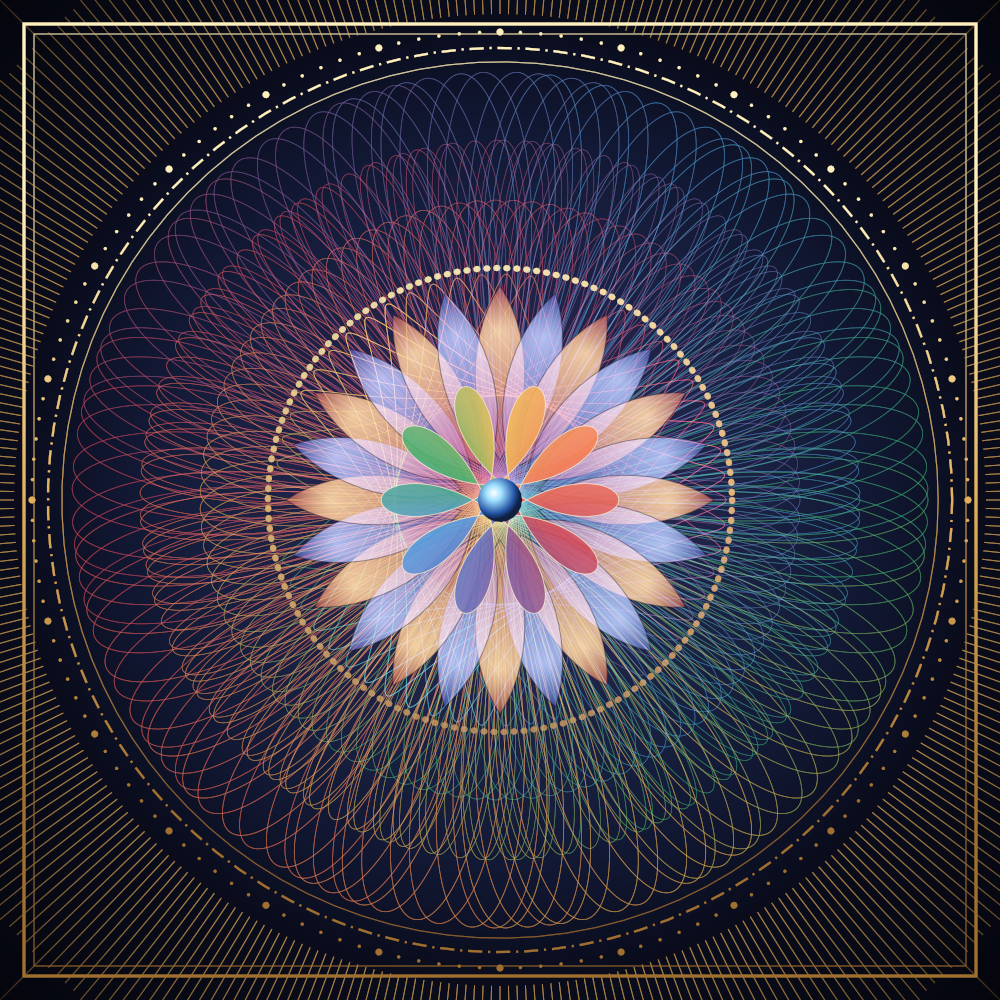

# @magick 0.2.0

Pure-Luau raster toolkit for Jess. Backward-compatible with the 0.1.0 Morrowind generator surface while adding PNG/BMP/TGA I/O, atlas operations, image-processing math, gradients, masking, blur/shadow, grayscale/threshold/colorize, and the H3/H3UI dependency cone.

ImageMagick is used only as a development oracle; this package does not spawn it at runtime.

What 0.1.x promises consumers, and what it keeps as it always did, is in [COMPATIBILITY.md](COMPATIBILITY.md).

The renderer design for 0.2.0 (coordinates, transforms, premultiplied working tiles, compositing and the API boundaries) is proposed for ratification by review in [RFC-0001](docs/RFC-0001-renderer.md), with its checked sketches in `docs/rfc/sketches/`.

## 0.2.0 changes

Two demos drawn only through the public API, rendered and checked byte for byte by `tools/demos.jsl` (records in
`demos/records.jsl`):

| [Lighthouse at Dusk](demos/lighthouse.jsl) | [Rosette](demos/rosette.jsl) |
|---|---|
|  |  |

Everything below is opt-in. A caller who uses only 0.1.x names gets the bytes 0.1.3 gave, except for the owner-approved
`Path:transformed` change recorded in [COMPATIBILITY.md](COMPATIBILITY.md#owner-approved-changes).

### `@magick/transform`

2x3 affine matrices in SVG's field order, `matrix(a b c d e f)` as `scaleX, skewY, skewX, scaleY, offsetX, offsetY`,
applied to column vectors. `multiply(first, second)` applies `second` first; `compose(T, S, R)` rotates, then scales,
then moves.

- `identity()`, `translate(x, y)`, `scale(x, y?)`, `rotate(radians)` (clockwise on screen), `skew(tanX, tanY?)`,
  `matrix(a, b, c, d, e, f)`.
- `multiply`, `compose`, `apply(m, x, y)`, `applyVector(m, x, y)`, `determinant`, `inverse`, `sigmaMax` (the largest
  stretch), `isIdentity`, `isSingular`, `check`, and `cubicBox(m, ...)`, the exact device box of a cubic.
- Every constructor refuses a NaN or infinite field (`magick: transform must be finite`). `inverse` refuses a matrix
  whose determinant is 0 or at most 1e-12 of the square of its largest linear entry (`magick: transform is singular`).

### Paths keep their curves

Each closed contour keeps the commands it was drawn with: points, quadratic and cubic curves, and the arcs of circles,
rings, rounded rectangles and round caps. `Path.contours` stays the 0.1.3 flattening at the path's tolerance.

- `Path:transformBy(matrix)`: a new path under a matrix, its curves flattened again where they land.
  `Path:transformed(scale, dx, dy)` is `transformBy(matrix(scale, 0, 0, scale, dx, dy))`.
- `path.flatten(path, tolerance?, matrix?)`: the closed contours as device-space point lists, the tolerance in device
  pixels (the path's own when left out). A chord strays from a quadratic by at most twice the tolerance, the 0.1.3
  piece-count formula, kept so legacy output does not move.
- `Path:deviceBounds(matrix?, halfWidth?)`: a box holding the exact curves (cubic and quadratic extrema, ellipse
  extremes on each arc) and the polygon they flatten to, widened by `halfWidth` times the matrix's largest stretch.
- Caps: `MaxPiecesPerCurve` 16384 pieces a curve, `MaxCommandsPerPath` 2^20, and every coordinate finite and within
  `MaxCoordinate` 2^22 when a 0.2.0 call flattens.

### Exact fill rules over any window

`Path:coverageIn(left, top, width, height, options?)` returns a `Mask` of the window's coverage bytes. Options:
`fillRule` (`nonzero`, the default, or `evenodd`), `transform` (a matrix, user to device), `tolerance` (device pixels)
and `clips` (at most `MaxClipDepth` 16 of `{ mask, left, top }`, multiplied in as `(coverage * clip + 127) // 255`).
An unknown option, fill rule or a window that is not whole numbers is refused by name.

- **Exact**: coverage is the area where the winding passes the rule, for crossing and overlapping contours too
  (RFC-0001 amendment A1). Legacy `Path:mask()` keeps the summed 0.1.3 rule; where no contours overlap the two agree
  within one step.
- **Tiles**: a window is the same bytes as that part of a larger window, so tiles rebuild a whole mask exactly.
  Scratch is one f64 row the window's width; geometry outside the window costs only its edges.
  `path.prepare(path, options?)` flattens and sorts once, and `path.coverOf(prepared, rule, left, top, width, height)`
  covers each tile from it.
- **Cost** (`bench/bench.jsl`, a 512 square, this machine, jess 0.4.0): the ring row is 2.1 ms against 1.5 ms for the
  0.1.3 mask; a row of many small shapes costs more (400 circles: 8.7 ms against 2.0 ms), since each crossing and
  vertex cuts the row. Known limitation, recorded rather than hidden.
- **Bounded**: exactness needs every crossing, so geometry that crosses itself densely inside one pixel row is
  refused rather than approximated: `path.MaxStripCrossings` (65,536) crossings, or `path.MaxStripWork` (2^22) pair
  tests and band steps, for one cluster of overlapping edges in one row raises before that work is done. Whether an
  outline is refused depends on the outline alone, never on the tiling. A 400-edge zigzag inside one row took 11.6 s
  before the caps and is now refused in milliseconds; 200 such edges cover exactly in 0.35 s.

### Strokes

`Path:stroked(options)` returns the stroke's outline as a new path: a band along each segment, a join piece at each
corner and caps at the ends of open subpaths and dashes. The pieces overlap and their union is the stroke, which is
what `coverageIn` covers under `nonzero`; legacy `mask()` sums overlaps and is not the call for a stroke. Options, in
the path's own space (RFC-0001 SK1 to SK7):

- `width` (required, finite, `0 <= width <= MaxCoordinate`; 0 gives an empty path).
- `join`: `miter` (default), `round` or `bevel`; `miterLimit` (default 4, at least 1): a miter whose length over the
  width, `1 / sin(interior / 2)`, exceeds it is a bevel, and one equal to it stays a miter.
- `cap`: `butt` (default), `round` or `square`. A subpath of one point draws its cap about itself: a disc, a square,
  or nothing for `butt`.
- `dashes` (at most `MaxDashEntries` 64, each finite and not negative; empty or all zero is solid; an odd list repeats
  twice, as SVG does) and `dashOffset` (reduced by floored modulo). A dash boundary exactly at the end of the line
  starts a dash of no length there, which a round or square cap draws. More than `MaxDashesPerStroke` (2^20) dashes
  are refused before any is built.
- `transform` and `tolerance`: where the stroke will be drawn, so curves in the centerline flatten to the device
  tolerance over the transform's largest stretch. Round joins and caps stay arcs and flatten again where drawn.

A subpath is closed for a stroke only when `close()` closed it; one ended by `moveTo`, `mask()` or `stroked()` is open,
and fills as closed, as in SVG. A subpath of two points is kept for strokes; it never filled and still does not.

### `@magick/color`: working tiles and Porter-Duff

A working tile is `{ width, height, left, top, space, data }`: premultiplied RGBA as f32, 16 bytes a pixel, placed at
(`left`, `top`) in device space. `space` is `srgb` (the default; composites encoded values, as legacy `Image` and
browsers do) or `linear` (the sRGB transfer taken off on entry and put back on output).

- `color.tile(width, height, { space?, left?, top? })`: transparent. Caps: `MaxImageEdge` 8192 a side and
  `MaxWorkingPixels` 2^24 a tile.
- `color.fromImage(image, { space?, left?, top? }?, width?, height?)` and `color.toImage(tile, image?)`: the only way
  in and out of legacy `Image`s. Output bytes are `floor(clamp(x, 0, 1) * 255 + 0.5)`, in linear space through exact
  rounding thresholds; a pixel whose alpha byte is 0 is written `0, 0, 0, 0`. Every straight byte at every alpha
  1..255 round-trips exactly in both spaces (`tests/color.jsl`).
- `color.convert(tile, space)`, `color.premultiplied(color, space?)`, `color.decode`, `color.encode`,
  `color.pixel(tile, column, row)`.
- `color.composite(destination, source, { operator?, opacity? })`: the twelve W3C Porter-Duff operators (`clear`,
  `src`, `dst`, `src-over` (default), `dst-over`, `src-in`, `dst-in`, `src-out`, `dst-out`, `src-atop`, `dst-atop`,
  `xor`), aligned by device position. Where the source does not reach it counts as transparent, so `src`, `src-in`,
  `dst-in`, `src-out`, `dst-atop` and `clear` clear the rest of the destination. `opacity` scales the source once.
  `color.factors(operator, as, ab)` gives the W3C `fa, fb`. Tiles of different spaces are refused.

Legacy `Image:over`, `Image:screen`, `Image:darken` and the rest keep their straight-alpha RGBA8 arithmetic and their
goldens; the working tile is a separate, opt-in substrate.

### `@magick/paint`: solids and gradients

A paint is a frozen value (it cannot be changed, and one paint fills any number of shapes and tiles) evaluated a span
of pixel centers at a time into premultiplied values in the target tile's space. Its `transform` maps paint space to
device space; pixel centers are taken back through its inverse.

- `paint.solid(color, { opacity? })`.
- `paint.stops(offset, color, offset, color, ...)` builds a stop list (`{ offset, color }` records also work). At most
  `MaxStops` 256, offsets in 0..1, sorted stably: at an offset two stops share, the later one wins, a hard edge.
  Colors interpolate **premultiplied** (opaque red to clear blue is half-transparent red at the middle, never purple),
  in `interpolation` `srgb` (default) or `linear` light.
- `paint.linear(x0, y0, x1, y1, stops, options?)`: offset 0 at the first point, 1 at the second. No length gives the
  last stop everywhere.
- `paint.radial(cx, cy, radius, stops, options?)`: 0 at the focus (`focusX`, `focusY`; the center by default), 1 on
  the circle. A focus on or past the circle is drawn in to 0.999 of the radius, as SVG 1.1 does; a radius of 0 gives
  the last stop.
- Gradient options: `spread` (`pad` default, `repeat`, `reflect`, the same rule for every gradient), `interpolation`,
  `transform`, `opacity`. A single stop is a solid.
- `paint.fillPath(tile, path, paint, { operator?, opacity?, fillRule?, transform?, tolerance?, clips? })`: covers the
  path exactly over the tile's window and composites the paint through it. `paint.fillMask(tile, paint, mask?, left?,
  top?, options?)` does the same through a coverage mask placed in device space, or over the whole tile.
  `paint.span(paint, tile, row, first, count, out)` is the evaluation itself, for code that composites on its own.

Nothing the size of the canvas is made for a paint: a fill allocates the coverage window and one row of span scratch.
`Path:fill(image, color)` stays the legacy straight-alpha routine; a solid fill through `fillPath` gives the same bytes
on whole pixels of opaque colors and is within one step elsewhere (premultiplied f32 rounds differently).

### Conic gradients and image patterns

- `paint.conic(cx, cy, stops, { startAngle?, ... })`: offset 0 on the seam at `startAngle` radians from +x (0 by
  default), rising **clockwise on screen** (y grows down) to 1 a whole turn on. The seam is a hard edge unless the
  first and last stops match. Its parameter never leaves 0..1, so every spread gives the same paint; turn it the other
  way with a reflecting `transform`. Evaluation is constant time at any coordinate.
- `paint.pattern(source, { transform?, sampling?, edge?, opacity? })`: a legacy `Image` (straight sRGB RGBA8) or a
  working tile (premultiplied, in the space of the tile it fills) laid out in paint space with source pixel (i, j)
  covering the unit square at (i, j). With the identity and `edge = 'repeat'` it aligns as a legacy tiled `Image`
  source does. `sampling`: `nearest` (default) or `bilinear`, which blends the four nearest pixels premultiplied, so a
  transparent neighbour lends no color. `edge`: `clamp` (default), `repeat`, `mirror`, or `transparent` (nothing past
  the source; an addition to RFC-0001 M10's three). The source is read where it is at each fill, nothing is copied,
  and a fill into the tile a pattern reads is refused (`magick: pattern reads its own destination`).

### Blend modes and isolated groups

`color.composite` and every paint fill take `blend`: one of the sixteen W3C modes, `normal` (default), `multiply`,
`screen`, `overlay`, `darken`, `lighten`, `color-dodge`, `color-burn`, `hard-light`, `soft-light`, `difference`,
`exclusion`, `hue`, `saturation`, `color`, `luminosity` (RFC-0001 amendment A2). A blend composites src-over:
`cr = cs (1 - ab) + cb (1 - as) + as ab B(Cb, Cs)`; another operator with a non-normal blend is refused, as is any other
name. `color.separable`, `color.blendColor` and `color.mixPixel` are the formulas themselves.

An isolated group is a transparent tile its children draw into (`color.group(backdrop)` makes one in the backdrop's
place and space), composited once with `color.compositeGroup(backdrop, group, { clip?, opacity?, blend?, operator? })`:
the clip multiplies the group, then its opacity is applied once, then its blend and operator lay it on (G2). Two
overlapping children at group opacity 0.6 show no darker overlap; the same children at 0.6 each do. Groups nest by the
caller making one tile per level.

## Gates

`tests/gate.jsl` holds the package to tiny exact fixtures (transparency, clipping, alpha, curves,
holes, gradients, line caps), to the reference scenes of `tests/scenes.jsl` at the pixels their
comments derive, to empty and one-pixel-wide images, and to the value of grayscale and setAlpha at
those sizes. Every value is exact except area: a flattened curve or circle is compared with its
analytic area within a quarter pixel, declared in the suite. That is a coarse check, since a shift
of a fraction of a pixel moves an area by less than a quarter pixel. The exact pixels and the scene
fingerprints are what catch a small shift. `jess package test .` writes nothing.

`tools/gallery.jsl` renders the same scenes to PNG and compares them with recorded checksums and
baseline files. Where the sizes match it reports the first differing pixel; where they do not, it reports
the geometry and the first differing byte. It needs both filesystem capabilities, and
re-baselining is an explicit `rebaseline` run whose output is reviewed. The commands are in
[BENCHMARKS.md](BENCHMARKS.md#gates).

## 0.1.3 changes

`@magick/path` fills shapes with anti-aliased coverage: polygons, rectangles (rounded or as frames), ellipses, rings, lines and polylines with butt, round or square caps, and contours of lines, quadratic and cubic curves. Coverage is worked out exactly for the flattened outline, so a pixel an edge halves is half covered. Contours that wind the same way join; one that winds the other way cuts a hole. `Path:mask()` gives the coverage and where it lies; `Path:fill(image, color)` composites a color through it. `Path:pen()` hands the path to code that draws outlines through plain functions, such as a font reader.

`Image:screen(source, dx?, dy?)` composites by screening, ImageMagick's `Screen`: black leaves what is under it alone. `Image:scale(width, height)` resamples by area, ImageMagick's `-scale`, weighing each pixel by how much of it is covered and by its alpha.

## 0.1.2 lab changes

The hot raster paths operate directly on packed RGBA buffers. `Image:overMask(mask, color, dx?, dy?)` composites a one-byte alpha mask directly into an image without materializing a temporary RGBA image. This is especially useful for glyph/logo masks and generated-site assets.
