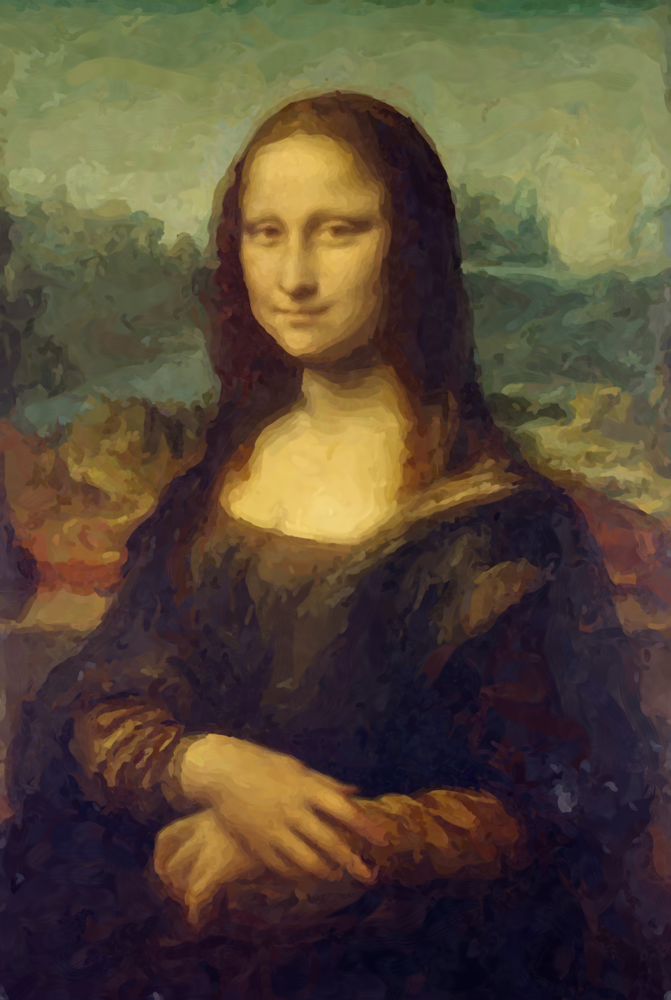
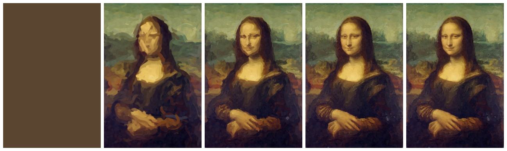
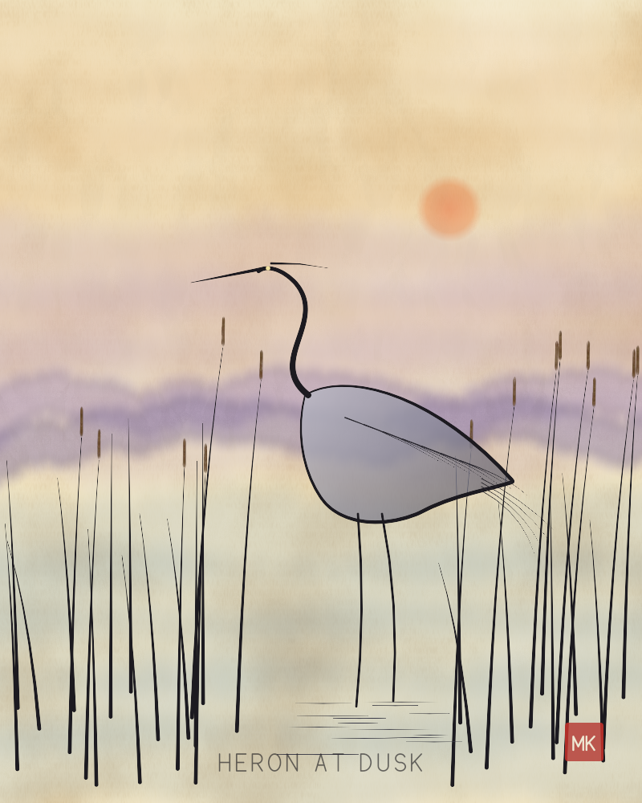
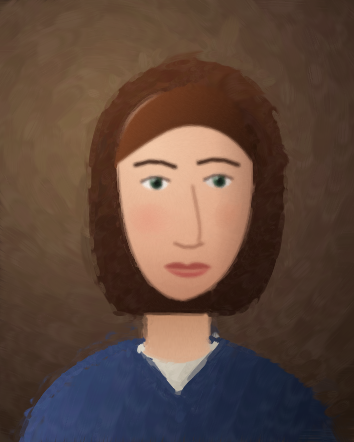
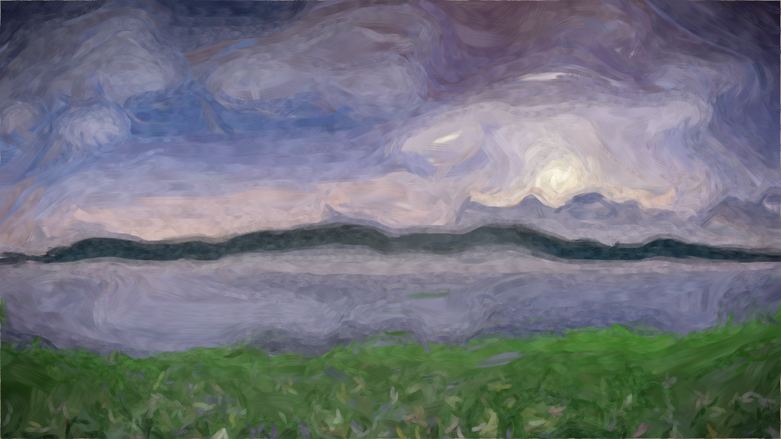
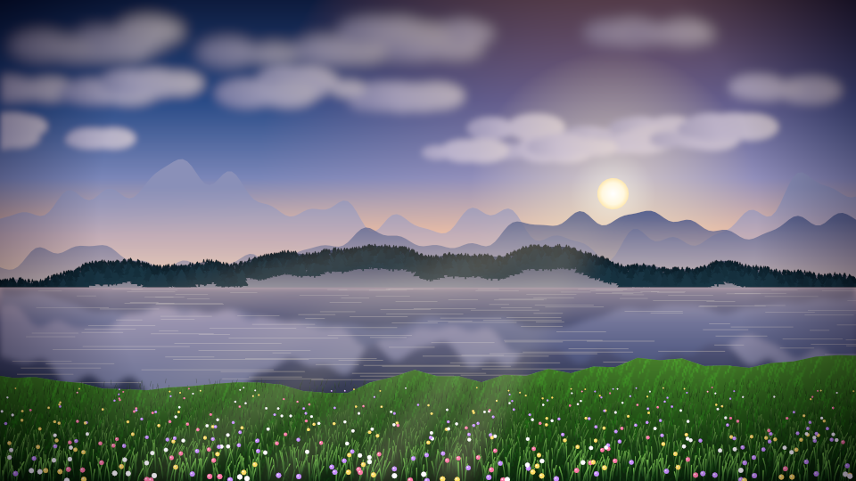

# @magick 0.5.0

Pure-Luau raster toolkit for Jess. Backward-compatible with the 0.1.0 Morrowind generator surface while adding PNG/BMP/TGA I/O, atlas operations, image-processing math, gradients, masking, blur/shadow, grayscale/threshold/colorize, and the H3/H3UI dependency cone.

ImageMagick is used only as a development oracle; this package does not spawn it at runtime.

What 0.1.x promises consumers, and what it keeps as it always did, is in [COMPATIBILITY.md](COMPATIBILITY.md).

The renderer design for 0.2.0 (coordinates, transforms, premultiplied working tiles, compositing and the API boundaries) is proposed for ratification by review in [RFC-0001](docs/RFC-0001-renderer.md), with its checked sketches in `docs/rfc/sketches/`.

## Gallery

Every picture here is drawn by checked-in JSL source through the public modules, with no generative
service and no retouching. The only outside media is the Mona Lisa's reference, a public-domain
photograph pinned by SHA-256 in [`gallery/references/PROVENANCE.md`](gallery/references/PROVENANCE.md);
every pixel of the painting is Magick's. `tools/demos.jsl` renders each one and holds its pixels to
the CRC-32 in `demos/records.jsl`, so anyone can reproduce them byte for byte (about five minutes on
one core):

```sh
jess run --package . --capability filesystem.read --capability filesystem.write tools/demos.jsl target/demos
```

### Mona Lisa, after Leonardo (MAG-041)





[`demos/monalisa.jsl`](demos/monalisa.jsl) paints Leonardo's portrait with `painter.paint`. The canvas is toned a
flat umber, then laid in with loaded oil strokes at radius 8, 4 and 2. The face and hands carry on to 1-pixel strokes
with a soft, thin, low-flow brush (sfumato) and a tighter threshold; the bust sits between the two. Each region's
strokes stay inside it. Every pass is planned against the canvas the brush engine actually rendered, and its error is
measured against the reference itself (mean absolute difference of the colors, 0..1, at the reference's size):

| Stage | Strokes | Error against the reference |
|---|---|---|
| Toned ground | 0 | 0.1490 |
| Radius 8, everywhere | 5,922 | 0.0517 |
| Radius 4 | 4,458 | 0.0418 |
| Radius 2 | 7,960 | 0.0376 |
| Radius 1, face and hands only | 3,492 | 0.0373 |

The numbers report what happened; nothing promises they fall. They are not a score to chase either: the reference
merely blurred by the largest brush measured 0.0343, lower than the finished painting, so the painter is judged by the
pictures, with the numbers as evidence that every pass moved the canvas toward its subject.

| | |
|---|---|
|  [Heron at Dusk](demos/heron.jsl): ink and watercolor |  [Portrait of a Reader](demos/portrait.jsl): an original vector reference ([reference](gallery/portrait-reference.png)) painted in oil |
|  [The Valley, in Oil](demos/oil.jsl): the valley repainted by `@magick/painter` |  [Valley at First Light](demos/valley.jsl): 5,941 scene nodes, 4K and 8K targets |
|  [Lighthouse at Dusk](demos/lighthouse.jsl): a vector poster |  [Rosette](demos/rosette.jsl): engraved guilloche |

## 0.5.0 changes: Masterpiece

### `@magick/painter`

Painting a reference coarse to fine, after Hertzmann's curved-stroke method (SIGGRAPH 1998; an implementation of the
idea, not of his code).

**`painter.paint(reference, options?)`** paints an opaque reference against the brush engine's real renders and
returns `{ image, ground, passes }`.
- **Ground:** the canvas is toned one flat color (`ground`, the reference's mean by default), and the first pass covers
  all of it.
- **Passes:** each pass blurs the reference for its radius and starts a stroke in every cell (as wide as the radius)
  where the *rendered* canvas misses that blur by more than `threshold`. Strokes run along the edge in the color there
  and stop where the target leaves it. The starts are laid in a seeded order, and strokes are built only for what
  `budget` has left.
- **Rendering and measurement:** each pass's strokes are rendered over the canvas so far, and its `error` is measured
  against the reference itself. Every `pass.image` is kept.
- **Regions** (`{ name, shape, radii?, threshold?, curvature?, maximumLength?, preset?, overrides? }`, shapes in
  reference pixels) paint parts of the picture with their own passes and brush, and their strokes stay inside them.
- **Brush size:** the planned radius is a stroke's reach across its line even at its tapered ends.
- **Other options:** `scale` (whole, 1..4), `workers`.
- **Caps:** `MaxStrokesPerPainting` 131072.

**`painter.plan` and `painter.apply`** are the earlier planner, kept as they were.
- **`painter.plan(image, options?)`** plans strokes against a fast disc estimate of the canvas, one level at a time in
  f64 planes (about 100 MB at `MaxReferencePixels`). It builds strokes only for the starts its budget takes, and refuses
  options that are not finite or whole. `plan.levels[i].error` is that estimate against the level's own blur: a
  planning diagnostic, not a measure of the painting.
- **`painter.apply(document, group, plan, options?)`** turns a plan into brush strokes over an underpainting blurred in
  place. (It once used a blur filter, which faded the underpainting toward the canvas edge and left a ragged unpainted
  frame. Fixed, and the oil and portrait records retaken.)
- **`painter.error(image, reference)`** is the mean absolute difference of the premultiplied colors plus that of the
  alphas, over 255. It is 0..2 in general and 0..1 for opaque images, where it is the plain color difference. Empty
  images are refused.
- **Caps:** `MaxStrokesPerPlan` 16384, `MaxPlanLevels` 8, `MaxStrokeLength` 64, `MaxReferencePixels` 1024 by 1024.

### `@magick/svg`

**`svg.export(document)`** writes a bounded SVG subset:
- retained path commands, with arcs as SVG arcs;
- solid, linear and radial paints, with every stroke setting;
- embedded PNG images;
- groups with transform, opacity, blend, clip, mask, and blur or shadow filters.

Conic, field, pattern, mix and shader paints and brush strokes are refused by name.

**`svg.import(text)`** reads:
- elements: `svg`, `g`, `path`, `rect`, `circle`, `ellipse`, `line`, `polyline`, `polygon`, `linearGradient` and
  `radialGradient` (with `href` inheritance and percentages), and `clipPath` on groups and shapes;
- styling: presentation attributes and `style`, CSS colors (every keyword, `#rgb`, `rgb()` and `rgba()` with
  percentages and alpha, `currentColor`), absolute units, `display` and `visibility`;
- geometry: transforms, and a viewBox fitted by `preserveAspectRatio` (`xMidYMid meet` by default).

Input is untrusted:
- every number list is read in order to its last character;
- a malformed number, a short argument group, a bad arc flag, or a size past 8192 pixels is refused by name, never
  dropped or clamped;
- caps: `MaxSvgBytes` 16 MiB, `MaxElements` 65536, `MaxDepth` 32, `MaxPathCommands` 2^20.

`tests/svg` holds six fixtures to librsvg 2.63.2's renders, made once and committed. The mean absolute difference is
0.02% to 0.12%, and 0.89% where a translucent radial stop interpolates slightly differently.

### Hardening (MAG-044)

**Package tests:**
- `tests/fuzz.jsl` drives seeded random geometry through coverage and strokes.
- `tests/adversarial.jsl` holds mutated PNGs, saved scenes and SVGs (400, 300 and 300) to a read or a named refusal.
  Verified PNGs read back as exactly the picture written.
- It also covers a PNG decompression bomb, refused by `readPNG(source, { maxPixels, verify })` before it is inflated.
- Degenerate geometry, scales from 1e-300 to 1e300, and a 3000-edge zigzag in one row are drawn right or refused at
  every tile size.

**The stress target** is `jess package run --capability worker.spawn --target stress .`. On an i7-10870H, under a
9 GB memory cap, with jess 0.4.0:
- the valley at 7680 by 4320 on 4 workers: 35.5 s;
- 100,000 shapes at 3840 by 2160: 21.3 s on 4 workers and 45.4 s on one, the same bytes;
- 267,600 brush dabs at 4K: 5.7 s on 4 workers;
- 113.9 s and **4.89 GB peak resident** for the whole run.

The render budget (`memoryBudgetBytes`) counts working tiles, coverage cells, queued tiles, each worker's plan estimate
and the output. It does not count the document, or Luau's own overhead on plans: the 100,000-node plan's estimate is
121 MiB, while a serial run of it peaks at 1.39 GB resident. Budget a process with that in mind.

### Downstream integration (MAG-045)

The DreamWeave Mod Template uses Magick as its site generator's image backend: `read`, `Image:resize`, `write`.
- **Its suite:** it passes 154 of 154 tests with its dependency moved to 0.5, on the local branch `deps/magick-0.5`,
  which is not yet published.
- **Its image output:** that same read, resize and write pipeline, run over three gallery images at three sizes each,
  gives PNGs whose SHA-256 is the same under 0.1.3 and 0.5.0, all nine of them.

The template pins Magick with a caret requirement, so publishing it waits on a Magick 0.5 release.
[`docs/downstream.md`](docs/downstream.md) has the script and commands to check both claims again.

## 0.4.0 changes: Atelier

### `@magick/noise`

Pure functions of a seed (an integer in 1..2^31 - 2) and a point: `value`, `perlin`, `fbm`, `turbulence`, `ridged`
(`MaxOctaves` 12) and `worley` (nearest and second distances), over a 1024-entry permutation made once a seed;
`hash(seed, a, b?, c?)` and `random(...)` by the murmur3 finalizer, for per-dab and per-feature keys. No generator state,
no `math.random`, so a texture never seams at a tile edge or differs between workers.

**Fields** are descriptions, plain data: `constant`, `coordinate`, `noiseField`, `fbmField`, `turbulenceField`,
`ridgedField`, `worleyField`, `checker`, `stripes`, `rings`, `combine`, `apply`, `scale`, `clamp`, `smoothstep`,
`power`, `blend`, `warp` (domain warping) and `transform`, at most `MaxFieldNodes` 256 nested `MaxFieldDepth` 32.
`noise.compile(field)` makes a closure where the field is used; descriptions save with scenes and cross to workers.

### Procedural paints

`paint.fieldPaint(field, stops, options?)` reads a field through stops as a gradient's parameter; `paint.mix(first,
second, field)` blends two paints by a field; `paint.masked(inner, field)` cuts a paint's alpha by one;
`paint.shader(function(x, y) return r, g, b, a end)` is the slow path for anything else, pure by contract, refused for
workers and saving, and failing with the point and tile it was asked for.

### `@magick/brush`

`brush.stroke(samples, brush, seed?)` turns samples `{ x, y, pressure? }` into dabs: smoothed (`smoothing`), walked by arc
length, a dab every `spacing` of its own pressure-sized diameter and one on the end, jitter (size, angle, scatter,
opacity, hue, lightness) from `noise.hash(seed, dab, channel)`. Tips: `round` (hardness, never sharper than a pixel),
`bristles` (tracks along the stroke) or an `image` mask; a canvas-fixed `grain` field and `dryness` for dry media.
Accumulation: `buildup` (pigment piles up where dabs overlap, its color pure), `constant` (an even stroke at its flow,
no seams) and `wet` (edges pooled darker, as watercolor). `blend` sets how the stroke lays on (`multiply` for glazes).
Presets: `ink`, `oil`, `watercolor`, `graphite`, `airbrush` through `brush.preset(name, size, color, overrides?)`;
`brush.paper(seed)` is a paper grain. Strokes are scene nodes (`document:stroke(samples, brush, { seed? })`), saved as
their samples, brush and seed and replayed exactly; dabs are stamped only into the tiles they reach. Caps:
`MaxSamplesPerStroke` and `MaxDabsPerStroke` 65536. These are stylized media, not simulations.

### `@magick/material`

Seeded recipes made of fields alone: `clouds`, `fog`, `wood`, `bark`, `rock`, `leaf`, `fabric`, `parchment`, `marble`,
each `material.<name> { seed, scale?, detail?, colors?, transform?, opacity? }` and by name through `material.make`.
`material.grain(paint)` gives the field for a brush's grain or a mask.

### `@magick/text` and `@magick/art`

`text.monoline(weight?)` is the built-in geometric face (capitals, small-capital lowercase, digits, punctuation), so text
needs no font file. `text.outline { outline = ..., measure = ... }` adapts any font that draws through a pen, such as
`@truetype`'s. `text.path(font, text, x, y, size, { tracking?, align?, kerning? })` sets one line as a path and
`text.measure` its width; shaping is out of scope. Stroking a monoline path outlines each piece, since a union outline
needs boolean path operations, which are not here. `@magick/art` adds `palette`, `scatter` (jittered, one point a cell),
`samples` (brush samples along any path) and `symbol` (reusable motifs). `Path:finish()` ends an open contour without
closing it.

## 0.3.0 changes

A retained canvas: scenes compiled once and rendered tile by tile, on one worker or several, the same bytes either way.
The showcase, [Valley at First Light](demos/valley.jsl), is 5,941 nodes drawn from a 3840 by 2160 design space at any
size; `gallery/valley.png` is its 960 by 540 render, held to a record by `tools/demos.jsl`.


### `@magick/scene`

`scene.new(width, height, { background?, space?, seed? })` makes a document with a root group. Nodes are made by the
document and placed with `group:add(node, index?)`, `document:add(node)`, `node:remove()`, `node:reorder(index)` and
`node:set { transform?, opacity?, blend?, name? }`. Ids follow the order nodes are made in; children keep the order they
were added in, never a table's.

- `document:shape(path, { fill?, fillRule?, stroke?, strokeStyle?, transform?, opacity?, blend?, name? })`. One path
  and one paint can serve any number of nodes. A shape with both paints and an opacity or blend is one isolated layer.
- `document:image(image, { transform?, sampling?, ... })`: a legacy `Image` placed by a matrix.
- `document:group { transform?, opacity?, blend?, clip = { path, fillRule? }?, mask = { node, kind? }?, filters? }`:
  children draw into an isolated tile, which is filtered, clipped, masked (by the mask node's `alpha` or `luminance`),
  faded once, and laid on by its blend. Filters are `{ kind = 'blur', radius }`, three exact integer box passes
  approximating a gaussian of that deviation, and `{ kind = 'shadow', radius, offsetX, offsetY, color }`, with offsets
  rounded to whole pixels. A filter sees only what lies on the canvas.
- Refusals: cycles, a node of another document, a second parent, a mask node as a child, `MaxDepth` 32, `MaxNodes`
  131072 (65536 in 0.3.0; raised for MAG-044's 100,000-node scenes), unknown options, filters and kinds,
  out-of-range opacities, radii past 21, and shadow offsets past 64.

### `@magick/render`

- `render.compile(document, { tolerance? })` makes an immutable plan: every path flattened and sorted in device space,
  every paint moved into device space, every group framed with its device box and its filters' halo (at most
  `MaxHaloPx` 64). Later edits to the document, its paths or its nodes do not change a compiled plan. Empty groups are
  left out. `render.dump(plan)` lists the operations with their boxes and marks those off the canvas.
- `render.image(plan or document, { tileSize?, reference?, region?, into?, memoryBudgetBytes?, workers?, cancel? })`
  renders row-major tiles (128 by default, at most 256) and returns the image and its stats: tiles, candidates,
  rendered, skipped, groups, and the peak working-tile bytes. Operations whose box misses a tile are skipped, a missed
  group whole. `reference` renders the canvas as one tile. `region` with `into` redraws only the tiles a box meets.
  The working-set bound is refused before any tile runs when it passes the budget (512 MiB by default).
- **Parity**: the bytes are the same at every tile size (tests at 1, 7, 16, 37, 64, 128 and 256, and the reference)
  and on any number of workers.
- **Workers** (`workers = n`, at most `MaxWorkers` 8, or `auto`): each worker gets the plan once and batches of tiles
  in turn, and every reply is stitched into its own place. `auto` uses 4 for renders of at least 512 by 512 when the
  runtime may spawn workers, and 1 otherwise. Workers need a ScriptDomain, so `jess run` and `jess package test`
  render on one; `jess package run --capability worker.spawn --target workers-check .` holds 2, 4 and 8 workers to
  the 1-worker bytes, and a cancel to stopping the render.

### Saved scenes

`scene.save(document)` writes versioned JSON (`format = 'magick.scene'`, `version = 1`) with sorted keys, so the same
document always gives the same, diffable text. Paths save their retained commands, paints their parameters and stops
as `#rrggbbaa`, and images as base64 assets with a CRC-32, each saved once. `scene.load(text)` reads it as untrusted
input and refuses, by name: another format, a later version, unknown fields or kinds, invalid JSON, out-of-range
numbers, unknown path commands, mismatched assets, duplicate ids, depth past `MaxDepth`, and text past `MaxSceneBytes`
(64 MiB). A checksum says only that bytes arrived as saved, so an asset must also name `straight8` (sRGB) or
`premultiplied32` (sRGB or linear), and every premultiplied pixel must hold finite values with alpha in 0..1 and each
color in 0..alpha (within 2^-20 for f32 rounding). The root is a group like any other: its name, clip, mask and
filters load back, and `save(load(save(document)))` is the same text (forty seeded documents hold this).
`tests/replay.jsl` is a committed saved scene held to its rendered bytes.

### Measured (this machine: i7-10870H, 16 threads, jess 0.4.0 verified release)

| Render | Time | Peak RSS |
|---|---|---|
| Valley 960 by 540, 1 worker (`tools/demos.jsl`) | 3.0 s | |
| Valley 3840 by 2160, 1 worker (`jess run`) | 32.9 s | 222 MB (33 MB of it the output image) |
| Valley 3840 by 2160, 1 then 4 workers (`--target showcase`) | 33.3 s, then 10.2 s | 710 MB for the whole run |

Each 128 tile's working set peaked at 1.8 MB across the base and its group levels. The output image is a whole-image
RGBA8 buffer, which is the output-memory floor; there is no streaming encode in 0.3.0.

## 0.2.0 changes

Two demos drawn only through the public API, rendered and checked byte for byte by `tools/demos.jsl` (records in
`demos/records.jsl`):

| [Lighthouse at Dusk](demos/lighthouse.jsl) | [Rosette](demos/rosette.jsl) |
|---|---|
|  |  |

Everything below is opt-in. A caller who uses only 0.1.x names gets the bytes 0.1.3 gave, except for the owner-approved
`Path:transformed` change recorded in [COMPATIBILITY.md](COMPATIBILITY.md#owner-approved-changes).

### `@magick/transform`

2x3 affine matrices in SVG's field order, `matrix(a b c d e f)` as `scaleX, skewY, skewX, scaleY, offsetX, offsetY`,
applied to column vectors. `multiply(first, second)` applies `second` first; `compose(T, S, R)` rotates, then scales,
then moves.

- `identity()`, `translate(x, y)`, `scale(x, y?)`, `rotate(radians)` (clockwise on screen), `skew(tanX, tanY?)`,
  `matrix(a, b, c, d, e, f)`.
- `multiply`, `compose`, `apply(m, x, y)`, `applyVector(m, x, y)`, `determinant`, `inverse`, `sigmaMax` (the largest
  stretch), `isIdentity`, `isSingular`, `check`, and `cubicBox(m, ...)`, the exact device box of a cubic.
- Every constructor refuses a NaN or infinite field (`magick: transform must be finite`). `inverse` refuses a matrix
  whose determinant is 0 or at most 1e-12 of the square of its largest linear entry (`magick: transform is singular`).

### Paths keep their curves

Each closed contour keeps the commands it was drawn with: points, quadratic and cubic curves, and the arcs of circles,
rings, rounded rectangles and round caps. `Path.contours` stays the 0.1.3 flattening at the path's tolerance.

- `Path:transformBy(matrix)`: a new path under a matrix, its curves flattened again where they land.
  `Path:transformed(scale, dx, dy)` is `transformBy(matrix(scale, 0, 0, scale, dx, dy))`.
- `path.flatten(path, tolerance?, matrix?)`: the closed contours as device-space point lists, the tolerance in device
  pixels (the path's own when left out). A chord strays from a quadratic by at most twice the tolerance, the 0.1.3
  piece-count formula, kept so legacy output does not move.
- `Path:deviceBounds(matrix?, halfWidth?)`: a box holding the exact curves (cubic and quadratic extrema, ellipse
  extremes on each arc) and the polygon they flatten to, widened by `halfWidth` times the matrix's largest stretch.
- Caps: `MaxPiecesPerCurve` 16384 pieces a curve, `MaxCommandsPerPath` 2^20, and every coordinate finite and within
  `MaxCoordinate` 2^22 when a 0.2.0 call flattens.

### Exact fill rules over any window

`Path:coverageIn(left, top, width, height, options?)` returns a `Mask` of the window's coverage bytes. Options:
`fillRule` (`nonzero`, the default, or `evenodd`), `transform` (a matrix, user to device), `tolerance` (device pixels)
and `clips` (at most `MaxClipDepth` 16 of `{ mask, left, top }`, multiplied in as `(coverage * clip + 127) // 255`).
An unknown option, fill rule or a window that is not whole numbers is refused by name.

- **Exact**: coverage is the area where the winding passes the rule, for crossing and overlapping contours too
  (RFC-0001 amendment A1). Legacy `Path:mask()` keeps the summed 0.1.3 rule; where no contours overlap the two agree
  within one step.
- **Tiles**: a window is the same bytes as that part of a larger window, so tiles rebuild a whole mask exactly.
  Scratch is one f64 row the window's width; geometry outside the window costs only its edges.
  `path.prepare(path, options?)` flattens and sorts once, and `path.coverOf(prepared, rule, left, top, width, height)`
  covers each tile from it.
- **Cost** (`bench/bench.jsl`, a 512 square, this machine, jess 0.4.0): the ring row is 2.1 ms against 1.5 ms for the
  0.1.3 mask; a row of many small shapes costs more (400 circles: 8.7 ms against 2.0 ms), since each crossing and
  vertex cuts the row. Known limitation, recorded rather than hidden.
- **Bounded**: exactness needs every crossing, so geometry that crosses itself densely inside one pixel row is
  refused rather than approximated: `path.MaxStripCrossings` (65,536) crossings, or `path.MaxStripWork` (2^22) pair
  tests and band steps, for one cluster of overlapping edges in one row raises before that work is done. Whether an
  outline is refused depends on the outline alone, never on the tiling. A 400-edge zigzag inside one row took 11.6 s
  before the caps and is now refused in milliseconds; 200 such edges cover exactly in 0.35 s.

### Strokes

`Path:stroked(options)` returns the stroke's outline as a new path: a band along each segment, a join piece at each
corner and caps at the ends of open subpaths and dashes. The pieces overlap and their union is the stroke, which is
what `coverageIn` covers under `nonzero`; legacy `mask()` sums overlaps and is not the call for a stroke. Options, in
the path's own space (RFC-0001 SK1 to SK7):

- `width` (required, finite, `0 <= width <= MaxCoordinate`; 0 gives an empty path).
- `join`: `miter` (default), `round` or `bevel`; `miterLimit` (default 4, at least 1): a miter whose length over the
  width, `1 / sin(interior / 2)`, exceeds it is a bevel, and one equal to it stays a miter.
- `cap`: `butt` (default), `round` or `square`. A subpath of one point draws its cap about itself: a disc, a square,
  or nothing for `butt`.
- `dashes` (at most `MaxDashEntries` 64, each finite and not negative; empty or all zero is solid; an odd list repeats
  twice, as SVG does) and `dashOffset` (reduced by floored modulo). A dash boundary exactly at the end of the line
  starts a dash of no length there, which a round or square cap draws. More than `MaxDashesPerStroke` (2^20) dashes
  are refused before any is built.
- `transform` and `tolerance`: where the stroke will be drawn, so curves in the centerline flatten to the device
  tolerance over the transform's largest stretch. Round joins and caps stay arcs and flatten again where drawn.

A subpath is closed for a stroke only when `close()` closed it; one ended by `moveTo`, `mask()` or `stroked()` is open,
and fills as closed, as in SVG. A subpath of two points is kept for strokes; it never filled and still does not.

### `@magick/color`: working tiles and Porter-Duff

A working tile is `{ width, height, left, top, space, data }`: premultiplied RGBA as f32, 16 bytes a pixel, placed at
(`left`, `top`) in device space. `space` is `srgb` (the default; composites encoded values, as legacy `Image` and
browsers do) or `linear` (the sRGB transfer taken off on entry and put back on output).

- `color.tile(width, height, { space?, left?, top? })`: transparent. Caps: `MaxImageEdge` 8192 a side and
  `MaxWorkingPixels` 2^24 a tile.
- `color.fromImage(image, { space?, left?, top? }?, width?, height?)` and `color.toImage(tile, image?)`: the only way
  in and out of legacy `Image`s. Output bytes are `floor(clamp(x, 0, 1) * 255 + 0.5)`, in linear space through exact
  rounding thresholds; a pixel whose alpha byte is 0 is written `0, 0, 0, 0`. Every straight byte at every alpha
  1..255 round-trips exactly in both spaces (`tests/color.jsl`).
- `color.convert(tile, space)`, `color.premultiplied(color, space?)`, `color.decode`, `color.encode`,
  `color.pixel(tile, column, row)`.
- `color.composite(destination, source, { operator?, opacity? })`: the twelve W3C Porter-Duff operators (`clear`,
  `src`, `dst`, `src-over` (default), `dst-over`, `src-in`, `dst-in`, `src-out`, `dst-out`, `src-atop`, `dst-atop`,
  `xor`), aligned by device position. Where the source does not reach it counts as transparent, so `src`, `src-in`,
  `dst-in`, `src-out`, `dst-atop` and `clear` clear the rest of the destination. `opacity` scales the source once.
  `color.factors(operator, as, ab)` gives the W3C `fa, fb`. Tiles of different spaces are refused.

Legacy `Image:over`, `Image:screen`, `Image:darken` and the rest keep their straight-alpha RGBA8 arithmetic and their
goldens; the working tile is a separate, opt-in substrate.

### `@magick/paint`: solids and gradients

A paint is a frozen value (it cannot be changed, and one paint fills any number of shapes and tiles) evaluated a span
of pixel centers at a time into premultiplied values in the target tile's space. Its `transform` maps paint space to
device space; pixel centers are taken back through its inverse.

- `paint.solid(color, { opacity? })`.
- `paint.stops(offset, color, offset, color, ...)` builds a stop list (`{ offset, color }` records also work). At most
  `MaxStops` 256, offsets in 0..1, sorted stably: at an offset two stops share, the later one wins, a hard edge.
  Colors interpolate **premultiplied** (opaque red to clear blue is half-transparent red at the middle, never purple),
  in `interpolation` `srgb` (default) or `linear` light.
- `paint.linear(x0, y0, x1, y1, stops, options?)`: offset 0 at the first point, 1 at the second. No length gives the
  last stop everywhere.
- `paint.radial(cx, cy, radius, stops, options?)`: 0 at the focus (`focusX`, `focusY`; the center by default), 1 on
  the circle. A focus on or past the circle is drawn in to 0.999 of the radius, as SVG 1.1 does; a radius of 0 gives
  the last stop.
- Gradient options: `spread` (`pad` default, `repeat`, `reflect`, the same rule for every gradient), `interpolation`,
  `transform`, `opacity`. A single stop is a solid.
- `paint.fillPath(tile, path, paint, { operator?, opacity?, fillRule?, transform?, tolerance?, clips? })`: covers the
  path exactly over the tile's window and composites the paint through it. `paint.fillMask(tile, paint, mask?, left?,
  top?, options?)` does the same through a coverage mask placed in device space, or over the whole tile.
  `paint.span(paint, tile, row, first, count, out)` is the evaluation itself, for code that composites on its own.

Nothing the size of the canvas is made for a paint: a fill allocates the coverage window and one row of span scratch.
`Path:fill(image, color)` stays the legacy straight-alpha routine; a solid fill through `fillPath` gives the same bytes
on whole pixels of opaque colors and is within one step elsewhere (premultiplied f32 rounds differently).

### Conic gradients and image patterns

- `paint.conic(cx, cy, stops, { startAngle?, ... })`: offset 0 on the seam at `startAngle` radians from +x (0 by
  default), rising **clockwise on screen** (y grows down) to 1 a whole turn on. The seam is a hard edge unless the
  first and last stops match. Its parameter never leaves 0..1, so every spread gives the same paint; turn it the other
  way with a reflecting `transform`. Evaluation is constant time at any coordinate.
- `paint.pattern(source, { transform?, sampling?, edge?, opacity? })`: a legacy `Image` (straight sRGB RGBA8) or a
  working tile (premultiplied, in the space of the tile it fills) laid out in paint space with source pixel (i, j)
  covering the unit square at (i, j). With the identity and `edge = 'repeat'` it aligns as a legacy tiled `Image`
  source does. `sampling`: `nearest` (default) or `bilinear`, which blends the four nearest pixels premultiplied, so a
  transparent neighbour lends no color. `edge`: `clamp` (default), `repeat`, `mirror`, or `transparent` (nothing past
  the source; an addition to RFC-0001 M10's three). The source is read where it is at each fill, nothing is copied,
  and a fill into the tile a pattern reads is refused (`magick: pattern reads its own destination`).

### Blend modes and isolated groups

`color.composite` and every paint fill take `blend`: one of the sixteen W3C modes, `normal` (default), `multiply`,
`screen`, `overlay`, `darken`, `lighten`, `color-dodge`, `color-burn`, `hard-light`, `soft-light`, `difference`,
`exclusion`, `hue`, `saturation`, `color`, `luminosity` (RFC-0001 amendment A2). A blend composites src-over:
`cr = cs (1 - ab) + cb (1 - as) + as ab B(Cb, Cs)`; another operator with a non-normal blend is refused, as is any other
name. `color.separable`, `color.blendColor` and `color.mixPixel` are the formulas themselves.

An isolated group is a transparent tile its children draw into (`color.group(backdrop)` makes one in the backdrop's
place and space), composited once with `color.compositeGroup(backdrop, group, { clip?, opacity?, blend?, operator? })`:
the clip multiplies the group, then its opacity is applied once, then its blend and operator lay it on (G2). Two
overlapping children at group opacity 0.6 show no darker overlap; the same children at 0.6 each do. Groups nest by the
caller making one tile per level.

## Gates

`tests/gate.jsl` holds the package to tiny exact fixtures (transparency, clipping, alpha, curves,
holes, gradients, line caps), to the reference scenes of `tests/scenes.jsl` at the pixels their
comments derive, to empty and one-pixel-wide images, and to the value of grayscale and setAlpha at
those sizes. Every value is exact except area: a flattened curve or circle is compared with its
analytic area within a quarter pixel, declared in the suite. That is a coarse check, since a shift
of a fraction of a pixel moves an area by less than a quarter pixel. The exact pixels and the scene
fingerprints are what catch a small shift. `jess package test .` writes nothing.

`tools/gallery.jsl` renders the same scenes to PNG and compares them with recorded checksums and
baseline files. Where the sizes match it reports the first differing pixel; where they do not, it reports
the geometry and the first differing byte. It needs both filesystem capabilities, and
re-baselining is an explicit `rebaseline` run whose output is reviewed. The commands are in
[BENCHMARKS.md](BENCHMARKS.md#gates).

## 0.1.3 changes

`@magick/path` fills shapes with anti-aliased coverage: polygons, rectangles (rounded or as frames), ellipses, rings, lines and polylines with butt, round or square caps, and contours of lines, quadratic and cubic curves. Coverage is worked out exactly for the flattened outline, so a pixel an edge halves is half covered. Contours that wind the same way join; one that winds the other way cuts a hole. `Path:mask()` gives the coverage and where it lies; `Path:fill(image, color)` composites a color through it. `Path:pen()` hands the path to code that draws outlines through plain functions, such as a font reader.

`Image:screen(source, dx?, dy?)` composites by screening, ImageMagick's `Screen`: black leaves what is under it alone. `Image:scale(width, height)` resamples by area, ImageMagick's `-scale`, weighing each pixel by how much of it is covered and by its alpha.

## 0.1.2 lab changes

The hot raster paths operate directly on packed RGBA buffers. `Image:overMask(mask, color, dx?, dy?)` composites a one-byte alpha mask directly into an image without materializing a temporary RGBA image. This is especially useful for glyph/logo masks and generated-site assets.
