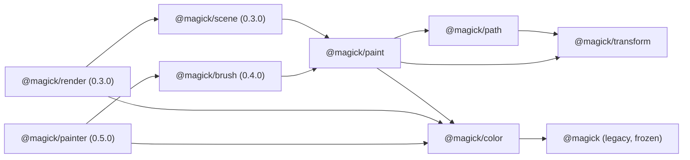

# RFC-0001: Renderer coordinates, compositing and API boundaries

- **Status:** Proposed for ratification by review. Nobody has ratified it yet.
- **Issue:** MAG-003, release 0.2.0. Merge order: PR-02 (this RFC only; no implementation).
- **Scope:** the 0.2.0 issues MAG-004 to MAG-014, including isolated composite groups with opacity
  (MAG-014, PR-09), and the sketches for 0.3.0 and later.
- **Baseline:** `org.dreamweave.magick` 0.1.3. The facts it relies on are pinned in `tests/rfc.jsl`.
  The 0.1.x contract is in [COMPATIBILITY.md](../COMPATIBILITY.md).
- **Plan inputs:** section 17 quotes the lines of `ARCHITECTURE.md` and `PR_SEQUENCE.md` that this RFC
  relies on, in full. Both files are in the main checkout and are not tracked by this repository.

Every decision has a number or a rule, a reason, and a check, or it says plainly that it has no check yet.
Section 19 lists the decisions a reviewer should attack first.

## 1. Summary

- Legacy `Image` (straight sRGB RGBA8) and every 0.1.x name stay as they are. Their goldens do not move.
- New rendering works on **premultiplied working tiles** (f32, 16 bytes a pixel), entered and left through
  explicit conversions. Output is straight RGBA8.
- Paths **keep their commands**. Curves are flattened at rasterization time, to a device-space tolerance,
  under hard caps.
- Transforms are **column-vector 2x3 affine matrices**; `T*S*R` applies rotation first.
- Coverage is evaluated per **tile**, with the tile rectangle given, so no full-shape scratch exists in tile
  mode.
- New APIs take a fill rule, a blend mode, a Porter-Duff operator and a color space as **options with fixed
  defaults** (`nonzero`, `normal`, `src-over`, `srgb`). Section 13 records this decision and its reason. An
  unknown name is an error, never ignored.
- Isolated composite groups with opacity are in **0.2.0** (section 10). Every group is isolated.
- Scene **structure** is a tree in 0.3.0; a DAG is deferred behind named prerequisites (section 12).

## 2. Coordinates

**C1.** Image space is continuous. The origin is the top-left corner of the image, x grows right, y grows
down. Pixel `(column, row)` is the square `[column, column+1) x [row, row+1)`. Pixel edges are whole numbers.
A pixel's center is `(column + 0.5, row + 0.5)`.

**C2 (coverage).** Coverage of a pixel is the exact area of its square covered by the shape, **when the
contours do not overlap**. Where contours overlap, coverage is computed from the **summed** signed area of
their contributions, and is clamped: the sum is `S`, and nonzero coverage is `min(1, |S|)` (F1). Overlap is
therefore an approximation by construction. Two identical `rect(0.5, 0, 2, 1)` contours give `S = 1.0` in
column 0, which is 255 bytes, not the exact union of 128; a single one gives 128. `tests/rfc.jsl` pins both.
Paint is evaluated at pixel centers (section 9).

**C3 (two conventions).** The legacy `Image` cell methods (`rect`, `rectOver`, `circle`, `line`, ...) keep
their own convention: inclusive pixel indices. The new API never uses them.

```text
  pixel edges (path rule)               legacy Image:rect(0,0,4,4)
  0   1   2   3   4                     fills indices 0,1,2,3,4 (five pixels)
  +---+---+---+---+                     column 5 is untouched
  |   |   |   |   |
  +---+---+---+---+                     path:rect(0,0,4,4) covers pixels 0..3 (four),
  |   |   |   |   |                     and its mask is 5 wide with column 4 clear
```

**C4 (mask extent, legacy).** A mask from `Path:mask()` is `ceil(maxX) - floor(minX) + 1` wide and
`ceil(maxY) - floor(minY)` high. Its width carries one spare column on the right, which is clear, and its
height carries no spare row. Both are legacy (`src/path.jsl`, `tests/rfc.jsl`) and are kept.

## 3. Affine transforms

**T1 (convention).** Column vectors. A matrix has six fields, which are SVG's `matrix(a b c d e f)` in that
order: `scaleX = a`, `skewY = b`, `skewX = c`, `scaleY = d`, `offsetX = e`, `offsetY = f`:

```text
x' = a*x + c*y + e
y' = b*x + d*y + f
```

**T2 (composition).** `multiply(first, second)` is `first o second`: the point goes through `second` first.
Products are written right to left, as in column-vector mathematics.

**T3 (worked example, `T*S*R`).** Rotation by 90 degrees, then scale by 2, then translation by (10, 20).
Applied to (1, 0):

```text
R(90)     (1, 0) -> (0, 1)
S(2)      (0, 1) -> (0, 2)
T(10,20)  (0, 2) -> (10, 22)
```

`docs/rfc/sketches/examples/transform_order.jsl` asserts this, and `tests/rfc.jsl` repeats it.

**T4 (legacy transform).** `Path:transformed(scale, dx, dy)` is `matrix(scale, 0, 0, scale, dx, dy)`, which is
`T*S`: scale first, then offset. `tests/rfc.jsl` checks the legacy call against `T*S` on a corner.

**T5 (reflection).** A reflection gives a negative determinant. Coverage uses `|S|` for nonzero and a
triangle wave of `|S|` for evenodd (section 6). Both are unchanged by a global sign flip, so a reflected path
covers the mirror of its mask. Contour orientation is set in user space before the transform, so holes stay
holes after a reflection. `tests/rfc.jsl` mirrors a path with a hole and checks the mask pixel by pixel.

**T6 (singular and nonfinite).**
- A matrix is singular when `det == 0` or `|det| <= 1e-12 * m * m`, where `m` is the largest absolute value
  among `a, b, c, d`. `inverse`, and any render that needs an inverse, raise `magick: transform is singular`.
  Nothing is rendered through a singular matrix. `tests/rfc.jsl` pins `scale(1, 1e-13)` as singular and
  `scale(1, 1e-11)` as invertible.
- A matrix with any of its six fields NaN or infinite (positive or negative) raises
  `magick: transform must be finite`. `inverse` checks this first. `tests/rfc.jsl` pins a NaN, a positive
  infinity and a negative infinity.

**T7 (largest singular value).** `sigmaMax = sqrt((S + sqrt(S*S - 4*det*det)) / 2)`, with
`S = a*a + b*b + c*c + d*d`. For the identity this is exactly 1, which keeps the legacy tolerance.

**T8 (device bounds, cubic extrema included).** Device bounds of a curve are exact for the curve. The control
points are transformed first (an affine map carries a Bezier to the Bezier of its transformed control points).
Then the box is taken over the two endpoints and over the points where each coordinate has zero slope. For a
cubic those parameters are the roots in `(0, 1)` of `A t^2 + B t + C`, with `u, v, w` the successive control
differences, `A = u - 2v + w`, `B = 2(v - u)`, `C = u`. `Transform.cubicBox` implements this. A whole path's
bounds add stroke inflation of `halfWidth * sigmaMax` and round out to whole pixel edges. This is MAG-005's
"cubic extrema" rule, and no deviation from it is taken. The roots use the textbook quadratic formula and an
absolute threshold of `1e-12` on `A`. Coordinates are at most `MaxCoordinate` (`2^22`), so the cancellation
this admits is far below one pixel. The threshold is not scale-invariant, and that is stated, not hidden.

**T9 (legacy bounds are not device bounds).** `Path:bounds()` stays the box of the flattened points of closed
contours at the path's own tolerance (P5). T8 is the device rule for new APIs.

## 4. Paths, tolerance and flattening

**P1 (commands kept).** A path retains its commands in user space: move, line, quadratic, cubic, close. Each
contour carries an orientation mode:
- `shape`: normalized to a positive signed area, as `wound` does for every shape builder;
- `hole`: normalized to a negative signed area (`ring`, `frame`, a hole drawn as one);
- `raw`: kept exactly as drawn (`moveTo`, `lineTo`, `close`).

Normalization is applied in user space, before any transform.

**P2 (tolerance).** The tolerance is in **device pixels**, and it is the largest distance between the flattened
outline and the true curve after the transform. The default is **0.25**, as `path.new()` has today. Flattening
uses the 0.1.3 piece-count formulas, with the tolerance taken in user space as `tol / sigmaMax`. For the
identity that is `tol`, so legacy output does not move.
- Quadratic: `pieces = ceil(sqrt(|bend| / (8 * tol)))`, where `bend` is the vector of second differences
  `P0 - 2*P1 + P2`, and `|bend|` is its Euclidean length.
- Cubic: `pieces = ceil(sqrt(0.75 * bend / tol))`, where `bend` is the larger of the Euclidean lengths of the
  two second differences `P0 - 2*P1 + P2` and `P1 - 2*P2 + P3`. The legacy code computes this as
  `max(|lead|, |tail|)` (`src/path.jsl`).

**P3 (flatten at rasterization).** Curves are flattened when coverage or bounds are asked for, never when they
are added. The 0.1.3 path flattens in `quadTo` and `cubicTo`; that changes, and the result for identity
transforms does not.

**P4 (legacy transformed bakes, and copies closed contours only).** `Path:transformed(scale, dx, dy)` keeps its
0.1.x output exactly. It flattens at the source's tolerance in source space, then moves each point. The result
is a path of lines. It copies **only closed contours**: an open contour is left out of the result entirely, as
COMPATIBILITY.md requires. New code transforms through `Path:transformBy(matrix)` (section 15), which keeps the
commands. This is a deliberate exception to MAG-004's "no permanently baked low-resolution curve geometry": the
legacy call is pinned, and fixing it is opt-in. Whether the issue owner accepts the exception is open question 2.

**P5 (legacy bounds, mask and finalize).** `Path:bounds()` is the box of the flattened points of **closed**
contours only, at the path's own tolerance, and is `0, 0, 0, 0` when there are none. An open contour is not
counted until it closes. `Path:mask()` finalizes: it closes the open contour as `close` does, and a contour of
fewer than three points is dropped on close, so a path with nothing left gives a 0 by 0 mask at 0, 0. The mask
extent is C4. `Path:mask()` is the nonzero coverage over those bounds. All of this is pinned by `tests/rfc.jsl`
and `tests/path.jsl`.

**P6 (budgets).** Section 11 gives the caps. Flattening stops with an error, never with a truncated outline,
when a cap is exceeded.

## 5. Strokes

Stroke units are decided here. MAG-007 implements them, and no stroke code exists in the 0.2.0 sketches, so
these rules have no executable check yet. That is stated, not hidden.

**SK1 (units).** A stroke width is in **user space**. The stroke outline is built in user space, from the
centerline flattened at `tol / sigmaMax`, and then transformed with the path. A device width at a point is
therefore the user width times the local stretch of the transform: at most `width * sigmaMax`, and exactly
`s * width` for a uniform scale `s`. Non-uniform transforms stretch strokes as they stretch shapes. A
device-space ("hairline") width is not in 0.2.0.

**SK2 (width).** A width is finite, `0 <= width <= MaxCoordinate`. A width of 0 draws nothing for butt caps.

**SK3 (zero-length segments).** A segment with no length has no direction. It draws its caps (round is a disk of
diameter `width`, square is a square of side `width`, as legacy `stroke` does), and joins at that point are
skipped.

**SK4 (joins).** New stroke options take `join` of `miter`, `round` or `bevel`. The default is `miter` with
`miterLimit` 4, as SVG. The miter length ratio at a join is `1 / sin(theta / 2)`, where `theta` is the angle
between the two segments at the join. Where that ratio exceeds `miterLimit`, the join is a bevel. Legacy
`Path:polyline` keeps round joins and is unchanged.

**SK5 (caps).** `cap` is `butt` (the default), `round` or `square`, as in 0.1.3.

**SK6 (dashes).** `dashes` is an array of lengths in user space. It has at most `MaxDashEntries` (64) entries,
each finite and `>= 0`, and its sum is `> 0`. An empty array, or a sum of 0, draws a solid stroke. `dashOffset`
is in user space and is reduced modulo the sum. Dashes are generated along the flattened centerline. A stroke
that would generate more than `MaxDashesPerStroke` dashes is an error.

**SK7 (reflection).** A reflected stroke is the mirror of the stroke, and its coverage follows T5. Width is
never negated.

## 6. Fill rules and clipping

**F1 (nonzero).** `nonzero` coverage of a pixel is `min(1, |S|)`, where `S` is the sum of the signed area
contributions in that pixel (C2). For integer windings this is the SVG nonzero rule. It is what 0.1.3 does, so
it is the legacy rule. Its reference is `Paint.coverage` in `docs/rfc/sketches/paint.jsl`.

**F2 (evenodd).** `evenodd` coverage is `w = |S| mod 2`, then `w` if `w <= 1`, else `2 - w`. It is applied to the
same summed `S` as F1, so it has the same approximation under overlap. Its outcome on the C2 example is pinned:
`evenodd` gives `{255, 0, 0}` for column 0 (`S = 1`) and column 1 (`S = 2`), where the exact even-odd answer is
`{0, 0, 0}`. The approximation is the one C2 states. Exact parity under overlap needs the winding per
contour rather than the sum, which the 0.2.0 rasterizer does not keep. **That exact even-odd rule is
unimplemented in 0.2.0, and MAG-006 owns it**: MAG-006 requires both fill rules to produce the documented
result on overlapping contours, so MAG-006 must add per-contour parity or document the approximation as its
result. Evenodd is exact for a single contour and for disjoint contours. `tests/rfc.jsl` pins the folding of
`Paint.coverage('evenodd', ...)` and the C2 outcome.

**F3 (defaults).** New APIs take `fillRule` as an option; omitted, it is `nonzero`. Legacy `Path:mask()` is
`nonzero`. Legacy `Image:polygon` is even-odd, and `Image:circle` is center-sampled. Each module documents its
rule.

**F4 (clip rectangle).** A rectangle clip has whole-pixel edges and is exact. `FillOptions.clip` takes one.

**F5 (clip mask).** A clip **mask** is a byte of coverage per pixel over an extent, produced from a path by
`Path:coverageIn` (section 15). It multiplies into the coverage it clips: a pixel's coverage is the product of
its own coverage and the clip's. Clips nest by multiplying, to a depth of at most 16 (`MaxClipDepth`). A clip
can be given to a group (G8). `Color.clipPixel` and `Color.nestClip` are the reference, and `tests/rfc.jsl`
pins a clip of 0.5 on opaque red, which gives `0.5, 0, 0, 0.5` premultiplied, and the depth refusal.

**F6 (allocation).** A clipped coverage evaluation allocates scratch only over the intersection of the clip
rectangle and the path's bounds. Geometry entering the rectangle from outside is handled by carrying each row's
accumulation in from the left edge of the rectangle.

## 7. Legacy boundary

**L1.** `Image` is a table with `width`, `height` and `data`. `data` is `width * height * 4` bytes of straight,
sRGB, RGBA8, rows from the top. It is frozen. Every 0.1.x method on `Image`, and every 0.1.x golden, keeps its
bytes.

**L2.** New APIs take a legacy `Image` as input and produce one only through the explicit conversions
`color.fromImage` and `color.toImage` (section 8). Nothing in the legacy surface starts using a working tile.

**L3 (NaN, recorded).** Legacy NaN handling stays where it is. In 0.1.3, `Image:rect(0, 0, 0/0, 2, c)` fills rows
0..2 across the whole image, silently, because `math.min` and `math.max` pass NaN through. `path:rect(0, 0, 0/0, 4):mask()`
raises a Lua error whose message contains `buffer access out of bounds`. It is not a `magick:` message. Both are
pinned by `tests/rfc.jsl`, so a fix is a recorded change.

**L4 (legacy seeds, recorded).** Legacy seeded functions (`magick.noise`, `magick.randomNoise`,
`magick.addGaussianNoise`) take the seed as `math.floor(seed) % 2147483647`, using Luau's floored modulo, and a
result of 0 is taken as 1. So a negative seed wraps: `-1` gives the same noise as `2147483646`, and `2147483647`
and `0` both give the seed 1. A non-integer seed is floored first, so `2.5` gives the noise of `2`. These are
pinned by `tests/rfc.jsl`.

## 8. Working tiles and color

**W1 (representation).** A working tile is `{ width, height, space, data }`, with `data` a buffer of
`width * height * 16` bytes: RGBA, **f32 per channel, premultiplied**, rows from the top. A 128 by 128 tile is
262,144 bytes (about 256 KiB), which matches ARCHITECTURE.md contract 6.

**W2 (f32, not fixed point).** f32 storage, f64 arithmetic. Fixed point would need a second set of rounding
rules, and f32 with the conversions below round-trips 8-bit values exactly (W5).

**W3 (space).** `space` is `'srgb'` (the default) or `'linear'`.
- `'srgb'`: values are sRGB-encoded. Compositing happens on those values, as legacy `Image` and browsers do.
- `'linear'`: the sRGB transfer is removed on entry, compositing happens on linear values, and it is applied
  again on output: `c_lin = c / 12.92` for `c <= 0.04045`, else `((c + 0.055) / 1.055)^2.4`, and the inverse.

A tile's space never changes in place. `color.convert(working, space)` makes a tile of the other space, and two
tiles of different space are never composited without it. `color.convert` is a stub in the sketch.

**W4 (clamp and round).** Output bytes are `floor(clamp(x, 0, 1) * 255 + 0.5)`, round half up, as legacy `clamp8`
does. A premultiplied channel is clamped to `[0, alpha]` before it is stored or converted, and alpha to `[0, 1]`.
NaN never reaches a tile: paint construction rejects nonfinite inputs (section 9), and a NaN produced by
arithmetic inside a tile is an internal error, raised with a `magick:` prefix.

**W5 (conversion in, exact round trip).** A straight byte `c` with alpha byte `a` is stored as
`premultiplied = (c/255) * (a/255)` and `alpha = a/255`, each written through an f32 store. Read back,
`straight = clamp(premultiplied / alpha, 0, 1)`, and the output byte is `floor(straight*255 + 0.5)`. This is exact
for every 8-bit value at every alpha from 1 to 255. `tests/rfc.jsl` checks it with two **different** values in the
red and green slots (`c` and `255 - c`), so a copy from one slot into another fails: 65,280 values, 0 failures. The
example `premultiplied_round_trip.jsl` checks the same.

**W6 (transparent RGB policy).** A pixel whose alpha byte is 0 stores RGB 0 in every straight output. The
premultiplied tile storage of that rule is a stub in the sketch, so what is pinned is `color.straight`: its output
at alpha 0 is `0, 0, 0, 0` whatever RGB went in. Legacy `Image` is not changed: it keeps the RGB it has under
alpha 0. A round trip of a legacy image through a working tile therefore changes only the RGB of alpha-0 pixels,
and only to zero, once the tile conversion exists.

**W7 (output).** A working tile leaves the module only through `color.toImage`, as straight RGBA8 in the legacy
layout.

**W8 (Porter-Duff).** The twelve W3C operators are implemented: `clear`, `src`, `dst`, `src-over`, `dst-over`,
`src-in`, `dst-in`, `src-out`, `dst-out`, `src-atop`, `dst-atop`, `xor`. Each is `result = source * fa +
backdrop * fb` on premultiplied values, with `fa` and `fb` from the W3C table (`color.factors`), and result alpha
`as * fa + ab * fb`. `tests/rfc.jsl` checks all twelve factor pairs, and checks `src-in`, `dst-over` and `xor`
composited through `blendPixel`. **An operator name outside the twelve raises `magick: unknown operator <name>`**,
from `factors` and from `blendPixel`. It is not ignored.

**W9 (blend modes and their formulas).** 0.2.0 ships seven separable modes. The separable blend function `B(cb, cs)`
takes straight channels `cb` (backdrop) and `cs` (source), each in 0..1:

| Mode | B(cb, cs) |
|---|---|
| `normal` | `cs` |
| `multiply` | `cb * cs` |
| `screen` | `cb + cs - cb * cs` |
| `overlay` | `HardLight(cs, cb)`, the hard-light formula with the arguments swapped |
| `darken` | `min(cb, cs)` |
| `lighten` | `max(cb, cs)` |
| `soft-light` | if `cs <= 0.5`: `cb - (1 - 2*cs) * cb * (1 - cb)`; else `cb + (2*cs - 1) * (D(cb) - cb)` |

where `HardLight(cb, cs)` is `cb * 2 * cs` if `cs <= 0.5`, else `screen(cb, 2*cs - 1)`, and `D(x)` is
`((16x - 12)x + 4)x` for `x <= 0.25`, else `sqrt(x)`.

The compositing of a premultiplied source over a premultiplied backdrop is, per color channel, with `as, ab` the
alphas, `cs, cb` the premultiplied colors, and `Cs = cs / as`, `Cb = cb / ab` the straight ones:

```text
cr = cs * (1 - ab) + cb * (1 - as) + as * ab * B(Cb, Cs)
ar = as + ab - as * ab
```

Opacity scales `as` and `cs` once before this (G2). Blend modes composite with `src-over` only; another operator
with a non-normal blend raises `magick: blend modes composite with src-over only`.

**Unknown names are refused.** `Color.separable`, `Color.blendPixel` and `Color.factors` each raise
`magick: unknown blend mode <name>` or `magick: unknown operator <name>` for any name outside the 0.2.0 sets. The
other separable modes (`color-dodge`, `color-burn`, `hard-light`, `difference`, `exclusion`) and the nonseparable
modes (`hue`, `saturation`, `color`, `luminosity`) are not in 0.2.0, so they are refused like any other unknown name.
Each later addition needs reference vectors.

**Worked values.** At `cb = 0.5`, `cs = 0.25`, opaque: normal 0.25, multiply 0.125, screen 0.625, overlay 0.25,
darken 0.25, lighten 0.5, soft-light 0.375. Off-center: `overlay(0.75, 0.25) = 0.625`,
`soft-light(0.5, 0.75) = 0.5 + 0.5 * (sqrt(0.5) - 0.5)`, and `soft-light(0.2, 0.75) = 0.324`, which takes the
quartic branch of D. Composited with opacity 0.5 over an opaque backdrop, multiply of `(0.25, 0.25, 0.25, 1)` over
`(0.5, 0.5, 0.5, 1)` gives 0.3125. Over a backdrop of straight 0.5 at alpha 0.5, the same source at opacity 0.5
gives `0.21875` with alpha `0.75`. Every value above is asserted in `tests/rfc.jsl`, and
`docs/rfc/sketches/examples/blend_modes.jsl` prints them.

**W10 (module).** The color module is **`@magick/color`**, separate from `@magick/paint`. It owns working tiles,
conversions, Porter-Duff, blend, clip and group compositing. `@magick/paint` owns paint values and span evaluation.
This is the name `ARCHITECTURE.md` uses.

## 9. Paint model

**M1 (immutable values).** A paint is an immutable value with no mutation API. It can be shared by many shapes and
nodes.

**M2 (span evaluation).** A paint is evaluated per span: a run of pixel centers in one row of a tile, at
`(column + 0.5, row + 0.5)`. It writes premultiplied f32 values into a scratch buffer, four values a pixel. No
per-pixel dispatch and no per-pixel callback is used.

**M3 (solid fast path).** A solid paint is a loop over the span with constant values. The paint's kind is checked
once per span, never per pixel.

**M4 (kinds in 0.2.0).** `solid`, `linear`, `radial`, `conic` and `pattern`, as typed in `docs/rfc/sketches/paint.jsl`.
Each has `opacity` in `[0, 1]`, which multiplies alpha.

**M5 (user callbacks).** Shader-like user callbacks are not in 0.2.0. A callback, when added, must be a pure function
of its sample center and explicit arguments. It may not read a clock, a mutable generator, or the destination.

**M6 (stops).** A gradient has at most **256** stops (`MaxStops`). Stops are sorted by offset, stably, so equal
offsets keep their input order. Offsets must be finite and in `[0, 1]`. A coincident pair makes a hard edge: at an
offset `t` shared by stops `i` and `i+1`, the color is that of stop `i+1`. A stop's color is a legacy `magick.Color`
(string or channels), converted once at construction to the straight channels in the sketch.

**M7 (spread).** `pad` clamps `t` to `[0, 1]`; `repeat` uses `t - floor(t)`; `reflect` uses the triangle wave of
period 2. Linear, radial and conic paints share it.

**M8 (degenerate cases and the conic seam).** A single stop is a solid paint. A linear gradient with
`(x0, y0) == (x1, y1)` gives the last stop's color, whatever the spread. A radial gradient with radius 0 gives the
last stop's color. A conic gradient's seam is at `startAngle` in paint space (default 0, the `+x` axis), and its
angle increases clockwise on screen. The angle is `atan2(dy, dx)` measured from `startAngle`, wrapped to `[0, 1)`
of a turn.

**M9 (interpolation, alpha).** Gradients interpolate in `'srgb'` by default, or `'linear'` when asked. **Alpha
interpolation is premultiplied.** Each straight color is premultiplied by its own stop's alpha, the premultiplied
channels and the alphas are mixed linearly, and the mix is made straight again. A mixed alpha of 0 gives color 0.
This is `Paint.mixStop`. Its worked example: opaque red at offset 0 and transparent blue (alpha 0) at offset 1 mix at
offset 1/2 to red at alpha 0.5, `(1, 0, 0, 0.5)`, where a straight mix would give `(0.5, 0, 0.5, 0.5)`, a purple.
With unequal alphas, opaque red and blue at alpha 0.5 mix to `(2/3, 0, 1/3, 0.75)`. `tests/rfc.jsl` pins both.
Linear interpolation converts the straight channels to linear before the premultiplication. Interpolation is between
stops; it is not compositing.

**M10 (patterns).** A pattern reads a source through the inverse of its transform. A source names its format:
`straight8` (a legacy RGBA8 `Image` layout) or `premultiplied32` (a working tile, W1). The two are never mixed up,
and the sketch's `PatternSource` carries the field. Sampling is `nearest` (default) or `bilinear` in premultiplied
values. Edges are `clamp` (default), `repeat` or `mirror`. A pattern whose source is the destination it is drawn
into raises `magick: pattern reads its own destination`. It is not snapshotted.

**M11 (no full-canvas image).** Paints can be clipped and reused without allocating a full-canvas image. Evaluation
writes into scratch the size of one span.

**M12 (transform direction).** For every paint, `transform` maps **paint space to device space** (pixel coordinates).
The gradient coordinates `x0, y0, x1, y1, cx, cy`, and a pattern's source coordinates, are in paint space. Sampling
uses the inverse of `transform` at pixel centers. The default is the identity. This satisfies ARCHITECTURE.md
contract 2 ("local-to-world paint coordinates") and MAG-010's "transform sampling into paint-space".

**M13 (legacy fills).** `Path:fill(image, color)` keeps its 0.1.x bytes: it is the legacy straight-alpha routine
(`overMask`), and the bridge in MAG-009 is that it stays a call into that routine. A new solid fill into a working
tile does **not** reproduce those bytes. It is a different compositing rule (f32, premultiplied, not legacy `clamp8`
straight compositing), so byte identity is not claimed for it. MAG-009's "identical to existing legacy fills where
APIs overlap" is therefore met by keeping `Path:fill` on the legacy routine, not by making the new API match it.

## 10. Composite groups (0.2.0)

Isolated groups with opacity are in 0.2.0 (MAG-014, PR-09). The order below is the renderer contract that the 0.3.0
scene compiles to.

**G1 (isolation).** A group is composited in its **own premultiplied working tile**, which starts fully transparent.
Its children draw into that tile, and never into the backdrop directly. The group is then composited onto its
backdrop as one layer. Every group in 0.2.0 is isolated (G6).

**G2 (order).** Operations run inside out, in a fixed order:
1. the children draw into the group tile, in painter order (the order they were added), each with its own operator
   and blend against what the group tile holds so far;
2. the group tile is clipped by the group's **clip mask**, if any (F5): each pixel's premultiplied values and alpha are
   multiplied by the clip's coverage;
3. the group's **opacity** is applied **once**, to the group's premultiplied pixel: its color and its alpha are both
   multiplied by the opacity. It is not applied per child;
4. the group's **blend** and **operator** composite the group pixel onto the backdrop (W8, W9).

The operator defaults to `src-over` and the blend to `normal`, which is the W9 formula with no blend.

**G3 (coverage).** A group's coverage is the alpha its operator leaves on the backdrop: for `src-over` (and any normal
blend with it) the union of its children's coverage; for another operator the factor `fa` and `fb` of W8 decide, so
`src-in` keeps only what is under the backdrop, `dst-in` keeps the backdrop only where the group is, and `clear` gives
nothing. A pixel the group tile does not cover is alpha 0 and contributes nothing (W6 applies to its RGB).

**G4 (memory).** An isolated group needs **one working tile per nesting level** in addition to the backdrop it
composites onto. A render therefore holds `1 + depth` tiles per open group chain, where `depth` is at most
`MaxGroupDepth` (32). Section 11 gives the bytes. A group's extent is one tile: a clip or group larger than a tile is
rendered tile by tile, each tile with its own group tile (B2), so B3's tile bound stays the bound.

**G5 (numbers).** Worked example, `docs/rfc/sketches/examples/group_composite.jsl`. Group tile empty. Child 1: opaque
red, painted over it, giving `(1, 0, 0, 1)`. Child 2: blue at alpha 0.5, `(0, 0, 0.5, 0.5)` premultiplied, painted
over child 1 with src-over, giving `(0.5, 0, 0.5, 1)`. Group opacity 0.5, applied once, is `(0.25, 0, 0.25, 0.5)`.
Composited src-over onto opaque white `(1, 1, 1, 1)`, the result is `(0.75, 0.5, 0.75, 1)`, which is the bytes
`191, 128, 191, 255`. `tests/rfc.jsl` repeats it.

**G6 (non-isolated groups: not defined; no flag).** A pass-through group, whose children composite straight onto the
backdrop, is **not defined in 0.2.0**. No 0.2.0 API has an isolation flag, and none accepts a value other than
isolated. The 0.3.0 scene's group type has **no** isolation field: every group is isolated, as in G1. A pass-through
group changes which backdrop each child sees, so it needs its own numbers. It is deferred to a later release with
reference vectors, and it is not an accident of the defaults.

**G7 (API, 0.2.0).** `color.compositeGroup(destination, group, options)` composites a finished group tile. Options are
`blend` (default `normal`), `operator` (default `src-over`), `opacity` (default 1, in `[0, 1]`) and `clip` (a clip mask,
F5, default none). Nonfinite or out-of-range opacity is an error. Nested groups are built by the caller with the same
call, one tile per level (G4).

**G8 (clip mask).** A clip mask is one byte of coverage per pixel over the group's extent, produced by
`Path:coverageIn(...)` from a path with its fill rule (F2 for evenodd, F1 for nonzero), or from a rectangle (F4). It is
applied at step 2 of G2. Clip masks nest by multiplication to a depth of 16 (F5). The sketch takes the mask as
`{ width, height, data }`, and `Color.clipPixel` is the per-pixel reference.

## 11. Tiles, budgets and determinism

Tiles are aligned to a grid from the image origin. Tile order is row-major. A tile's coverage comes from
`Path:coverageIn(left, top, width, height, options)`. `Path:mask()` stays as it is.

**B1 (tile edges).** Default tile edge **128** px; maximum **256** px (`MaxTileEdge`).

**B2 (byte-identical tiles).** The mask rebuilt from clipped tiles must be byte-identical to single-shot coverage over
the same rectangle. This is the requirement MAG-008 is judged against. It is **not yet proven**; MAG-008 proves it. If
an implementation cannot meet it, the RFC is amended before anything loosens.

**B3 (memory, per worker and per output).** The memory contract has three terms, and the render check covers all three.

- **Per worker (working set):** `perWorker = (1 + MaxGroupDepth) * tileBytes + coverageBytes + haloBytes`, where
  - `tileBytes = E * E * 16` (one f32 RGBA working tile per group level, and the backdrop, at tile edge `E`);
  - `coverageBytes = (E + 1) * E * 8`: the coverage cells are f64, one per pixel plus one spare column a row, over `E`
    rows, the same layout `Path:mask` uses (`src/path.jsl`);
  - `haloBytes = (E + 2H)^2 * 16`, one f32 RGBA halo tile at halo `H` per side (`H` is 0 for renders without a filter, and
    at most `MaxHaloPx` = 64).
- **Output:** `outputBytes = 4 * W * H` for the one straight RGBA8 `Image` the render writes tile by tile.
- **Encode (when the caller will encode the result):** `encodeBytes = 2.01 * outputBytes`. This is a conservative upper
  bound, not a measurement. A PNG encode holds the filtered scanlines, one output-sized copy, and a compressed stream of
  at most 1.01 output (stored blocks), so 2.01 holds whatever the codec does. MAG-025 replaces it with a measured peak.

The total is `workers * perWorker + outputBytes + encodeBytes`, and the render refuses with
`magick: render needs <n> bytes, budget is <m>` when it exceeds `memoryBudgetBytes`. The default budget is 512 MiB.

**Checked arithmetic.** `docs/rfc/sketches/render.jsl` (`Render.workingBytes`) computes this, and `tests/rfc.jsl` asserts
its values. For an 8192 by 8192 output (`outputBytes = 268,435,456`, 256 MiB), 8 workers, halo 64:

| Tile | Per worker | 8 workers | Total, no encode | Total, with encode | Default 512 MiB |
|---|---|---|---|---|---|
| 256 | 37,488,640 (33 MiB + 0.5 MiB cells + 2.25 MiB halo) | 299,909,120 | 568,344,576 (542 MiB) | not counted | refused |
| 128 | 9,831,424 (8.25 MiB + 0.13 MiB cells + 1 MiB halo) | 78,651,392 | 347,086,848 (331 MiB) | 886,642,114 (845 MiB, rounded down) | passes without encode, refused with it |

So at tile 256 the render alone is refused at the default budget. At tile 128 the render passes, and a caller who encodes
an 8192 square must raise the budget (for example to 1 GiB). The earlier round's shortfall (520 MiB passing) is now a
refusal, because the output and the cells are counted.

The numeric caps:

| Cap | Value | Why this value |
|---|---|---|
| `MaxCoordinate` | `2^22` (4,194,304) | Any user or device coordinate or stroke width must be finite and within `±2^22`. |
| `MaxCommandsPerPath` | `2^20` | About a million commands is an outline far larger than any glyph or sprite set. |
| `MaxPiecesPerCurve` | `16384` | At 0.25 px, a cubic may have a control bend up to `16384^2 * 0.25 / 0.75`, about `8.9e7` px. The largest bend `MaxCoordinate` allows is about `2.4e7`, so every in-range curve fits. |
| `MaxSegmentsPerCoverage` | `2^20` | Flattened segments one coverage call may produce. |
| `MaxDashEntries` | `64` | A dash pattern is a short list (SK6). |
| `MaxDashesPerStroke` | `2^20` | Generated dashes per stroke (SK6). |
| `MaxStops` | `256` | A gradient stop list is not a lookup table (M6). |
| `MaxClipDepth` | `16` | Clips nest only to this depth (F5). |
| `MaxGroupDepth` | `32` | Group nesting (G4). Also the scene's depth cap in 0.3.0. |
| `DefaultTileEdge` / `MaxTileEdge` | `128` / `256` | B1. |
| `MaxImageEdge` | `8192` px | One dimension of any image a new API makes. Covers the 4K and 8K targets (MAG-025, MAG-044). |
| `MaxImagePixels` | `2^26` (67,108,864) | The output an operation may make: 256 MiB as RGBA8. |
| `MaxWorkingPixels` | `2^24` (4096 by 4096) | Whole-image working conversions (`color.fromImage`, `color.toImage`). Rendering never makes a whole-image working buffer. A 2048 by 3072 image (6.3 M pixels) fits; an 8192 by 8192 working conversion is refused, and the tiled render is the way to it. |
| `MaxHaloPx` | `64` | Filter halo, per side, per pass (0.3.0, MAG-023). |
| `MaxDecodedPixels` | `MaxImagePixels` | Any new decoder. Legacy codecs keep their 0.1.x behaviour, which has no cap, because the contract is frozen (section 16). |
| `MaxReferenceDepth` | `0` | No references in 0.3.0, since scene structure is a tree (section 12). |
| `MaxNodes` | `65536` | Scene nodes (0.3.0, MAG-016). |
| `MaxDabsPerStroke` | `65536` | Brush dabs in one stroke (0.4.0, MAG-030). |
| `MaxDabsPerScene` | `2^20` | Brush dabs in one scene (0.4.0). |
| `MaxStrokesPerPlan` | `16384` | Strokes in one painter plan (0.5.0, MAG-038). |
| `MaxPlanLevels` | `8` | Analysis levels in one painter plan (0.5.0, MAG-037). |
| `MaxWorkers` | `8` | Render workers (0.3.0, MAG-024). `workers` is an integer 1..8, or `'auto'`, the host count capped at 8. |

**Error text for caps (E5).** Every cap raises an error that starts with `magick:` and names the cap and its
limit, as `magick: <CapName> <limit> exceeded`. Examples: `magick: MaxClipDepth 16 exceeded` (pinned by a test),
`magick: MaxGroupDepth 32 exceeded`, `magick: MaxCommandsPerPath 1048576 exceeded`. The rule is the same for every
row of the table, so MAG-025 can check each cap by its name.

**Worker failure and cancellation (0.3.0, contract 8).** Any worker error aborts the render with that error. No
partial `Image` is returned. Cancellation is checked between tiles, and a cancelled render raises
`magick: render cancelled`.

**Halo.** Filters (0.3.0) need a halo of at most `MaxHaloPx` around each tile; the boundary policy is decided in
MAG-023.

**D1 (determinism, 0.2.0).** 0.2.0 has no random input to the renderer. Output is a function of the path, the
transform, the paint and the tile grid.

**D2 (seeds, later).** Seeded features take an integer seed in `1..2^31-2`, and any other value is an error for new
APIs. Per-sample randomness is a stable hash of a tuple, `(seed, node, stroke, dab, sample)`, not a shared generator,
so that worker and tile order cannot change output. **The hash itself is decided by the 0.4.0 `@magick/noise` RFC**,
not this one. Legacy seeds keep the rule in L4, which is not this rule.

**D3 (parity, 0.3.0).** 1-worker and N-worker output are compared, and tile sizes 64, 128 and 256 must give the same
output. This is a test, not an assumption.

## 12. Scene structure: tree, not DAG

**S1.** Scene structure is a **tree** in 0.3.0. Each node has one parent, and nodes are not shared. A paint or pattern
is shared freely, because paints are immutable values (M1). Composite groups (section 10) are in 0.2.0; this section is
about the scene's nesting of nodes, which is 0.3.0 (MAG-016 to MAG-020).

**S2 (why not a DAG now).** A shared node has to render once per group context, and that interacts with group
isolation, opacity and blend order. Section 10 fixes those for one group at a time, and it does not say what happens
when one node is reached through two parents. Until that is specified, a DAG is ambiguous.

**S3 (path to a DAG).** A DAG comes later, as explicit `ref` nodes that point at a node by identity, and only after
three things exist: the rule for a shared node's isolation and opacity, a cycle check that runs when a `ref` is added
(bounded by `MaxReferenceDepth`, which is 0 until then), and a test that the result does not depend on how many times
the node is reached.

**S4 (group type).** The scene's `Group` has no isolation field. Every group is isolated (G1, G6). The sketch's `Group`
has `children`, `opacity`, `blend` and `transform`.

## 13. Errors, options and the fill-rule decision

**E1.** Every error from a new API starts with `magick:`. Argument errors use `error(..., 2)`, so they name the caller's
line. Internal failures use `assert`.

**E2.** Nonfinite numbers are rejected by every new API: coordinates, widths, stops, offsets, opacities, matrices and
seeds. Out-of-range values are rejected, not clamped, except where a clamp is part of the algebra (W4).

**E3 (options, defaults, and the decision).** Every new API takes its options as a table. An omitted option takes the
default this RFC fixes (`fillRule` `nonzero`, `blend` `normal`, `operator` `src-over`, `space` `srgb`, `join` `miter`,
`cap` `butt`, `sampling` `nearest`, `edge` `clamp`, `spread` `pad`). An unknown key raises `magick: unknown option
<name>`. An unsupported value raises its own refusal (W8, W9). Nothing unsupported is silently ignored, and no default is
silent: each is written here.

**E3a (decision on ARCHITECTURE.md contract 4).** Contract 4 says "nonzero/evenodd explicit for new APIs". **Decided:
the fill rule, blend, operator and color space are options of the new API, each with the default above, and the
contract is read as "named in the options, with the documented default" for those four.** Reasons. (1) Every new API
already takes a single options table (paths, paints, groups, strokes), so a required positional fill rule would be the
only exception and would make a fill's call shape differ from every other option. (2) A default that is written in this
RFC, and in every signature, is as explicit as a required argument to a reader, and it is refused loudly when a value is
unknown. (3) Legacy calls keep their own rules (F3), so the default does not reach them. ARCHITECTURE.md is untracked, so
the amendment is recorded here and the maintainer updates the plan file. Open question 1 is resolved by this decision.

**E4.** Legacy error messages are not changed. COMPATIBILITY.md lists the ones the suites pin.

**E5.** The cap error rule is in section 11.

## 14. Diagrams

Pipeline, from authoring to output:

```text
  path (commands, user space)
     |  Path:transformBy(M)           keeps commands
     v
  path (commands, user space, transformed)
     |  path.flatten(path, tol, M)    tol / sigmaMax in user space; device-space contours out
     v
  device contours  ------>  Path:coverageIn(tile)   exact area (C2), f32, clipped to the tile
                                 |
  paint  ---(span at pixel centers)-+
                                 v
                  premultiplied working tile (f32, srgb | linear)
                                 |  color.compositeGroup (groups, G1 to G8)
                                 v
                  working tile  --color.toImage-->  straight RGBA8 Image
```

Group order, inside out (G2):

```text
  group tile (transparent) <- child 1 <- child 2 <- ... (painter order)
        |  clip mask (F5, G8)
        |  opacity, once
        v
  blend + operator onto backdrop tile  -> one layer on the backdrop
```

Module dependencies (arrows mean "requires"):



Tile grid with geometry crossing a tile edge:

```text
   tile (0,0)          tile (1,0)
  +----------------+----------------+
  |                |                |
  |      ____      |  ____          |   The curve enters tile (1,0) from outside. Its
  |     /    \_____|_/    \         |   accumulation at the left edge is carried in from
  |    |          | |      |        |   the cells to the left, so the pixels inside the
  +----------------+----------------+   tile match a single-shot evaluation (B2).
  |                |                |
  +----------------+----------------+
```

## 15. Module surface and versioning

**V1 (modules, 0.2.0).** New in 0.2.0: `@magick/transform`, `@magick/color`, `@magick/paint`. Changed: `@magick/path`
(new names, and internal retention). `@magick` gets no new behaviour.

**V2 (new names on path, 0.2.0).** These are additive:
- `Path:transformBy(matrix)`: a new retained path under a matrix (P4 is the legacy call).
- `Path:coverageIn(left, top, width, height, options)`: coverage over a rectangle, with the fill rule as an option.
- `path.flatten(path, tolerance, matrix?)`: device-space contours (P2).

**V3 (later modules).** `@magick/scene`, `@magick/render`, `@magick/brush` and `@magick/painter` are sketched in
`docs/rfc/sketches/` with stubs, each marked with its release. None is a 0.2.0 name. `@magick/noise`,
`@magick/material` and `@magick/svg` are named by ARCHITECTURE.md and are not sketched.

**V4 (stable names).** Every name in COMPATIBILITY.md is stable, with its parameters, return values, mutation behaviour,
byte layouts and pinned error messages. The names in V1 and V2 are the 0.2.0 surface. Nothing is removed or renamed
inside 0.1.x or 0.2.x.

**V5 (0.1.x names keep working).** `Path:transformed`, `path.new(tolerance)`, `Path:mask`, `Path:fill`, `Image:polygon`,
`Image:circle`, and every other 0.1.x name keeps its 0.1.3 result. A change goes through a new name, with the old one
kept.

**V6 (opt-in).** Premultiplied tiles, linear space, the new fill rules, the new blend modes, the new paints, groups and
the explicit conversions are all opt-in. A caller who uses only 0.1.x names gets the same bytes.

**V7 (semver).** Additions are minor-version changes. `jess_api` stays `"1"` while the package keeps its 0.x line. The
version bump belongs to MAG-015.

**V8 (manifest).** This RFC changes no module or export entry in `jess.toml`. It does add `tests/rfc.jsl` to the `tests`
list, which is a test entry. Module and export entries are added when the modules are implemented.

## 16. Non-goals and deferred features

Not in 0.2.0, with the release that takes each one. The grouping is the PR_SEQUENCE.md table's (its PR-11 to PR-36 rows).

- **0.3.0, scene structure and rendering (MAG-016 to MAG-027):** the typed scene graph, nodes and lifecycle (MAG-016,
  017); nested node trees, transform inheritance and scene-level isolated opacity (MAG-018, 019); the scene compiler to
  deterministic render operations (MAG-020); the sequential tiled renderer and tile composition (MAG-021, 022); the
  filter graph with halos and boundary policies (MAG-023); parallel tiles through Jess workers (MAG-024); budgets and
  streaming output (MAG-025); scene serialization and replays (MAG-026); and the 0.3.0 release (MAG-027). Composite groups
  themselves are in 0.2.0 (section 10), and scene groups build on them.
- **0.4.0, procedural and painting (MAG-028 to MAG-036):** seeded noise and coordinate fields (MAG-028); procedural paints
  and material fields (MAG-029); the stamped brush engine (MAG-030, 031); accumulation, textured tips and pigment effects
  (MAG-032); curated presets (MAG-033); material recipes (MAG-034); authoring ergonomics and text or glyph adapters
  (MAG-035); and the 0.4.0 release (MAG-036).
- **0.5.0, reference-guided painting (MAG-037 to MAG-046):** reference analysis pyramids and feature maps (MAG-037);
  coarse-to-fine stroke planning (MAG-038); gradient-guided curved strokes (MAG-039); error metrics, progressive preview
  and iteration controls (MAG-040); a public-reference portrait pipeline (MAG-041); original procedural compositions
  without a reference (MAG-042); a bounded SVG subset (MAG-043); the 4K and 8K stress and hardening pass (MAG-044, 045);
  and the 0.5.0 release (MAG-046).

Also not in 0.2.0, with a reason:

- Nonseparable blend modes, and the separable modes outside W9. Each needs reference vectors (W9).
- Pass-through (non-isolated) groups (G6). They change what each child sees, and they need their own numbers.
- User shader callbacks (M5).
- A DAG of scene nodes (S3).
- Linear-light compositing as a default. Linear is opt-in (W3).
- Text, glyphs, fonts, GPU and network. None is a dependency.
- Any change to legacy outputs, goldens, or legacy error messages.
- The exact even-odd rule under overlap (F2). MAG-006 owns it.

## 17. Plan inputs, quoted

This RFC relies on these lines of the plan documents in the main checkout. They are untracked, so the lines are quoted
here in full, with the section that uses each.

- `ARCHITECTURE.md`, contract 1: "**Legacy binary semantics**: public `Image` stores width, height and raw RGBA8 buffer
  in the exact order it does today; old CRCs are nonnegotiable. New colors, new working representation and blending are
  opt-in APIs." (sections 7, V6)
- `ARCHITECTURE.md`, contract 2: "**Coordinates**: origin top-left, y down, pixels span `[x,x+1] × [y,y+1]`; transforms
  specify matrix multiplication order and local-to-world paint coordinates." (sections 2, 3, M12)
- `ARCHITECTURE.md`, contract 3: "**Path ownership**: authoring retains commands; rasterization flattens with
  device-space tolerance. Legacy `Path:mask()` remains, a new rectangle-constrained method is the tiling workhorse."
  (sections 4, V2)
- `ARCHITECTURE.md`, contract 4: "**Coverage rules**: nonzero/evenodd explicit for new APIs; legacy winding/holes preserved
  for old calls. Clipped coverage must handle geometry entering a tile from outside." (sections 6, 13 E3a)
- `ARCHITECTURE.md`, contract 5: "**Color**: output is straight RGBA8. Working tiles are premultiplied, with selectable
  sRGB/linear-light math. Alpha-zero RGB strategy and rounding must be explicit; filters and blend modes must be tested
  separately." (sections 8, W3, W6, W9)
- `ARCHITECTURE.md`, contract 6: "**Memory**: 128×128 RGBA f32 tile uses approximately 256 KiB; 4096×4096 RGBA8 final
  image alone uses 64 MiB. Halo, compositing stack and output encode cost must be included in budget estimates. No
  full-f64-path-bounds scratch in tile mode." (section 11, B3)
- `ARCHITECTURE.md`, contract 7: "**Determinism**: derive random bytes from stable `hash(seed, sceneNodeID, strokeID,
  dabID, sampleID)`, not loop ordering or mutable PRNG shared across workers. Stable painter order; tile and worker
  schedules must not perturb output." (D1 to D3, G2)
- `ARCHITECTURE.md`, contract 8: "**Parallelism**: render plan/assets immutable; each worker exclusively writes its own
  result tile; host stitches in fixed order; worker failure/cancellation propagates. Verify installed Jess worker APIs; do
  not assume a particular data transport without a test." (section 11, worker failure)
- `ARCHITECTURE.md`, contract 9: "**Resource safety**: hard caps on dimensions, paths, nodes, dabs, filter halo, recursion,
  references and decode sizes. Reject nonfinite coordinates or infinite transform inverses." (section 11)
- `ARCHITECTURE.md`, contract 10: "**Reproducibility**: art recipe includes Magick/Jess versions, seed, options, asset
  checksums, license and manifest of input files. Gallery scripts are executable and source-backed." (section 18: deferred to
  0.5.0 with MAG-041 and MAG-042, which own recipes; this RFC adds no recipe format)
- `ARCHITECTURE.md`, its module table: "Proposed module map (nonbinding until MAG-003 RFC accepted)." (V1, V3)
- `PR_SEQUENCE.md`, PR-02: "MAG-003 | Ratify renderer RFC, coordinate semantics and API boundaries"; PR-09: "MAG-014 | Add
  advanced blend modes and isolated composite groups"; and the 0.2.0 gate: "old golden CRCs unchanged; vector fill and
  stroke edge cases; transformed gradients; color numeric oracle; no full path-bound scratch on tiled raster; two real
  vector demos." (sections 10, 16)

Contracts 1, 3 and 8 are met by sections 7, 4 and 11 respectively, and are not restated by any test. Contract 10 is
deferred to 0.5.0.

**Differences from the ARCHITECTURE.md sketch (the RFC replaces it):**

| ARCHITECTURE.md sketch | This RFC |
|---|---|
| `scene.new(2048, 3072, { seed = 418, colorSpace = 'linear-srgb' })` | `scene.new(width, height, seed, space?)`, `space` is `'srgb'` or `'linear'` (0.3.0, sketch) |
| `paint.linear({ from = {0,900}, to = {0,3000}, stops = {...} })` | `paint.linear(x0, y0, x1, y1, stops, options?)`, positional, with stops as legacy colors converted to channels (M6) |
| `doc:addPath(horizon, { fill = paint })` | Scene structure is 0.3.0 and is sketched only (`scene.jsl`) |
| `render.image(doc, { tileSize = 128, workers = 'auto', memoryBudgetBytes = 512*1024*1024 })` | The same keys, with the values and checks in section 11, and `encode` added |
| `-- Existing magick.writePNG(path, output) stays available.` | Kept: the output is a legacy `Image` |

## 18. Sketches, examples and checks

Typed sketches, in `docs/rfc/sketches/`:

- `transform.jsl`: 0.2.0 reference arithmetic for section 3: matrix operations, singular and finite checks, sigma,
  inverse, and `cubicBox` (T8). One stub, the whole-path bounds.
- `color.jsl`: 0.2.0 reference arithmetic for sections 8 and 10: byte rounding, the f32 premultiply, straight conversion,
  the Porter-Duff factors, the seven separable blend functions, `blendPixel`, the clip multiplication and nesting
  (`clipPixel`, `nestClip`). Stubs for the image conversions, `convert` and `compositeGroup`.
- `paint.jsl`: 0.2.0 types and constructors. Reference arithmetic for the fill-rule coverage (`coverage`) and the stop mix
  (`mixStop`). Every constructor is a stub.
- `scene.jsl`, `render.jsl`: 0.3.0. `render.jsl` has the reference budget `Render.workingBytes`; the rest are stubs.
- `brush.jsl`: 0.4.0, stubs.
- `painter.jsl`: 0.5.0, stubs.

Runnable examples, in `docs/rfc/sketches/examples/`:

- `transform_order.jsl`: T*S*R, legacy `transformed`, the reflection determinant, `cubicBox`, singular refusal.
- `premultiplied_round_trip.jsl`: the exact round trip and the zero-alpha policy.
- `blend_modes.jsl`: one worked value per 0.2.0 blend mode, and the off-center values for each branch.
- `group_composite.jsl`: the G5 group, with painter order, group opacity and the bytes.

Checks, from the worktree root:

```sh
jess check --package . docs/rfc/sketches/*.jsl docs/rfc/sketches/examples/*.jsl
jess run --package . docs/rfc/sketches/examples/transform_order.jsl
jess run --package . docs/rfc/sketches/examples/premultiplied_round_trip.jsl
jess run --package . docs/rfc/sketches/examples/blend_modes.jsl
jess run --package . docs/rfc/sketches/examples/group_composite.jsl
jess package test .
jess package check .
```

`tests/rfc.jsl` is in the package gate, and it runs the sketch arithmetic: `transform.jsl`, `color.jsl`, `paint.jsl` and
`render.jsl`. It also pins the 0.1.3 facts: pixel corners, the spare mask column, the legacy inclusive `Image:rect`, the
0.25 tolerance default, the overlap rule and the evenodd outcome, the closed-contour and finalize rules, `transformed`
returning a new path with `T*S` order, reflection on a mirrored mask, the two legacy NaN behaviours, the legacy seed rule,
the refusals of unknown names, the blend and operator vectors (including opacity and blend alpha), the soft-light branches,
the matrix guards, the stop mix, the clip, and the budget arithmetic. The package runner counts each test once per
provider (source and packed), so the 51 tests in `tests/rfc.jsl` are counted 102 times.

**Mutation evidence.** Each of the following was applied to a scratch copy of the sketches, and `jess package test .` was
run on it. Every one fails the gate: M05 (non-src-over operator treated as src-over), M06 (opacity dropped from a blend),
M07 (near-singular clause dropped), M08 (infinity check dropped), M14 (blend alpha without the overlap term), M16 (soft-light
quartic branch never taken), S01 (green taken from red in `straight`), N1 to N3 (name checks removed from `separable`,
`factors`, `blendPixel`), E1 (evenodd treated as nonzero), MIX1 (straight stop mixing), CLIP1 (clip not applied to alpha),
BUD1 (output dropped from the budget), BUD2 (halo dropped), BUD3 (encode dropped). Stubs raise `magick: sketch stub`. A
stub is not an implementation.

## 19. Decisions a reviewer should attack first

1. **P4, legacy `transformed` bakes curves.** It is pinned by the contract, and it keeps the quality problem the issue
   describes. Changing it would move a 0.1.x result. The issue owner must accept the exception (open question 2).
2. **C2, F1 and F2, overlap is an approximation for both fill rules.** A pixel covered twice by a half-covering contour gives
   255, not the exact 128. Evenodd gives 255 where the exact even-odd answer is 0. This is the 0.1.3 summed rule, pinned, and
   the exact even-odd parity is MAG-006's (F2).
3. **B2, byte-identical tiles.** It is required, and it is not yet proven. MAG-008 has to prove it.
4. **T6, singular means error.** A caller who wants a degenerate projection must work around it.
5. **B3, the budget.** Output and encode are counted, and so are the coverage cells and the halo. At tile 256 an 8192 square
   is refused at the default budget. A reviewer may want a different encode bound than 2.01, which is conservative, not measured.
6. **W3, sRGB as the default space.** ARCHITECTURE.md contract 5 says "selectable", and linear is selectable. The default is
   sRGB for legacy consistency.
7. **E3a, the fill-rule decision.** The options-with-defaults reading of contract 4 is decided in section 13, with reasons. A
   reviewer who wants a required argument must reject E3a's reason (1) and (2).
8. **L3 and L4, legacy defects kept and pinned.** The `Image:rect` NaN fill and the seed wrap are defects. They are kept,
   because the contract forbids silent changes, and a fix is a recorded change.
9. **W6, transparent RGB dropped in tiles.** A legacy image with RGB under alpha 0 loses that RGB after a tile round trip.
   Legacy images keep it. The tile storage is a stub, so this is text plus the `straight` check.
10. **M8 and M9, degenerate gradients use the last stop, and alpha mixes premultiplied.** Both follow SVG and CSS.
11. **G6, non-isolated groups are not defined, and the scene has no flag.** A reviewer may want a flag now. This RFC refuses to
    add one without its numbers.
12. **M13, new solid fills do not reproduce legacy bytes.** MAG-009's identity claim is met by keeping `Path:fill` on the
    legacy routine, not by matching it.

## 20. Open questions

1. **Resolved.** Whether new APIs should require `fillRule` and `space` as arguments, or take fixed defaults. Decided in
   section 13, E3a: options with fixed defaults, with reasons.
2. Whether the issue owner accepts the P4 exception: legacy `Path:transformed` keeps its baked curves, against MAG-004's
   "no permanently baked low-resolution curve geometry". The RFC cannot resolve this for the owner.
3. Whether `Path:coverageIn` and `path.flatten` should be functions, methods, or both. V2 gives the names a role.
4. The exact hash for D2 belongs to the 0.4.0 `@magick/noise` RFC, not to this one.
5. Whether a shared node's isolation is per reference or per node. That is left to 0.3.0 (S3).
