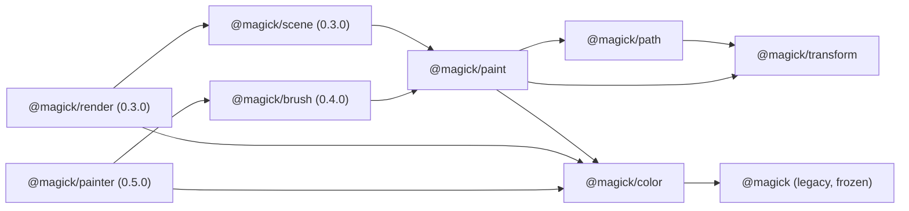

# RFC-0001: Renderer coordinates, compositing and API boundaries

- **Status:** Proposed for ratification by review. Nobody has ratified it yet.
- **Issue:** MAG-003, release 0.2.0. Merge order: PR-02 (this RFC only; no implementation).
- **Scope:** the 0.2.0 issues MAG-004 to MAG-014, including isolated composite groups with opacity
  (MAG-014, PR-09), and the sketches for 0.3.0 and later.
- **Baseline:** `org.dreamweave.magick` 0.1.3. The facts it relies on are pinned in `tests/rfc.jsl`; the
  computable contracts are in `tests/rfc_contracts.jsl`. The 0.1.x contract is in
  [COMPATIBILITY.md](../COMPATIBILITY.md), with the one owner-approved change in its change list.
- **Plan inputs:** section 17 quotes the lines of `ARCHITECTURE.md` and `PR_SEQUENCE.md` that this RFC
  relies on, in full. Both files are in the main checkout and are not tracked by this repository.

Every normative claim here is one of three kinds. A **computable** claim has an executable test, named in the
text. A **by construction** claim follows from the arithmetic and is stated with the argument. An **owned**
claim is a later issue's acceptance test, listed with its owner in section 16. No claim is only text.

## 1. Summary

- Legacy `Image` (straight sRGB RGBA8) and every 0.1.x name stay as they are, except one owner-approved
  change: `Path:transformed` keeps curves (P4, section 4). Goldens do not move.
- New rendering works on **premultiplied working tiles** (f32, 16 bytes a pixel), entered and left through
  explicit conversions. Output is straight RGBA8.
- Paths **keep their commands**. Curves are flattened at rasterization time, to a device-space tolerance,
  under hard caps.
- Transforms are **column-vector 2x3 affine matrices**; `T*S*R` applies rotation first.
- Coverage is evaluated per **tile**, with the tile rectangle given, so no full-shape scratch exists in tile
  mode.
- New APIs take a fill rule, a blend mode, a Porter-Duff operator and a color space as **options with fixed
  defaults** (`nonzero`, `normal`, `src-over`, `srgb`). Section 13 records this decision and its reason. An
  unknown name is an error, never ignored.
- Isolated composite groups with opacity are in **0.2.0** (section 10). Every group is isolated.
- Scene **structure** is a tree in 0.3.0; a DAG is deferred behind named prerequisites (section 12).

## 2. Coordinates

**C1.** Image space is continuous. The origin is the top-left corner of the image, x grows right, y grows
down. Pixel `(column, row)` is the square `[column, column+1) x [row, row+1)`. Pixel edges are whole numbers.
A pixel's center is `(column + 0.5, row + 0.5)`.

**C2 (coverage).** A pixel's coverage is the exact area of its square covered by the shape **when no two contours overlap
and no contour crosses itself**. Otherwise the 0.2.0 rule is the **summed signed area** of the contributions, clamped by F1
and F2. That is an approximation, and it is the documented 0.2.0 result, not an exact area in general. Pinned by
`tests/rfc.jsl`: two identical `rect(0.5, 0, 2, 1)` contours (overlap) give 255 in column 0, where the exact union is 128;
the bowtie `(0,0) (3,3) (3,0) (0,3)` (self-crossing) gives 0 in pixel (1, 1), where the exact nonzero coverage is 0.5; a
rectangle traced twice as one contour gives 255 in column 0 under nonzero, which is exact there. Paint is evaluated at
pixel centers (section 9).

**C3 (two conventions).** The legacy `Image` cell methods (`rect`, `rectOver`, `circle`, `line`, ...) keep
their own convention: inclusive pixel indices. The new API never uses them.

```text
  pixel edges (path rule)               legacy Image:rect(0,0,4,4)
  0   1   2   3   4                     fills indices 0,1,2,3,4 (five pixels)
  +---+---+---+---+                     column 5 is untouched
  |   |   |   |   |
  +---+---+---+---+                     path:rect(0,0,4,4) covers pixels 0..3 (four),
  |   |   |   |   |                     and its mask is 5 wide with column 4 clear
```

**C4 (mask extent, legacy).** A mask from `Path:mask()` is `ceil(maxX) - floor(minX) + 1` wide and
`ceil(maxY) - floor(minY)` high. Its width carries one spare column on the right, which is clear, and its
height carries no spare row. Pinned by `tests/rfc.jsl`.

## 3. Affine transforms

**T1 (convention).** Column vectors. A matrix has six fields, which are SVG's `matrix(a b c d e f)` in that
order: `scaleX = a`, `skewY = b`, `skewX = c`, `scaleY = d`, `offsetX = e`, `offsetY = f`:

```text
x' = a*x + c*y + e
y' = b*x + d*y + f
```

**T2 (composition).** `multiply(first, second)` is `first o second`: the point goes through `second` first.
Products are written right to left, as in column-vector mathematics. Computable: 1000 random matrices satisfy
`inverse(M) * M = I` within 1e-9, and `M * scale(-1, 1)` flips the sign of the determinant. Both are in
`tests/rfc_contracts.jsl`.

**T3 (worked example, `T*S*R`).** Rotation by 90 degrees, then scale by 2, then translation by (10, 20).
Applied to (1, 0):

```text
R(90)     (1, 0) -> (0, 1)
S(2)      (0, 1) -> (0, 2)
T(10,20)  (0, 2) -> (10, 22)
```

`docs/rfc/sketches/examples/transform_order.jsl` asserts this, and `tests/rfc.jsl` repeats it.

**T4 (legacy transform).** `Path:transformed(scale, dx, dy)` is `matrix(scale, 0, 0, scale, dx, dy)`, which is
`T*S`: scale first, then offset (P4 changes what it keeps, not this order). Pinned by `tests/rfc.jsl`.

**T5 (reflection).** A reflection gives a negative determinant. Coverage uses `|S|` for nonzero and a triangle
wave of `|S|` for evenodd (section 6). Both are unchanged by a global sign flip, so a reflected path covers the
mirror of its mask. Contour orientation is set in user space before the transform, so holes stay holes after a
reflection. `tests/rfc.jsl` mirrors a path with a hole and checks the mask pixel by pixel.

**T6 (singular and nonfinite).**
- A matrix is singular when `det == 0` or `|det| <= 1e-12 * m * m`, where `m` is the largest absolute value
  among `a, b, c, d`. `inverse`, and any render that needs an inverse, raise `magick: transform is singular`.
  Computable: `scale(1, 1e-13)` is singular and `scale(1, 1e-11)` is invertible
  (`tests/rfc_contracts.jsl`, "treats a determinant of 1e-13 ...").
- A matrix with any of its six fields NaN or infinite (positive or negative) raises
  `magick: transform must be finite`. Computable: NaN, +Inf and -Inf are each refused.

**T7 (largest singular value).** `sigmaMax = sqrt((S + sqrt(S*S - 4*det*det)) / 2)`, with
`S = a*a + b*b + c*c + d*d`. Computable: 1 for the identity, 3 for `scale(3, 1)`, 1 for a rotation, 2 for
`scale(2, -1)` (`tests/rfc_contracts.jsl`).

**T8 (device bounds, cubic extrema included).** Device bounds of a curve are exact for the curve. The control
points are transformed first (an affine map carries a Bezier to the Bezier of its transformed control points).
Then the box is taken over the two endpoints and over the points where each coordinate has zero slope. For a
cubic those parameters are the roots in `(0, 1)` of `A t^2 + B t + C`, with `u, v, w` the successive control
differences, `A = u - 2v + w`, `B = 2(v - u)`, `C = u`. A whole curve set's bounds add stroke inflation of
`halfWidth * sigmaMax` and round out to whole pixel edges (`Transform.bounds`).

Computable (`tests/rfc_contracts.jsl`):
- `cubicBox` matches an independent dense sampling (20001 parameters) on five curves, including a collinear set,
  a zero-length handle (box bottom 400/9, hand-derived), zero-length handles at both ends, and an S-curve; and
  under a reflected rotation.
- The threshold of `1e-12` on `A` is exercised on both sides, at `A = 1e-13` (linear branch) and `A = 2e-12`
  (quadratic branch); both agree with dense sampling to 1e-6.
- `Transform.bounds` of the arch under `scale(3, 1)` with half width 0.5 is `(-2, -2, 302, 77)`, hand-derived.
- The elevated quadratic `(0,0),(50,100),(100,0)` has box `(0, 0, 100, 50)`, and the empty set is `0, 0, 0, 0`.

The roots use the textbook quadratic formula and an absolute threshold. Coordinates are at most `MaxCoordinate`
(`2^22`), and the threshold is not scale-invariant; the tests above are the evidence that both sides agree within
1e-6.

**T9 (legacy bounds are not device bounds).** `Path:bounds()` stays the box of the flattened points of closed
contours at the path's own tolerance (P5). T8 is the device rule for new APIs.

## 4. Paths, tolerance and flattening

**P1 (commands kept).** A path retains its commands in user space: move, line, quadratic, cubic, close. Each
contour carries an orientation mode:
- `shape`: normalized to a positive signed area, as `wound` does for every shape builder;
- `hole`: normalized to a negative signed area (`ring`, `frame`, a hole drawn as one);
- `raw`: kept exactly as drawn (`moveTo`, `lineTo`, `close`).

Normalization is applied in user space, before any transform.

**P2 (tolerance, and the bound the formula gives).** The tolerance is in **device pixels**. The default is
**0.25**, as `path.new()` has today. Flattening uses the 0.1.3 piece-count formulas, with the tolerance taken in
user space as `tol / sigmaMax`. For the identity that is `tol`, so legacy output does not move.
- Quadratic: `pieces = ceil(sqrt(|bend| / (8 * tol)))`, where `bend` is the vector of second differences
  `P0 - 2*P1 + P2`, and `|bend|` is its Euclidean length.
- Cubic: `pieces = ceil(sqrt(0.75 * bend / tol))`, where `bend` is the larger of the Euclidean lengths of the two
  second differences `P0 - 2*P1 + P2` and `P1 - 2*P2 + P3`.

**Correction, found by the round-3 checks.** The earlier text said `tol` is the largest distance between the
outline and the curve. That is not what the formula delivers for quadratics. With `n` equal-parameter pieces the
worst chord midpoint sits `|bend| / (4 n^2)` from the curve, and `n^2 >= |bend| / (8 tol)`, so the error is at
most **2 * tol**. Measured: the source quadratic `(0,0),(50,100),(100,0)` at tol 0.25 (10 pieces) has worst chord
error exactly 0.5; the same curve at device scale 4 with 20 pieces has 0.5 device pixels. Both are `2 * tol`.
Computable: `tests/rfc_contracts.jsl`, "bounds the chord error by 2 * tolerance". The legacy formula is kept, since
changing it would move legacy output. **For cubics the bound is not derived here**: the constant is an owned
measurement in MAG-004 (section 16).

**P3 (flatten at rasterization).** Curves are flattened when coverage or bounds are asked for, never when they
are added. The 0.1.3 path flattens in `quadTo` and `cubicTo`; that changes, and the result for identity
transforms does not (P4 gives the reason for the transformed case).

**P4 (legacy `Path:transformed` keeps its curves: an owner-approved change to a 0.1.x name).**

*Decision (owner, 2026-11-07).* `Path:transformed(scale, dx, dy)` keeps the path's commands. The transform
`point * scale + offset` is applied to the control points, and the curves are flattened at rasterization with the device
tolerance (P2, P3). The 0.1.3 behaviour, which flattened the curves at the source tolerance and then moved the points,
is **removed**. This resolves MAG-004's "no permanently baked low-resolution curve geometry" for the legacy call.

*The RFC's own V5 before this change, quoted in full (committed text, `c5c5ffa`):*

> **V5 (0.1.x names keep working).** `Path:transformed`, `path.new(tolerance)`, `Path:mask`, `Path:fill`, `Image:polygon`,
> `Image:circle`, and every other 0.1.x name keeps its 0.1.3 result. A change goes through a new name, with the old one
> kept.

It is overridden for `Path:transformed` only, as V5 now states.

*Who implements it.* The source change is **MAG-004**, not this RFC. `src/path.jsl` stores points, not commands; retaining
move, line, quadratic, cubic and close commands is MAG-004's refactor (its issue text: "Retain move/line/quadratic/cubic/
close commands so geometry can transform without quality loss"). This RFC changes no `src/` file. Until MAG-004 lands,
the package's `Path:transformed` still bakes curves, and **no test in the gate asserts the new behaviour**. The package
test that calls the real `Path:transformed` is owned by MAG-004 (section 16). The P4 block of `tests/rfc_contracts.jsl`
is a sketch reference only: it does not call `Path:transformed`.

*The 0.1.x rule it overrides, quoted in full.* COMPATIBILITY.md, the bullet for `Path:transformed`:

> - `Path:transformed(scale, dx, dy)`: a **new** `Path` whose closed contours are copied with each
>   point moved to `point * scale + offset`. An open contour is **not** copied: a contour not yet
>   closed is left out of the result entirely, and the result's bounds do not include it. The
>   source is unchanged. Close a contour before transforming it.

and the policy line of the same file: "**Quirks are contract too.** The legacy behavior in [Legacy compositing]
is kept as it is. A fix goes in as a clearly versioned opt-in, never as a silent change." The bullet reads the
transformed points as the path's points; the 0.1.3 implementation flattened the curves first, so the change is to what the
result keeps, and the owner approved overriding that reading for curves.

*Exact scope.*
- **Changed:** curved paths (quadratic or cubic contours) under any transform that is not the identity.
- **Unchanged, by construction:** paths with no curves (lines, closed polygons, rectangles, outlines): the points are
  `p * scale + offset` in both calls, the same arithmetic.
- **Unchanged, by construction:** the identity (`scale 1`, `dx = dy = 0`): the control points are the same, the flattening
  is the same function on the same inputs, and `x * 1 + 0 = x` exactly. So `Path:transformed(1, 0, 0)` is claimed
  byte-identical. That claim is **not tested by this RFC**; MAG-004's real-function test is its check.
- **Expected, not proven:** curved paths under a translation only (scale 1, `dx` or `dy` nonzero). The two calls perform
  the same operations in a different order, so the last floating-point bits can differ, and a coverage byte at a rounding
  edge could change. The masks are expected byte-identical on the MAG-004 fixtures. This is an owned test, not a proof.

*Device error of the old bake.* The 0.1.3 bake flattened the source quadratic at source tolerance 0.25. Its worst chord
error is 0.5 source pixels (P2: `2 * tolerance`). At scale 4 that is **2 device pixels**, eight times the 0.25 device
tolerance. The retained curve at device tolerance 0.25 has worst chord error 0.5 device pixels. Reference evidence,
`tests/rfc_contracts.jsl` (a sketch, labelled as such): the exact device area under the quadratic is 53333.33, the
retained polygon has area 53200 (20 pieces) and the baked polygon 52800 (10 pieces), so the retained error is 133.3 and the
baked error 533.3 square pixels.

*Policy.* A documented, owner-approved behaviour change. It is announced in the 0.2.0 release notes, recorded as an explicit
entry in COMPATIBILITY.md's change list, and it is not a silent break. No golden or benchmark calls `transformed` on a
curve (`tests/goldens.jsl` and `bench/bench.jsl` contain no call), so no golden moves. `Path:mask`, `Path:fill` and
`Path:bounds` keep their 0.1.3 rules (P5).

**P5 (legacy bounds, mask and finalize).** `Path:bounds()` is the box of the flattened points of **closed**
contours only, at the path's own tolerance, and is `0, 0, 0, 0` when there are none. An open contour is not
counted until it closes. `Path:mask()` finalizes: it closes the open contour as `close` does, and a contour of
fewer than three points is dropped on close, so a path with nothing left gives a 0 by 0 mask at 0, 0. The mask
extent is C4. Pinned by `tests/rfc.jsl`.

**P6 (budgets).** Section 11 gives the caps. Flattening stops with an error, never with a truncated outline, when
a cap is exceeded.

## 5. Strokes

Stroke units are decided here. The rules are computable on their reference functions in
`docs/rfc/sketches/stroke.jsl`, tested in `tests/rfc_contracts.jsl`. MAG-007 implements the stroke outline itself,
and its tests must agree with these functions.

**SK1 (units).** A stroke width is in **user space**. The stroke outline is built in user space, from the
centerline flattened at `tol / sigmaMax`, and then transformed with the path. A device width at a point is
`w * |det M| / |M d|` along user direction `d`: the strip maps to a parallelogram of area `|det M| * w * L`, and its
device length is `|M d| * L`. Computable, `Stroke.deviceWidth`:
- identity, width 2, vertical: 2;
- `scale(2, 2)`, width 3: 6;
- `scale(-1, 1)`, width 3, vertical: 3 (a reflection keeps the width);
- `scale(3, 1)`, width 2: horizontal 2, vertical 6;
- over 360 directions under a rotated `scale(3, 1)`, the device width never exceeds `w * sigmaMax` and reaches it.
A device-space ("hairline") width is not in 0.2.0.

**SK2 (width).** A width is finite, not negative, and at most `MaxCoordinate`. Computable: `checkWidth` refuses -1
and `4194305` with `MaxCoordinate 4194304 exceeded`, and accepts `4194304`.

**SK3 (zero-length segments).** A segment with no length has no direction. It draws its caps (round is a disk of
the width's diameter, square a square of the width's side, butt nothing). Computable: `zeroLengthCap`.

**SK4 (joins).** New stroke options take `join` of `miter`, `round` or `bevel`. The default is `miter` with
`miterLimit` 4, as SVG. The miter length ratio at a join with interior angle `theta` is `1 / sin(theta / 2)`.
Where the ratio exceeds `miterLimit`, the join is a bevel. Computable: the ratio is `sqrt 2` at 90 degrees and
`3.8637033` at 30 degrees; a 90 degree join is a miter at limit 4 and at limit `sqrt 2` (equality is a miter), and
a bevel at limit 1.4; a 20 degree join (ratio 5.7588) is a bevel at limit 4, a 30 degree join a miter. Legacy
`Path:polyline` keeps round joins and is unchanged.

**SK5 (caps).** `cap` is `butt` (the default), `round` or `square`, as in 0.1.3.

**SK6 (dashes).** `dashes` is an array of lengths in user space. It has at most `MaxDashEntries` (64) entries,
each finite and `>= 0`, and its sum is `> 0`. An empty array, or a sum of 0, draws a solid stroke. Computable:
`checkDashes` refuses 65 entries and a negative entry and sums `{1, 2, 3}` to 6. `dashOffset` is in user space
and reduced into `[0, period)` by floored modulo: `-1` with period 5 gives 4, `12` gives 2, `10` gives 0.
Dashes are generated along the flattened centerline. A stroke that would generate more than `MaxDashesPerStroke`
dashes is an error (owned by MAG-007, its cap is in section 11).

**SK7 (reflection).** A reflected stroke is the mirror of the stroke, and its coverage follows T5. Width is never
negated (SK1, `scale(-1, 1)` test).

## 6. Fill rules and clipping

**F1 (nonzero).** `nonzero` coverage of a pixel is `min(1, |S|)`, where `S` is the sum of the signed area contributions in
that pixel (C2). It equals the SVG nonzero rule when no contour overlaps or crosses itself, and the summed approximation
otherwise (C2, with the bowtie vector). A negative winding counts by magnitude: `nonzero(-1) = 1` and `nonzero(-0.5) = 0.5`
(`tests/rfc.jsl`). Legacy `Path:mask()` is this rule. Reference: `Paint.coverage`. For MAG-006, which requires that nonzero "produce the documented result" on self-crossing contours (`issue-6.md`), the documented result is the pinned bowtie vector (C2): nonzero is 0 at pixel (1, 1), where the exact answer is 0.5. An exact rule is a new rule and needs an RFC amendment.

**F2 (evenodd).** `evenodd` coverage is `w = |S| mod 2`, then `w` if `w <= 1`, else `2 - w`, on the same summed `S` as F1.
It is exact only when no contour overlaps or crosses itself, and it is **not exact** for a rectangle traced twice as one
contour: column 0 has `S = 1`, so the rule gives 1 (255 bytes), where the exact even-odd answer is 0. That outcome is
pinned (`paint.coverage('evenodd', 1) = 1` in `tests/rfc_contracts.jsl`, and the legacy mask in `tests/rfc.jsl`).
**The 0.2.0 rule for evenodd is this approximation.** MAG-006 requires that both fill rules "produce the documented result"
on self-crossing and overlapping contours (`issue-6.md`); these pinned vectors are that documented result. An exact parity
rule needs the winding per contour, which the 0.2.0 rasterizer does not keep. Adding one is a new rule, and it requires an
RFC amendment, not a silent change.

**F3 (defaults).** New APIs take `fillRule` as an option; omitted, it is `nonzero`. Legacy `Path:mask()` is
`nonzero`. Legacy `Image:polygon` is even-odd, and `Image:circle` is center-sampled. Each module documents its
rule.

**F4 (clip rectangle).** A rectangle clip has whole-pixel edges and is exact. `FillOptions.clip` takes one.

**F5 (clip mask).** A clip **mask** is a byte of coverage per pixel over an extent, produced from a path by
`Path:coverageIn` (section 15). It multiplies into the coverage it clips: a pixel's coverage is the product of its
own coverage and the clip's. Clips nest by multiplying, to a depth of at most 16 (`MaxClipDepth`). A clip can be
given to a group (G8). Computable: `Color.clipPixel` (a clip of 0.5 on opaque red gives `0.5, 0, 0, 0.5`
premultiplied) and `Color.nestClip` (depth 16 accepted, 17 refused with `magick: MaxClipDepth 16 exceeded`).

**F6 (allocation).** A clipped coverage evaluation allocates scratch only over the intersection of the clip
rectangle and the path's bounds. Geometry entering the rectangle from outside is handled by carrying each row's
accumulation in from the left edge of the rectangle. **By construction** only; the allocation bound is owned by
MAG-008 (section 16).

## 7. Legacy boundary

**L1.** `Image` is a table with `width`, `height` and `data`. `data` is `width * height * 4` bytes of straight,
sRGB, RGBA8, rows from the top. It is frozen. Every 0.1.x method on `Image`, and every 0.1.x golden, keeps its
bytes.

**L2.** New APIs take a legacy `Image` as input and produce one only through the explicit conversions
`color.fromImage` and `color.toImage` (section 8). Nothing in the legacy surface starts using a working tile.

**L3 (NaN, recorded).** Legacy NaN handling stays where it is. In 0.1.3, `Image:rect(0, 0, 0/0, 2, c)` fills rows
0..2 across the whole image, silently, because `math.min` and `math.max` pass NaN through. `path:rect(0, 0, 0/0, 4):mask()`
raises a Lua error whose message contains `buffer access out of bounds`. It is not a `magick:` message. Pinned by
`tests/rfc.jsl`, so a fix is a recorded change.

**L4 (legacy seeds, recorded).** Legacy seeded functions (`magick.noise`, `magick.randomNoise`,
`magick.addGaussianNoise`) take the seed as `math.floor(seed) % 2147483647`, using Luau's floored modulo, and a
result of 0 is taken as 1. So a negative seed wraps: `-1` gives the same noise as `2147483646`, and `2147483647`
and `0` both give the seed 1. A non-integer seed is floored first, so `2.5` gives the noise of `2`. The reference
`Seed.legacy` and the package agree on these values, pinned by `tests/rfc.jsl` and `tests/rfc_contracts.jsl`.

## 8. Working tiles and color

**W1 (representation).** A working tile is `{ width, height, space, data }`, with `data` a buffer of
`width * height * 16` bytes: RGBA, **f32 per channel, premultiplied**, rows from the top. A 128 by 128 tile is
262,144 bytes (about 256 KiB), which matches ARCHITECTURE.md contract 6. **By construction**: `E * E * 16`.

**W2 (f32, not fixed point).** f32 storage, f64 arithmetic. Fixed point would need a second set of rounding rules,
and f32 with the conversions below round-trips 8-bit values exactly (W5).

**W3 (space).** `space` is `'srgb'` (the default) or `'linear'`.
- `'srgb'`: values are sRGB-encoded. Compositing happens on those values, as legacy `Image` and browsers do.
- `'linear'`: the sRGB transfer is removed on entry, compositing happens on linear values, and it is applied
  again on output: `c_lin = c / 12.92` for `c <= 0.04045`, else `((c + 0.055) / 1.055)^2.4`, and the inverse.

A tile's space never changes in place. `color.convert(working, space)` makes a tile of the other space, and two
tiles of different space are never composited without it. `color.convert` is a stub in the sketch, so the
linear transfer is **text only**; its numbers are owned by MAG-013.

**W4 (clamp and round).** Output bytes are `floor(clamp(x, 0, 1) * 255 + 0.5)`, round half up, as legacy `clamp8`
does. A premultiplied channel is clamped to `[0, alpha]` before it is stored or converted, and alpha to `[0, 1]`.
NaN never reaches a tile: paint construction rejects nonfinite inputs (section 9). Computable: `unitByte` and
`straight` clamp as stated, and the blended-pixel property keeps colour within `[0, alpha]`.

**W5 (conversion in, exact round trip).** A straight byte `c` with alpha byte `a` is stored as
`premultiplied = (c/255) * (a/255)` and `alpha = a/255`, each written through an f32 store. Read back,
`straight = clamp(premultiplied / alpha, 0, 1)`, and the output byte is `floor(straight*255 + 0.5)`. **Computable**
(`tests/rfc_contracts.jsl`, "round-trips every straight byte at alpha 1..255 in all three slots"): for every
channel value at every alpha from 1 to 255, with three distinct values in the three slots (`c`, `255 - c`,
`7c mod 256`), the output equals the input: 65,280 values in each slot, 0 failures.

**W6 (transparent RGB policy).** A pixel whose alpha byte is 0 stores RGB 0 in every straight output. The
premultiplied tile storage of that rule is a stub, so what is computable is `color.straight`: its output at alpha
0 is `0, 0, 0, 0` whatever RGB went in. Legacy `Image` is not changed: it keeps the RGB it has under alpha 0. A
round trip of a legacy image through a working tile therefore changes only the RGB of alpha-0 pixels, and only to
zero, once the tile conversion exists (MAG-013).

**W7 (output).** A working tile leaves the module only through `color.toImage`, as straight RGBA8 in the legacy
layout.

**W8 (Porter-Duff).** The twelve W3C operators are implemented: `clear`, `src`, `dst`, `src-over`, `dst-over`,
`src-in`, `dst-in`, `src-out`, `dst-out`, `src-atop`, `dst-atop`, `xor`. Each is `result = source * fa + backdrop *
fb` on premultiplied values, with `fa` and `fb` from the W3C table (`color.factors`), and result alpha
`as * fa + ab * fb`. Computable: all twelve factor pairs; `src-in`, `dst-over` and `xor` through `blendPixel`; for
2000 random alpha pairs every factor pair and result alpha is in `[0, 1]`; the alpha identities hold: union is
`src-out + dst-out + src-in`, `xor` is `src-out + dst-out`, `src-in` is `as * ab`, and `clear` is 0
(`tests/rfc_contracts.jsl`). **An operator name outside the twelve raises `magick: unknown operator <name>`**, from
`factors` and from `blendPixel`.

**W9 (blend modes and their formulas).** 0.2.0 ships seven separable modes. The separable blend function `B(cb, cs)`
takes straight channels `cb` (backdrop) and `cs` (source), each in 0..1:

| Mode | B(cb, cs) |
|---|---|
| `normal` | `cs` |
| `multiply` | `cb * cs` |
| `screen` | `cb + cs - cb * cs` |
| `overlay` | `HardLight(source, backdrop)`, the hard-light formula with the arguments swapped |
| `darken` | `min(cb, cs)` |
| `lighten` | `max(cb, cs)` |
| `soft-light` | if `cs <= 0.5`: `cb - (1 - 2*cs) * cb * (1 - cb)`; else `cb + (2*cs - 1) * (D(cb) - cb)` |

where `HardLight(backdrop, source)` is `backdrop * 2 * source` if `source <= 0.5`, else `screen(backdrop, 2*source - 1)`, and `D(x)` is
`((16x - 12)x + 4)x` for `x <= 0.25`, else `sqrt(x)`.

The compositing of a premultiplied source over a premultiplied backdrop is, per color channel, with `as, ab` the
alphas, `cs, cb` the premultiplied colors, and `Cs = cs / as`, `Cb = cb / ab` the straight ones:

```text
cr = cs * (1 - ab) + cb * (1 - as) + as * ab * B(Cb, Cs)
ar = as + ab - as * ab
```

Opacity scales `as` and `cs` once before this (G2). Blend modes composite with `src-over` only; another operator
with a non-normal blend raises `magick: blend modes composite with src-over only`.

**Unknown names are refused.** `Color.separable`, `Color.blendPixel` and `Color.factors` each raise
`magick: unknown blend mode <name>` or `magick: unknown operator <name>` for any name outside the 0.2.0 sets. The
other separable modes (`color-dodge`, `color-burn`, `hard-light`, `difference`, `exclusion`) and the nonseparable
modes (`hue`, `saturation`, `color`, `luminosity`) are not in 0.2.0, so they are refused like any other unknown name.
Each later addition needs reference vectors.

**Computable values.** At `cb = 0.5`, `cs = 0.25`, opaque: normal 0.25, multiply 0.125, screen 0.625, overlay 0.25,
darken 0.25, lighten 0.5, soft-light 0.375. Off-center: `overlay(0.75, 0.25) = 0.625`,
`soft-light(0.5, 0.75) = 0.5 + 0.5 * (sqrt(0.5) - 0.5)`, and `soft-light(0.2, 0.75) = 0.324`, which takes the
quartic branch of D. Composited with opacity 0.5 over an opaque backdrop, multiply of `(0.25, 0.25, 0.25, 1)` over
`(0.5, 0.5, 0.5, 1)` gives 0.3125. Over a backdrop of straight 0.5 at alpha 0.5, the same source at opacity 0.5
gives premultiplied colour `0.21875` (straight `0.2917`, that is `0.21875 / 0.75`) with alpha `0.75`. Every value is asserted in `tests/rfc.jsl`, and `blend_modes.jsl` prints them.
For 2000 random pairs the seven values lie in `[0, 1]`, and for 1000 random valid premultiplied pixels each of the
seven blended results has colour within `[0, alpha]` and alpha within `[0, 1]` (`tests/rfc_contracts.jsl`).

**W10 (module).** The color module is **`@magick/color`**, separate from `@magick/paint`. It owns working tiles,
conversions, Porter-Duff, blend, clip and group compositing. `@magick/paint` owns paint values and span evaluation.
This is the name `ARCHITECTURE.md` uses.

## 9. Paint model

**M1 (immutable values).** A paint is an immutable value with no mutation API. It can be shared by many shapes and
nodes.

**M2 (span evaluation).** A paint is evaluated per span: a run of pixel centers in one row of a tile, at
`(column + 0.5, row + 0.5)`. It writes premultiplied f32 values into a scratch buffer, four values a pixel. No
per-pixel dispatch and no per-pixel callback is used. **Owned**: MAG-009 implements and measures it.

**M3 (solid fast path).** A solid paint is a loop over the span with constant values. The paint's kind is checked
once per span, never per pixel. **Owned**: MAG-009 (performance, measured under MAG-002).

**M4 (kinds in 0.2.0).** `solid`, `linear`, `radial`, `conic` and `pattern`, as typed in `docs/rfc/sketches/paint.jsl`.
Each has `opacity` in `[0, 1]`, which multiplies alpha.

**M5 (user callbacks).** Shader-like user callbacks are not in 0.2.0. A callback, when added, must be a pure function
of its sample center and explicit arguments. It may not read a clock, a mutable generator, or the destination.

**M6 (stops).** A gradient has at most **256** stops (`MaxStops`). Stops are sorted by offset, stably, so equal
offsets keep their input order. Offsets must be finite and in `[0, 1]`. A coincident pair makes a hard edge: at an
offset `t` shared by stops `i` and `i+1`, the color is that of stop `i+1`. A stop's color is a legacy `magick.Color`
(string or channels), converted once at construction to the straight channels in the sketch.

**M7 (spread).** `pad` clamps `t` to `[0, 1]`; `repeat` uses `t - floor(t)`; `reflect` uses the triangle wave of
period 2. Linear, radial and conic paints share it. **Owned**: MAG-010 and MAG-011 test it on fixtures.

**M8 (degenerate cases and the conic seam).** A single stop is a solid paint. A linear gradient with
`(x0, y0) == (x1, y1)` gives the last stop's color, whatever the spread. A radial gradient with radius 0 gives the
last stop's color. A conic gradient's seam is at `startAngle` in paint space (default 0, the `+x` axis), and its
angle increases clockwise on screen. The angle is `atan2(dy, dx)` measured from `startAngle`, wrapped to `[0, 1)` of
a turn. **Owned**: MAG-010 and MAG-011 test these on fixtures.

**M9 (interpolation, alpha).** Gradients interpolate in `'srgb'` by default, or `'linear'` when asked. **Alpha
interpolation is premultiplied.** Each straight color is premultiplied by its own stop's alpha, the premultiplied
channels and the alphas are mixed linearly, and the mix is made straight again. A mixed alpha of 0 gives color 0.
This is `Paint.mixStop`. Computable: opaque red at offset 0 and transparent blue at offset 1 mix at 1/2 to
`(1, 0, 0, 0.5)`, where a straight mix would give a purple; opaque red and blue at alpha 0.5 mix to `(2/3, 0, 1/3,
0.75)`; the alpha at 1/4 is `0.875`; and 500 random stop pairs mix within their range. Linear interpolation converts
the straight channels to linear before the premultiplication, and that conversion is owned by MAG-013.

**M10 (patterns).** A pattern reads a source through the inverse of its transform. A source names its format:
`straight8` (a legacy RGBA8 `Image` layout) or `premultiplied32` (a working tile, W1). The two are never mixed up, and
the sketch's `PatternSource` carries the field. Sampling is `nearest` (default) or `bilinear` in premultiplied values.
Edges are `clamp` (default), `repeat` or `mirror`. A pattern whose source is the destination it is drawn into raises
`magick: pattern reads its own destination`. It is not snapshotted. **Owned**: MAG-012 tests sampling on fixtures.

**M11 (no full-canvas image).** Paints can be clipped and reused without allocating a full-canvas image. Evaluation
writes into scratch the size of one span. **Owned**: MAG-009 (allocation, measured in MAG-025 and MAG-008).

**M12 (transform direction).** For every paint, `transform` maps **paint space to device space** (pixel coordinates).
The gradient coordinates `x0, y0, x1, y1, cx, cy`, and a pattern's source coordinates, are in paint space. Sampling
uses the inverse of `transform` at pixel centers. The default is the identity. This satisfies ARCHITECTURE.md
contract 2 ("local-to-world paint coordinates") and MAG-010's "transform sampling into paint-space".

**M13 (legacy fills).** `Path:fill(image, color)` keeps its 0.1.x bytes: it is the legacy straight-alpha routine
(`overMask`), and the bridge in MAG-009 is that it stays a call into that routine. A new solid fill into a working
tile does **not** reproduce those bytes. It is a different compositing rule (f32, premultiplied, not legacy `clamp8`
straight compositing), so byte identity is not claimed for it. MAG-009's "identical to existing legacy fills where
APIs overlap" is therefore met by keeping `Path:fill` on the legacy routine, not by making the new API match it.

## 10. Composite groups (0.2.0)

Isolated groups with opacity are in 0.2.0 (MAG-014, PR-09). The order below is the renderer contract that the 0.3.0
scene compiles to.

**G1 (isolation).** A group is composited in its **own premultiplied working tile**, which starts fully transparent.
Its children draw into that tile, and never into the backdrop directly. The group is then composited onto its
backdrop as one layer. Every group in 0.2.0 is isolated (G6). Computable: `Color.composeGroup` starts its group
pixel transparent; a child drawn `src-in` into an empty group leaves the white backdrop unchanged
(`tests/rfc_contracts.jsl`, "isolates").

**G2 (order).** Operations run inside out, in a fixed order:
1. the children draw into the group tile, in painter order (the order they were added), each with its own operator
   and blend against what the group tile holds so far;
2. the group tile is clipped by the group's **clip mask**, if any (F5): each pixel's premultiplied values and alpha
   are multiplied by the clip's coverage;
3. the group's **opacity** is applied **once**, to the group's premultiplied pixel: its color and its alpha are both
   multiplied by the opacity. It is not applied per child;
4. the group's **blend** and **operator** composite the group pixel onto the backdrop (W8, W9).

The operator defaults to `src-over` and the blend to `normal`, which is the W9 formula with no blend. Computable:
two children at opacity 0.5 give `(0.75, 0.5, 0.75, 1)` (opacity once), opacity 0 leaves the backdrop, opacity 1
gives the full group; a multiply group of red over white is red; a clip of 0.5 before the composite gives
`(1, 0.5, 0.5, 1)` (`tests/rfc_contracts.jsl`).

**G3 (coverage).** A group's coverage is the alpha its operator leaves on the backdrop: for `src-over` (and any normal
blend with it) the union of its children's coverage; for another operator the factor `fa` and `fb` of W8 decide, so
`src-in` keeps only what is under the backdrop, `dst-in` keeps the backdrop only where the group is, and `clear` gives
nothing. A pixel the group tile does not cover is alpha 0 and contributes nothing (W6 applies to its RGB). Computable:
the alpha identities of W8.

**G4 (memory and depth).** An isolated group needs **one working tile per nesting level** in addition to the backdrop it
composites onto. A render therefore holds `1 + depth` tiles per open group chain, where `depth` is at most
`MaxGroupDepth` (32). Computable: `Color.nestGroup` accepts depth 32 and refuses 33 with `magick: MaxGroupDepth 32
exceeded`. The bytes are in section 11 (B3, the `(1 + MaxGroupDepth)` term). A group's extent is one tile: a clip or
group larger than a tile is rendered tile by tile, each tile with its own group tile (B2), so B3's tile bound stays
the bound.

**G5 (numbers).** Worked example, `docs/rfc/sketches/examples/group_composite.jsl`. Group tile empty. Child 1: opaque
red, painted over it, giving `(1, 0, 0, 1)`. Child 2: blue at alpha 0.5, `(0, 0, 0.5, 0.5)` premultiplied, painted over
child 1 with src-over, giving `(0.5, 0, 0.5, 1)`. Group opacity 0.5, applied once, is `(0.25, 0, 0.25, 0.5)`.
Composited src-over onto opaque white `(1, 1, 1, 1)`, the result is `(0.75, 0.5, 0.75, 1)`, which is the bytes
`191, 128, 191, 255`. `tests/rfc.jsl` and `tests/rfc_contracts.jsl` repeat it.

**G6 (non-isolated groups: not defined; no flag).** A pass-through group, whose children composite straight onto the
backdrop, is **not defined in 0.2.0**. No 0.2.0 API has an isolation flag, and none accepts a value other than
isolated. The 0.3.0 scene's group type has **no** isolation field: every group is isolated, as in G1. A pass-through
group changes which backdrop each child sees, so it needs its own numbers. It is deferred to a later release with
reference vectors, and it is not an accident of the defaults.

**G7 (API, 0.2.0).** `color.compositeGroup(destination, group, options)` composites a finished group tile. Options are
`blend` (default `normal`), `operator` (default `src-over`), `opacity` (default 1, in `[0, 1]`) and `clip` (a clip mask,
F5, default none). Nonfinite or out-of-range opacity is an error. Nested groups are built by the caller with the same
call, one tile per level (G4). The pixel-level reference is `Color.composeGroup`; the tile function is a stub, and its
tile behaviour is owned by MAG-014.

**G8 (clip mask).** A clip mask is one byte of coverage per pixel over the group's extent, produced by
`Path:coverageIn(...)` from a path with its fill rule (F2 for evenodd, F1 for nonzero), or from a rectangle (F4). It is
applied at step 2 of G2. Clip masks nest by multiplication to a depth of 16 (F5). The sketch takes the mask as
`{ width, height, data }`, and `Color.clipPixel` is the per-pixel reference.

## 11. Tiles, budgets and determinism

Tiles are aligned to a grid from the image origin. Tile order is row-major. A tile's coverage comes from
`Path:coverageIn(left, top, width, height, options)`. `Path:mask()` stays as it is.

**B1 (tile edges).** Default tile edge **128** px; maximum **256** px (`MaxTileEdge`). Computable: `Render.plan`
refuses 257 with `magick: MaxTileEdge 256 exceeded` and refuses tile 0 as not a whole number at least one.

**B2 (byte-identical tiles).** The mask rebuilt from clipped tiles must be byte-identical to single-shot coverage over
the same rectangle. **Owned by MAG-008**: it is the tile test of that issue, on fixtures. It is not proven here.

**B3 (memory, per worker and per output).** The memory contract has three terms, and the render check covers all three.

- **Per worker (working set):** `perWorker = (1 + MaxGroupDepth) * tileBytes + coverageBytes + haloBytes`, where
  - `tileBytes = E * E * 16` (one f32 RGBA working tile per group level, and the backdrop, at tile edge `E`);
  - `coverageBytes = (E + 1) * E * 8`: the coverage cells are f64, one per pixel plus one spare column a row, over `E`
    rows, the same layout `Path:mask` uses (`src/path.jsl`);
  - `haloBytes = (E + 2H)^2 * 16`, one f32 RGBA halo tile at halo `H` per side (`H` is 0 for renders without a filter, and
    at most `MaxHaloPx` = 64).
- **Output:** `outputBytes = 4 * W * H` for the one straight RGBA8 `Image` the render writes tile by tile.
- **Encode (when the caller will encode the result):** `encodeBytes = 3.02 * outputBytes`. This is the peak of
  `Magick.png` (`src/init.jsl`), not a guess. The encoder holds `lines` (the output plus one filter byte a row) until it
  returns; `packed`, a zlib stream from `bytes.deflate` whose stored-block worst case is `lines` plus 5 bytes a 65,535-byte
  block plus framing, at most `1.0001 * lines`; and `out`, a copy of `packed` built while `packed` is still live. The peak
  is therefore `lines + packed + out <= output * (1 + 2 * 1.0001) = 3.0002 * output`, and 3.02 covers it with margin.
  Arithmetic for the 8192 square: `268,435,456 * 3.02 = 810,675,077.12`, floored to 810,675,077. MAG-025 replaces the bound
  with a measured peak.

The total is `workers * perWorker + outputBytes + encodeBytes`. `Render.plan` returns it, and refuses with
`magick: render needs <n> bytes, budget is <m>` when it exceeds `memoryBudgetBytes`. The default budget is 512 MiB.

**Computable arithmetic (`tests/rfc.jsl`, `tests/rfc_contracts.jsl`).** The table, with the hand-derived values:

| Case | Per worker | Workers | Output | Total | Default 512 MiB |
|---|---|---|---|---|---|
| 8192 square, tile 256, halo 64, 8 workers, no encode | 37,488,640 (33 MiB + 0.5 MiB cells + 2.25 MiB halo) | 8 | 268,435,456 | 568,344,576 (542 MiB) | refused |
| 8192 square, tile 128, halo 64, 8 workers, no encode | 9,831,424 (8.25 MiB + 0.13 MiB cells + 1 MiB halo) | 8 | 268,435,456 | 347,086,848 (331 MiB) | passes |
| 8192 square, tile 128, halo 64, 8 workers, encode | as above | 8 | 268,435,456 + 810,675,077 | 1,157,761,925 (1104 MiB, rounded down) | refused; a 1 GiB budget refuses it, 1.25 GiB (1,342,177,280) accepts it |
| **Boundary:** tile 248, halo 1, 8 workers, 8091 by 8192, no encode | 33,968,128 | 8 | 265,125,888 | **536,870,912 (512 MiB exactly)** | accepted |
| Boundary plus one column: 8092 by 8192 | as above | 8 | 265,158,656 | 536,903,680 | refused |
| The exact boundary with budget one byte less | as above | 8 | as above | 536,870,912 | refused |

Each row is a `Render.plan` assertion. The exact-boundary geometry is the only `(tile, halo, workers, width)` found
with total exactly 512 MiB at height 8192 (search over tile 1..256, halo 0..64, workers 1..8, width at most 8192).
The earlier round's shortfall (520 MiB passing) is now a refusal, because the output and the cells are counted.

**Option validation (computable).** `Render.plan` refuses a tile edge or a worker count that is not a whole number at
least one, and refuses each option past its cap with the E5 message: tile 257 (`MaxTileEdge 256 exceeded`), 9 workers
(`MaxWorkers 8 exceeded`), halo 65 (`MaxHaloPx 64 exceeded`), and an output edge 8193 (`MaxImageEdge 8192 exceeded`).

The numeric caps. Each has a row and a test (below). Caps with no code path in the sketches are constants whose
relations are tested, and their code is owned by the issue named in the row.

| Cap | Value | Code path and test | Why this value |
|---|---|---|---|
| `MaxCoordinate` | `2^22` (4,194,304) | `checkWidth`; E5 boundary tested | Any user or device coordinate or stroke width must be finite and within `±2^22`. |
| `MaxCommandsPerPath` | `2^20` | constant; E5 rule tested; owned by MAG-004 | About a million commands is an outline far larger than any glyph or sprite set. |
| `MaxPiecesPerCurve` | `16384` | constant; relation tested: the coordinate-limit cubic needs 8431 pieces; owned by MAG-004 | At 0.25 px, a cubic may have a control bend up to `16384^2 * 0.25 / 0.75`, about `8.9e7` px; the largest bend `MaxCoordinate` allows is about `2.4e7`. |
| `MaxSegmentsPerCoverage` | `2^20` | constant; E5 rule tested; owned by MAG-008 | Flattened segments one coverage call may produce. |
| `MaxDashEntries` | `64` | `checkDashes`; E5 boundary tested | A dash pattern is a short list (SK6). |
| `MaxDashesPerStroke` | `2^20` | constant; E5 rule tested; owned by MAG-007 | Generated dashes per stroke (SK6). |
| `MaxStops` | `256` | constant; E5 rule tested; owned by MAG-010 | A gradient stop list is not a lookup table (M6). |
| `MaxClipDepth` | `16` | `nestClip`; boundary 16 accepted, 17 refused, tested | Clips nest only to this depth (F5). |
| `MaxGroupDepth` | `32` | `nestGroup` and `Render.workingBytes`; boundary tested | Group nesting (G4). Also the scene's depth cap in 0.3.0. |
| `MaxTileEdge` | `256` | `Render.plan`; boundary tested | B1. |
| `DefaultTileEdge` | `128` | `Caps.DefaultTileEdge`; relation `<= MaxTileEdge` tested | B1. |
| `MaxImageEdge` | `8192` px | `Render.plan`; boundary tested | One dimension of any image a new API makes. Covers the 4K and 8K targets (MAG-025, MAG-044). |
| `MaxImagePixels` | `2^26` (67,108,864) | constant; relation `= MaxImageEdge^2` tested | The output an operation may make: 256 MiB as RGBA8. |
| `MaxWorkingPixels` | `2^24` (4096 by 4096) | constant; relation tested; owned by MAG-013 | Whole-image working conversions only (`color.fromImage`, `color.toImage`). Rendering never makes a whole-image working buffer. A 2048 by 3072 image (6.3 M pixels) fits. |
| `MaxHaloPx` | `64` | `Render.plan`; boundary tested | Filter halo, per side, per pass (0.3.0, MAG-023). |
| `MaxDecodedPixels` | `MaxImagePixels` | constant; relation tested; owned by MAG-012 (decoders) | Any new decoder. Legacy codecs keep their 0.1.x behaviour, which has no cap, because the contract is frozen (section 16). |
| `MaxReferenceDepth` | `0` | constant; owned by MAG-016 | No references in 0.3.0, since scene structure is a tree (section 12). |
| `MaxNodes` | `65536` | constant; owned by MAG-016 | Scene nodes (0.3.0). |
| `MaxDabsPerStroke` | `65536` | constant; owned by MAG-030 | Brush dabs in one stroke (0.4.0). |
| `MaxDabsPerScene` | `2^20` | constant; owned by MAG-030 | Brush dabs in one scene (0.4.0). |
| `MaxStrokesPerPlan` | `16384` | constant; owned by MAG-038 | Strokes in one painter plan (0.5.0). |
| `MaxPlanLevels` | `8` | constant; owned by MAG-037 | Analysis levels in one painter plan (0.5.0). |
| `MaxWorkers` | `8` | `Render.plan`; boundary tested | Render workers (0.3.0, MAG-024). `workers` is an integer 1..8, or `'auto'`, the host count capped at 8. |

Every cap's error follows one rule. **Computable** (`tests/rfc_contracts.jsl`, "accepts each cap at its limit, and
refuses limit + 1 with the exact message"): for every row of the table above, the value at the limit passes and the
value one above it raises `magick: <CapName> <limit> exceeded`. An unknown cap name is refused, so a typo cannot
pass a check.

**Worker failure and cancellation (0.3.0, contract 8).** Any worker error aborts the render with that error. No
partial `Image` is returned. Cancellation is checked between tiles, and a cancelled render raises
`magick: render cancelled`. **Owned by MAG-024**: the failure and cancellation tests run on the real workers.

**Halo.** Filters (0.3.0) need a halo of at most `MaxHaloPx` around each tile; the boundary policy is decided in
MAG-023.

**D1 (determinism, 0.2.0).** 0.2.0 has no random input to the renderer. Output is a function of the path, the
transform, the paint and the tile grid.

**D2 (seeds, later).** Seeded features take an integer seed in `1..2^31-2`, and any other value is an error for new
APIs. Computable (`tests/rfc_contracts.jsl`, "seeds"): `Seed.check` accepts 1 and 2147483646, and refuses 0, -1,
2.5, 2147483647 and NaN with `magick: seed must be an integer in 1..2147483646`. The Park-Miller step uses the
multiplier 48271 and the modulus 2^31 - 1 (a prime, by trial division in the test); `step(1) = 48271`; and
`2147483646 * 48271 < 2^53`, so the product is exact in f64. Per-sample randomness is a stable hash of a tuple,
`(seed, node, stroke, dab, sample)`, not a shared generator, so that worker and tile order cannot change output.
**The hash itself is decided by the 0.4.0 `@magick/noise` RFC**, not this one. Legacy seeds keep the rule in L4,
which is not this rule (`Seed.legacy`, tested against the package).

**D3 (parity, 0.3.0).** 1-worker and N-worker output are compared, and tile sizes 64, 128 and 256 must give the same
output. **Owned by MAG-021 and MAG-024**: these are render tests that need the renderer.

## 12. Scene structure: tree, not DAG

**S1.** Scene structure is a **tree** in 0.3.0. Each node has one parent, and nodes are not shared. A paint or pattern
is shared freely, because paints are immutable values (M1). Composite groups (section 10) are in 0.2.0; this section is
about the scene's nesting of nodes, which is 0.3.0 (MAG-016 to MAG-020).

**S2 (why not a DAG now).** A shared node has to render once per group context, and that interacts with group
isolation, opacity and blend order. Section 10 fixes those for one group at a time, and it does not say what happens
when one node is reached through two parents. Until that is specified, a DAG is ambiguous.

**S3 (path to a DAG).** A DAG comes later, as explicit `ref` nodes that point at a node by identity, and only after
three things exist: the rule for a shared node's isolation and opacity, a cycle check that runs when a `ref` is added
(bounded by `MaxReferenceDepth`, which is 0 until then), and a test that the result does not depend on how many times
the node is reached. **Owned by MAG-016 and MAG-020.**

**S4 (group type).** The scene's `Group` has no isolation field. Every group is isolated (G1, G6). The sketch's `Group`
has `children`, `opacity`, `blend` and `transform`.

## 13. Errors, options and the fill-rule decision

**E1.** Every error from a new API starts with `magick:`. Public functions use `error(..., 2)`; the name-check helpers they call use level 3, so every error names the caller's
line. Internal failures use `assert`.

**E2.** Nonfinite numbers are rejected by every new API: coordinates, widths, stops, offsets, opacities, matrices and
seeds. Out-of-range values are rejected, not clamped, except where a clamp is part of the algebra (W4).

**E3 (options, defaults, and the decision).** Every new API takes its options as a table. An omitted option takes the
default this RFC fixes (`fillRule` `nonzero`, `blend` `normal`, `operator` `src-over`, `space` `srgb`, `join` `miter`,
`cap` `butt`, `sampling` `nearest`, `edge` `clamp`, `spread` `pad`). An unknown key raises `magick: unknown option
<name>`. An unsupported value raises its own refusal (W8, W9). Nothing unsupported is silently ignored, and no default is
silent: each is written here.

**E3a (decision on ARCHITECTURE.md contract 4).** Contract 4 says "nonzero/evenodd explicit for new APIs". **Decided:
the fill rule, blend, operator and color space are options of the new API, each with the default above, and the
contract is read as "named in the options, with the documented default" for those four.** Reasons. (1) Every new API
already takes a single options table (paths, paints, groups, strokes), so a required positional fill rule would be the
only exception and would make a fill's call shape differ from every other option. (2) A default that is written in this
RFC, and in every signature, is as explicit as a required argument to a reader, and it is refused loudly when a value is
unknown. (3) Legacy calls keep their own rules (F3), so the default does not reach them. ARCHITECTURE.md is untracked, so
the amendment is recorded here and the maintainer updates the plan file. Open question 1 is resolved by this decision.

MAG-006's wording is "Introduce explicit fillRule on new path rendering" (`issue-6.md`, line 12). It is met by the option
name: `fillRule` is a named option of every new fill API, its value is always resolved (default `nonzero`), and no fill
depends on an implicit rule. The evenodd and nonzero results under overlap are the approximation of F1 and F2, pinned.

**E4.** Legacy error messages are not changed. COMPATIBILITY.md lists the ones the suites pin.

**E5 (the cap rule).** Every cap raises an error that starts with `magick:` and names the cap and its limit, as
`magick: <CapName> <limit> exceeded`. The rule is computable for every cap in section 11 (tested).

## 14. Diagrams

Pipeline, from authoring to output:

```text
  path (commands, user space)
     |  Path:transformBy(M)           keeps commands (P4 for the legacy call)
     v
  path (commands, user space, transformed)
     |  path.flatten(path, tol, M)    tol / sigmaMax in user space; device-space contours out
     v
  device contours  ------>  Path:coverageIn(tile)   area (C2; exact without overlap or self-crossing), f32, clipped to the tile
                                 |
  paint  ---(span at pixel centers)-+
                                 v
                  premultiplied working tile (f32, srgb | linear)
                                 |  color.compositeGroup (groups, G1 to G8)
                                 v
                  working tile  --color.toImage-->  straight RGBA8 Image
```

Group order, inside out (G2):

```text
  group tile (transparent) <- child 1 <- child 2 <- ... (painter order)
        |  clip mask (F5, G8)
        |  opacity, once
        v
  blend + operator onto backdrop tile  -> one layer on the backdrop
```

Module dependencies (arrows mean "requires"):



Tile grid with geometry crossing a tile edge:

```text
   tile (0,0)          tile (1,0)
  +----------------+----------------+
  |                |                |
  |      ____      |  ____          |   The curve enters tile (1,0) from outside. Its
  |     /    \_____|_/    \         |   accumulation at the left edge is carried in from
  |    |          | |      |        |   the cells to the left, so the pixels inside the
  +----------------+----------------+   tile match a single-shot evaluation (B2, owned by MAG-008).
  |                |                |
  +----------------+----------------+
```

## 15. Module surface and versioning

**V1 (modules, 0.2.0).** New in 0.2.0: `@magick/transform`, `@magick/color`, `@magick/paint`. Changed: `@magick/path`
(new names, internal retention, and the P4 change to `transformed`). `@magick` gets no new behaviour.

**V2 (new names on path, 0.2.0).** These are additive:
- `Path:transformBy(matrix)`: a new retained path under a matrix. The legacy `Path:transformed(scale, dx, dy)` is the
  same operation for `matrix(scale, 0, 0, scale, dx, dy)`, with its P4 behaviour.
- `Path:coverageIn(left, top, width, height, options)`: coverage over a rectangle, with the fill rule as an option.
- `path.flatten(path, tolerance, matrix?)`: device-space contours (P2).

**V3 (later modules).** `@magick/scene`, `@magick/render`, `@magick/brush` and `@magick/painter` are sketched in
`docs/rfc/sketches/` with stubs, each marked with its release. None is a 0.2.0 name. `@magick/noise`,
`@magick/material` and `@magick/svg` are named by ARCHITECTURE.md and are not sketched.

**V4 (stable names).** Every name in COMPATIBILITY.md is stable, with its parameters, return values, mutation behaviour,
byte layouts and pinned error messages, **except** the one owner-approved change in P4. The names in V1 and V2 are the
0.2.0 surface. Nothing is removed or renamed inside 0.1.x or 0.2.x.

**V5 (0.1.x names keep working; one owner-approved change).** Every 0.1.x name keeps its 0.1.3 result, with one exception:
`Path:transformed(scale, dx, dy)` keeps the curves of the source (P4). That change is owner-approved (2026-11-07), is
implemented by MAG-004, and is recorded in COMPATIBILITY.md. A further change goes through a new name, with the old one kept.

**V6 (opt-in).** Premultiplied tiles, linear space, the new fill rules, the new blend modes, the new paints, groups and
the explicit conversions are all opt-in. A caller who uses only 0.1.x names gets the same bytes, except for the curved,
non-identity `transformed` case of P4.

**V7 (semver).** Additions are minor-version changes. `jess_api` stays `"1"` while the package keeps its 0.x line. The
version bump belongs to MAG-015.

**V8 (manifest).** This RFC changes no module or export entry in `jess.toml`. It adds `tests/rfc.jsl` and
`tests/rfc_contracts.jsl` to the `tests` list, which are test entries. Module and export entries are added when the
modules are implemented.

## 16. Non-goals, deferred features and owned acceptance tests

Not in 0.2.0, with the release that takes each one. The grouping is the PR_SEQUENCE.md table's (its PR-11 to PR-36 rows).

- **0.3.0, scene structure and rendering (MAG-016 to MAG-027):** the typed scene graph, nodes and lifecycle (MAG-016,
  017); nested node trees, transform inheritance and scene-group opacity (MAG-018, 019; a scene group has no isolation flag, S4); the scene compiler to
  deterministic render operations (MAG-020); the sequential tiled renderer and tile composition (MAG-021, 022); the
  filter graph with halos and boundary policies (MAG-023); parallel tiles through Jess workers (MAG-024); budgets and
  streaming output (MAG-025); scene serialization and replays (MAG-026); and the 0.3.0 release (MAG-027). Composite groups
  themselves are in 0.2.0 (section 10), and scene groups build on them.
- **0.4.0, procedural and painting (MAG-028 to MAG-036):** seeded noise and coordinate fields (MAG-028); procedural paints
  and material fields (MAG-029); the stamped brush engine (MAG-030, 031); accumulation, textured tips and pigment effects
  (MAG-032); curated presets (MAG-033); material recipes (MAG-034); authoring ergonomics and text or glyph adapters
  (MAG-035); and the 0.4.0 release (MAG-036).
- **0.5.0, reference-guided painting (MAG-037 to MAG-046):** reference analysis pyramids and feature maps (MAG-037);
  coarse-to-fine stroke planning (MAG-038); gradient-guided curved strokes (MAG-039); error metrics, progressive preview
  and iteration controls (MAG-040); a public-reference portrait pipeline (MAG-041); original procedural compositions
  without a reference (MAG-042); a bounded SVG subset (MAG-043); the 4K and 8K stress and hardening pass (MAG-044, 045);
  and the 0.5.0 release (MAG-046).

**MAG-004 row (resolved).** MAG-004 asks to "retain move/line/quadratic/cubic/close commands" and to avoid "permanently
baked low-resolution curve geometry". Its legacy-call part is resolved by the owner's decision in P4: `Path:transformed`
keeps its commands. What remains owned by MAG-004 is listed below.

Also not in 0.2.0, with a reason:

- Nonseparable blend modes, and the separable modes outside W9. Each needs reference vectors (W9).
- Pass-through (non-isolated) groups (G6). They change what each child sees, and they need their own numbers.
- User shader callbacks (M5).
- A DAG of scene nodes (S3).
- Linear-light compositing as a default. Linear is opt-in (W3).
- Text, glyphs, fonts, GPU and network. None is a dependency.
- Any change to legacy outputs, goldens, or legacy error messages, except the owner-approved P4 change.
- Exact parity for self-crossing and overlapping contours. It is **not** deferred: the 0.2.0 rule for both fill rules is the summed approximation of F1 and F2, pinned by vectors (section 6), which MAG-006 documents as its result. An exact rule is a new rule and needs an RFC amendment.

**Acceptance tests owned by later issues.** These cannot be run against the 0.2.0 sketches, so the RFC names each test and
its owner. Each is text here until its issue runs it.

| Contract | Test that must exist | Owner |
|---|---|---|
| P4, byte identity of the translation-only curve case | Mask bytes of curved paths under `transformed(1, dx, dy)` equal the 0.1.3 masks, on the MAG-004 fixtures | MAG-004 |
| P4, real `Path:transformed` (the package change) | The package `Path:transformed` keeps curves: its flattened mask of a curved path at scale 4 equals the retained-curve reference (area 53200 for the quadratic of P4), and a control shows the old bake (52800) differs; the test calls the real function, not the sketch | MAG-004 |
| P4, identity and line cases by construction | `transformed(1, 0, 0)` and line-only paths give the 0.1.3 masks (claimed by construction, tested by MAG-004 only) | MAG-004 |
| P2, cubic chord-error bound | Measured worst chord error of cubics against `tol` and a stated constant, on fixtures | MAG-004 |
| P5, package bounds and mask | `Path:bounds` and `Path:mask` on the package, against the rules | MAG-004 |
| F2, exact even-odd under overlap | Two identical contours under evenodd give 0 in the overlap column | MAG-006 |
| F6, allocation of clipped coverage | Scratch bytes of `coverageIn` bounded by clip width and tile height | MAG-008 |
| B2, byte-identical tiles | Mask rebuilt from clipped tiles equals single-shot coverage, byte for byte | MAG-008 |
| SK1 to SK7, stroke outlines | Outline numbers for every join, cap and dash under rotation and reflection, against `docs/rfc/sketches/stroke.jsl` | MAG-007 |
| W3, linear transfer | `convert` round trip against the sRGB transfer at fixed values | MAG-013 |
| M2, M3, M11, span paths | Span evaluation equals per-pixel evaluation; allocation counted | MAG-009 |
| M7, M8, M9, gradient fixtures | Spread, degenerate, conic seam and interpolation fixtures against their stated values | MAG-010, MAG-011 |
| M10, pattern sampling | Sampling fixtures: half-pixel offsets, negative coordinates, repeats, rotation, transparent edges | MAG-012 |
| D2, the seeded hash | The 0.4.0 hash's values, against `@magick/noise` | MAG-028 |
| D3, parity | 1-worker and N-worker output equal; tile sizes 64, 128 and 256 equal | MAG-021, MAG-024 |
| B3, measured memory | Measured peak against the bound and the 3.02 encode term (the `Magick.png` peak, section 11) | MAG-025 |
| worker failure and cancellation | Failure aborts with the worker's error; cancellation raises `render cancelled` | MAG-024 |
| S3, DAG | Result independent of the number of references; cycle refused | MAG-016, MAG-020 |
| halo boundaries | Halo policies on filter fixtures | MAG-023 |
| contract 10, reproducibility | Recipe format and gallery scripts are executable | MAG-041, MAG-042 |

## 17. Plan inputs, quoted

This RFC relies on these lines of the plan documents in the main checkout. They are untracked, so the lines are quoted
here in full, with the section that uses each.

- `ARCHITECTURE.md`, contract 1: "**Legacy binary semantics**: public `Image` stores width, height and raw RGBA8 buffer
  in the exact order it does today; old CRCs are nonnegotiable. New colors, new working representation and blending are
  opt-in APIs." (sections 7, V6)
- `ARCHITECTURE.md`, contract 2: "**Coordinates**: origin top-left, y down, pixels span `[x,x+1] × [y,y+1]`; transforms
  specify matrix multiplication order and local-to-world paint coordinates." (sections 2, 3, M12)
- `ARCHITECTURE.md`, contract 3: "**Path ownership**: authoring retains commands; rasterization flattens with
  device-space tolerance. Legacy `Path:mask()` remains, a new rectangle-constrained method is the tiling workhorse."
  (sections 4, P4, V2)
- `ARCHITECTURE.md`, contract 4: "**Coverage rules**: nonzero/evenodd explicit for new APIs; legacy winding/holes preserved
  for old calls. Clipped coverage must handle geometry entering a tile from outside." (sections 6, 13 E3a)
- `ARCHITECTURE.md`, contract 5: "**Color**: output is straight RGBA8. Working tiles are premultiplied, with selectable
  sRGB/linear-light math. Alpha-zero RGB strategy and rounding must be explicit; filters and blend modes must be tested
  separately." (sections 8, W3, W6, W9)
- `ARCHITECTURE.md`, contract 6: "**Memory**: 128×128 RGBA f32 tile uses approximately 256 KiB; 4096×4096 RGBA8 final
  image alone uses 64 MiB. Halo, compositing stack and output encode cost must be included in budget estimates. No
  full-f64-path-bounds scratch in tile mode." (section 11, B3)
- `ARCHITECTURE.md`, contract 7: "**Determinism**: derive random bytes from stable `hash(seed, sceneNodeID, strokeID,
  dabID, sampleID)`, not loop ordering or mutable PRNG shared across workers. Stable painter order; tile and worker
  schedules must not perturb output." (D1 to D3, G2)
- `ARCHITECTURE.md`, contract 8: "**Parallelism**: render plan/assets immutable; each worker exclusively writes its own
  result tile; host stitches in fixed order; worker failure/cancellation propagates. Verify installed Jess worker APIs; do
  not assume a particular data transport without a test." (section 11, worker failure)
- `ARCHITECTURE.md`, contract 9: "**Resource safety**: hard caps on dimensions, paths, nodes, dabs, filter halo, recursion,
  references and decode sizes. Reject nonfinite coordinates or infinite transform inverses." (section 11)
- `ARCHITECTURE.md`, contract 10: "**Reproducibility**: art recipe includes Magick/Jess versions, seed, options, asset
  checksums, license and manifest of input files. Gallery scripts are executable and source-backed." (section 16: owned by
  MAG-041 and MAG-042, which own recipes; this RFC adds no recipe format)
- `ARCHITECTURE.md`, its module table: "Proposed module map (nonbinding until MAG-003 RFC accepted)." (V1, V3)
- `PR_SEQUENCE.md`, PR-02: "MAG-003 | Ratify renderer RFC, coordinate semantics and API boundaries"; PR-09: "MAG-014 |
  Add advanced blend modes and isolated composite groups"; and the 0.2.0 gate: "old golden CRCs unchanged; vector fill and
  stroke edge cases; transformed gradients; color numeric oracle; no full path-bound scratch on tiled raster; two real
  vector demos." (sections 10, 16)

Contracts 1, 3 and 8 are met by sections 7, 4 and 11 respectively. Contract 10 is owned by MAG-041 and MAG-042.

**Differences from the ARCHITECTURE.md sketch (the RFC replaces it):**

| ARCHITECTURE.md sketch | This RFC |
|---|---|
| `scene.new(2048, 3072, { seed = 418, colorSpace = 'linear-srgb' })` | `scene.new(width, height, seed, space?)`, `space` is `'srgb'` or `'linear'` (0.3.0, sketch) |
| `paint.linear({ from = {0,900}, to = {0,3000}, stops = {...} })` | `paint.linear(x0, y0, x1, y1, stops, options?)`, positional, with stops as legacy colors converted to channels (M6) |
| `doc:addPath(horizon, { fill = paint })` | Scene structure is 0.3.0 and is sketched only (`scene.jsl`) |
| `render.image(doc, { tileSize = 128, workers = 'auto', memoryBudgetBytes = 512*1024*1024 })` | The same keys, with the values and checks of section 11 (`Render.plan`), and `encode` added |
| `-- Existing magick.writePNG(path, output) stays available.` | Kept: the output is a legacy `Image` |

## 18. Sketches, examples, tests and checks

Typed sketches, in `docs/rfc/sketches/`:

- `transform.jsl`: 0.2.0 reference arithmetic for section 3: matrix operations, singular and finite checks, sigma,
  inverse, `cubicBox` (T8), `flattenQuadratic` (P2, P4), `elevateQuadratic`, and `bounds` (T8).
- `color.jsl`: 0.2.0 reference arithmetic for sections 8 and 10: byte rounding, the f32 premultiply, straight conversion,
  the Porter-Duff factors, the seven separable blend functions, `blendPixel`, the clip multiplication and nesting
  (`clipPixel`, `nestClip`), the group nesting (`nestGroup`), and `composeGroup` (G1 to G7). Stubs for the image
  conversions, `convert` and the tile `compositeGroup`.
- `paint.jsl`: 0.2.0 types and constructors. Reference arithmetic for the fill-rule coverage (`coverage`) and the stop mix
  (`mixStop`). Every constructor is a stub.
- `stroke.jsl`: 0.2.0 reference arithmetic for SK1 to SK7: width, device width, miter ratio and join, zero-length caps,
  dash checks and offsets.
- `caps.jsl`: the caps of section 11 and the one error rule (E5).
- `noise.jsl`: the seed rules (D2) and the legacy rule (L4), the Park-Miller step.
- `scene.jsl`, `render.jsl`: 0.3.0. `render.jsl` has the reference budget `Render.workingBytes` and the checks `Render.plan`;
  the render itself is a stub.
- `brush.jsl`: 0.4.0, stubs.
- `painter.jsl`: 0.5.0, stubs.

Runnable examples, in `docs/rfc/sketches/examples/`, each of which is also run by the gate (`tests/rfc_contracts.jsl`
requires each one, and a failed assert fails the test):

- `transform_order.jsl`: T*S*R, legacy `transformed`, the reflection determinant, `cubicBox`, singular refusal.
- `premultiplied_round_trip.jsl`: the exact round trip and the zero-alpha policy.
- `blend_modes.jsl`: one worked value per 0.2.0 blend mode, and the off-center values for each branch.
- `group_composite.jsl`: the G5 group, with painter order, group opacity and the bytes.

Checks, from the worktree root:

```sh
jess check --package . docs/rfc/sketches/*.jsl docs/rfc/sketches/examples/*.jsl
jess run --package . docs/rfc/sketches/examples/transform_order.jsl
jess run --package . docs/rfc/sketches/examples/premultiplied_round_trip.jsl
jess run --package . docs/rfc/sketches/examples/blend_modes.jsl
jess run --package . docs/rfc/sketches/examples/group_composite.jsl
jess package test .
jess package check .
```

**Tests.** `tests/rfc.jsl` (56 tests) pins the 0.1.3 facts: pixel corners, the spare mask column, the legacy inclusive
`Image:rect`, the 0.25 default, the overlap rule and the evenodd outcome, the closed-contour and finalize rules,
`transformed` order, reflection on a mirrored mask, the two legacy NaN behaviours, the legacy seed rule, the refusal of
unknown names, the blend and operator vectors, and the stop mix. `tests/rfc_contracts.jsl` (57 tests) runs the sketch
references against hand-derived numbers, dense sampling and fixed-seed property samples: the budget boundaries, the
stroke units and joins, the cap rule for every cap, the seed rules, the group compositing and nesting, the cubic extrema
and bounds, the legacy transformed curve (P4), the property samples (1000 inversions, 1000 determinant reflections,
every straight byte at alpha 1..255 in three slots, 2000 Porter-Duff samples and alpha identities, 2000 blend samples,
1000 blended pixels), and the examples. The package runner counts each test once per provider (source and packed), so the 113 tests are counted 226 times.

**Mutation evidence (final head).** On a scratch copy of the sketches and examples, 57 distinct mutants were applied one at
a time, and `jess package test .` was run on each. **53 are killed; 4 survive, and each is explained below.** The mutants
cover the blend and operator formulas, the soft-light branches, the alpha identities, the stop mix and its weights, the
cubic roots and the threshold, the flattening count, the bounds inflation, the caps and their messages, the seed step and
bounds, the budget terms (tile, halo, cells, output), the encode factor (3.02, and 2.01 as a regression), the fill rules
including the negative-winding nonzero, the stroke width, miter and dash rules, and the three examples' own asserts.

- **Survived, explained (4):**
  - **Mutant 16 (`straight`: clamp to 1 rather than to alpha).** Equivalent. `unitByte` saturates at 255, so a
    premultiplied value above alpha gives 255 under either clamp.
  - **Mutant 28 (turning points admitted at the endpoints, `0 <= t <= 1`).** Equivalent. The endpoints are already
    candidates in `cubicBox`, so admitting them changes no box.
  - **Mutant 34 (evenodd branch `remainder < 1` rather than `<= 1`).** Equivalent. At `remainder = 1` both branches return 1.
  - **Mutant 29 (quadratic-branch threshold `1e-6` rather than `1e-12`).** Not observable at the tests' precision. The
    linear and quadratic branches differ by an amount of the order of `A`, below the 1e-6 agreement the dense-sampling
    tests resolve, so no value test separates the two thresholds. The threshold is an implementation constant; the tests
    pin that the box is correct on both sides of `1e-12`.

**Stubs** raise `magick: sketch stub`. A stub is not an implementation.

## 19. Decisions a reviewer should attack first

1. **P4, `Path:transformed` keeps its curves (owner-approved; implemented by MAG-004).** The package change is not on this
   branch, and no gate test asserts it yet. A reviewer should attack the exact scope (P4), the expected translation-only
   byte identity, and the MAG-004 test that will call the real function.
2. **P2, the chord error is 2 * tolerance, not tolerance.** Found by the round-3 checks. The legacy formula is kept, so
   legacy output does not move, and the bound is stated as it is. For cubics the constant is not yet measured.
3. **C2, F1 and F2, the 0.2.0 fill rules are the summed approximation.** Exact for non-overlapping, non-self-crossing
   contours; the bowtie (nonzero 0 where the exact answer is 0.5) and the retraced rectangle (evenodd 255 where the exact
   answer is 0) are the documented, pinned results. A reviewer who wants exact parity must accept a new rule and an RFC
   amendment (F2).
4. **B2, byte-identical tiles.** It is owned by MAG-008 and not proven here.
5. **T6, singular means error.** A caller who wants a degenerate projection must work around it.
6. **B3, the budget.** Output and encode are counted, and so are the coverage cells and the halo. The encode term is
   3.02 output, the peak of `Magick.png` (arithmetic in section 11). MAG-025 replaces it with a measured peak. At tile 128
   the 8192 square with encode needs more than 1 GiB; the advice is 1.25 GiB.
7. **W3, sRGB as the default space.** ARCHITECTURE.md contract 5 says "selectable", and linear is selectable. The default is
   sRGB for legacy consistency. The linear transfer is text, owned by MAG-013.
8. **E3a, the fill-rule decision.** The options-with-defaults reading of contract 4, and how it meets MAG-006's "explicit
   fillRule", are decided in section 13 with reasons.
9. **L3 and L4, legacy defects kept and pinned.** The `Image:rect` NaN fill and the seed wrap are defects. They are kept,
   because the contract forbids silent changes, and a fix is a recorded change.
10. **W6, transparent RGB dropped in tiles.** A legacy image with RGB under alpha 0 loses that RGB after a tile round trip.
    The tile storage is owned by MAG-013.
11. **M8 and M9, degenerate gradients use the last stop, and alpha mixes premultiplied.** Both follow SVG and CSS.
12. **G6, non-isolated groups are not defined, and the scene has no flag.**
13. **M13, new solid fills do not reproduce legacy bytes.** MAG-009's identity claim is met by keeping `Path:fill` on the
    legacy routine.
14. **Mutant 29 (the 1e-12 threshold is not observable).** A reviewer may want a test that separates it; this RFC says
    why no value test can at the current precision.

## 20. Open questions

1. **Resolved.** Whether new APIs should require `fillRule` and `space` as arguments, or take fixed defaults. Decided in
   section 13, E3a: options with fixed defaults, with the MAG-006 wording met by the option name.
2. Whether `Path:coverageIn` and `path.flatten` should be functions, methods, or both. V2 gives the names a role.
3. The exact hash for D2 belongs to the 0.4.0 `@magick/noise` RFC, not to this one.
4. Whether a shared node's isolation is per reference or per node. That is left to 0.3.0 (S3).
5. The cubic chord-error constant (P2). It is owned by MAG-004 and is not stated here.
