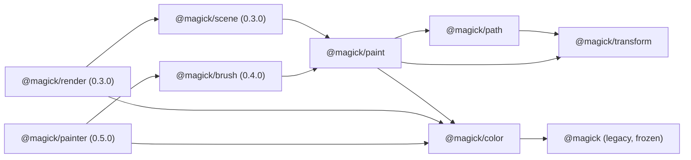

# RFC-0001: Renderer coordinates, compositing and API boundaries

- **Status:** Proposed for ratification by review. Nobody has ratified it yet.
- **Issue:** MAG-003, release 0.2.0. Merge order: PR-02 (this RFC only; no implementation).
- **Scope:** the 0.2.0 issues MAG-004 to MAG-014, and the sketches for 0.3.0 and later.
- **Baseline:** `org.dreamweave.magick` 0.1.3, measured in `tests/rfc.jsl`. The 0.1.x contract is in
  [COMPATIBILITY.md](../COMPATIBILITY.md).
- **Sources of truth:** this document decides. The sketches in `docs/rfc/sketches/` are checked
  against it. `ARCHITECTURE.md` and `PR_SEQUENCE.md` in the main checkout are the plan; where this
  RFC makes a decision they leave open, it says so.

Every decision below has a number or a rule, a reason, and a way to check it. Section 16 lists the
ones a reviewer should attack first.

## 1. Summary

- Legacy `Image` (straight sRGB RGBA8) and every 0.1.x name stay exactly as they are. Their goldens
  do not move.
- New rendering works on **premultiplied working tiles** (f32, 16 bytes a pixel), entered and left
  through explicit conversions. Output is always straight RGBA8.
- Paths **keep their commands**. Curves are flattened at rasterization time, to a device-space
  tolerance, under hard caps.
- Transforms are **column-vector 2x3 affine matrices**; `T*S*R` applies rotation first.
- Coverage is evaluated per **tile**, with the tile rectangle given, so no full-shape scratch exists
  in tile mode.
- Every new API takes its fill rule, blend mode and color space **explicitly**. Nothing is silently
  ignored, and nonfinite input is rejected.
- Scenes are **trees** in 0.3.0. A DAG is deferred behind named prerequisites.

## 2. Coordinates

**Decision C1.** Image space is continuous. The origin is the top-left corner of the image, x grows
right, y grows down. Pixel `(column, row)` is the square `[column, column+1) x [row, row+1)`. Pixel
edges are whole numbers. A pixel's center is `(column + 0.5, row + 0.5)`.

**Decision C2.** Coverage is the exact area of a pixel's square inside the shape, as it is in 0.1.3.
Paint is evaluated at pixel centers (section 8). Coverage is area; color is a sample at the center.

**Decision C3.** The legacy `Image` cell methods (`rect`, `rectOver`, `circle`, `line`, ...) keep their
own convention: inclusive pixel indices. The new API never uses them. Both conventions are pinned by
`tests/rfc.jsl`:

```text
  pixel edges (path, new API)          legacy Image:rect(0,0,4,4)
  0   1   2   3   4                    fills indices 0,1,2,3,4 (five pixels)
  +---+---+---+---+                    column 5 is untouched
  |   |   |   |   |
  +---+---+---+---+                    path:rect(0,0,4,4) covers pixels 0..3 (four),
  |   |   |   |   |                    and its mask is 5 wide with column 4 clear
```

Reviewer note: a mask from `Path:mask()` is `ceil(maxX) - floor(minX) + 1` wide, so it carries one
spare column on the right. That is a legacy quirk and is kept (section 13).

## 3. Affine transforms

**Decision T1 (convention).** Column vectors. A matrix has six fields, which are SVG's
`matrix(a b c d e f)` in that order: `scaleX = a`, `skewY = b`, `skewX = c`, `scaleY = d`,
`offsetX = e`, `offsetY = f`. It maps a point as

```text
x' = a*x + c*y + e
y' = b*x + d*y + f
```

**Decision T2 (composition).** `multiply(first, second)` is `first o second`: the point goes through
`second` first. Products are written right to left, as in column-vector mathematics.

**Decision T3 (worked example, `T*S*R`).** Rotation by 90 degrees, then scale by 2, then translation
by (10, 20). Applied to (1, 0):

```text
R(90)     (1, 0) -> (0, 1)
S(2)      (0, 1) -> (0, 2)
T(10,20)  (0, 2) -> (10, 22)
```

`docs/rfc/sketches/examples/transform_order.jsl` asserts this.

**Decision T4 (legacy transform).** `Path:transformed(scale, dx, dy)` is `matrix(scale, 0, 0, scale,
dx, dy)`, which is `T*S`: scale first, then offset. The same example asserts that the legacy call
agrees with `T*S` on a corner. So the legacy call and the new convention agree.

**Decision T5 (reflection).** A reflection gives a negative determinant. Coverage uses `|sum|` for
nonzero and a triangle wave of `|sum|` for evenodd (section 5). Both are unchanged by a global sign
flip, so reflecting a whole path does not change which pixels it covers. Shape contours keep their
declared orientation in user space, so holes stay holes after a reflection.

**Decision T6 (singular and nonfinite).**
- A matrix is singular when `det == 0` or `|det| <= 1e-12 * m * m`, where `m` is the largest
  absolute value among `a, b, c, d`. A singular matrix raises `magick: transform is singular` from
  `inverse` and from any render that needs an inverse. Nothing is rendered through it.
- A matrix with any of its six fields nonfinite (NaN, +Inf, -Inf) raises
  `magick: transform must be finite`.

**Decision T7 (largest singular value).** `sigmaMax = sqrt((S + sqrt(S*S - 4*det*det)) / 2)`, with
`S = a*a + b*b + c*c + d*d`. For the identity this is exactly 1, which keeps the legacy tolerance.

**Decision T8 (conservative bounds).** Device bounds of a path under a matrix are the box of the
transformed control points, which contains every curve by the convex hull property, inflated by
`strokeHalfWidth * sigmaMax`, then rounded out to whole pixel edges. No extrema are computed. This
bound is conservative and looser than the true box for curves. The legacy `Path:bounds()` is
unchanged (section 6).

## 4. Path representation, tolerance and flattening

**Decision P1 (commands kept).** A path retains its commands in user space: move, line, quadratic,
cubic, close. Each contour carries an orientation mode:
- `shape`: normalized to a positive signed area, as `wound` does today for every shape builder;
- `hole`: normalized to a negative signed area (`ring`, `frame`, the inner contour of a hole);
- `raw`: kept exactly as drawn (`moveTo`, `lineTo`, `close`).

The normalization is applied in user space, before any transform.

**Decision P2 (tolerance).** The tolerance is in **device pixels**, and it is the largest distance
between the flattened outline and the true curve after the transform. The default is **0.25**, as
`path.new()` has today. Flattening uses the same piece-count formulas as 0.1.3 (quadratic
`ceil(sqrt(|bend| / (8 tol)))`, cubic `ceil(sqrt(0.75 * bend / tol))`) with the tolerance taken in
user space as `tol / sigmaMax`. For the identity that is `tol`, so legacy output does not move.

**Decision P3 (flatten at rasterization).** Curves are flattened when coverage or bounds are asked
for, never when they are added. The 0.1.3 path flattens in `quadTo` and `cubicTo`; that changes, and
the observable result for identity transforms does not.

**Decision P4 (legacy transformed bakes).** `Path:transformed(scale, dx, dy)` keeps its 0.1.x output
exactly. It flattens at the source's tolerance in source space and then moves each point. The result
is a path of lines. New code transforms through `Path:transformBy(matrix)` (section 13), which keeps
the commands. This is a deliberate exception to "no baked geometry": the legacy call is pinned, and
fixing it is opt-in, as COMPATIBILITY.md requires.

**Decision P5 (legacy bounds and mask).** `Path:bounds()` is the box of the flattened points at the
path's own tolerance, as today. `Path:mask()` is the nonzero coverage over those bounds, as today.
Both are pinned by `tests/path.jsl` and `tests/compat.jsl`.

**Decision P6 (budgets).** See section 9. Flattening stops with an error, not a truncated outline,
when a budget is exceeded.

## 5. Fill rules and clipping

**Decision F1 (nonzero).** `nonzero` coverage of a pixel is `min(1, |S|)`, where `S` is the sum of
the signed area contributions in that pixel. For integer windings this is the SVG nonzero rule. It
is also exactly what 0.1.3 does, so it is the legacy rule.

**Decision F2 (evenodd).** `evenodd` coverage is `w = |S| mod 2`, then `w` if `w <= 1`, else `2 - w`.
This is new and must be asked for explicitly.

**Decision F3 (defaults).** New APIs take `fillRule` explicitly and default to `nonzero`. Legacy
`Path:mask()` stays `nonzero` as it is. Legacy `Image:polygon` stays even-odd, and `Image:circle`
stays center-sampled. The fill rule is documented by each module.

**Decision F4 (clip rectangle).** A clip rectangle has whole-pixel edges and is exact.

**Decision F5 (clip coverage).** A clip path contributes coverage, multiplied into the fill's
coverage, in f32. Clips nest to a depth of at most 16 (`MaxClipDepth`).

**Decision F6 (allocation).** A clipped coverage evaluation allocates scratch only over the
intersection of the clip rectangle and the path's bounds. Geometry entering the rectangle from
outside is handled by carrying each row's accumulation in from the left edge of the rectangle.

## 6. Legacy boundary

**Decision L1.** `Image` is a table with `width`, `height` and `data`. `data` is `width * height * 4`
bytes of straight, sRGB, RGBA8, rows from the top. It is frozen. Every 0.1.x method on `Image`, and
every 0.1.x golden, keeps its bytes.

**Decision L2.** New APIs accept a legacy `Image` as input and produce one as output only through
explicit conversions `color.fromImage` and `color.toImage` (section 7). Nothing in the legacy surface
starts using a working tile.

**Decision L3.** Legacy NaN handling stays where it is, and this RFC records it. In 0.1.3,
`Image:rect(0, 0, 0/0, 2, c)` fills rows 0..2 across the whole image, silently, because
`math.min` and `math.max` pass NaN through. `path:rect(0, 0, 0/0, 4):mask()` raises a Lua error
(`buffer access out of bounds`), which is not a `magick:` message. Both are pinned by `tests/rfc.jsl`
so that a fix is a deliberate, recorded change, not a side effect.

## 7. Working tiles and color

**Decision W1 (representation).** A working tile is `{ width, height, space, data }` with `data` a
buffer of `width * height * 16` bytes: RGBA, **f32 per channel, premultiplied**, rows from the top.
One 128 by 128 tile is 262,144 bytes (about 256 KiB), which matches ARCHITECTURE.md.

**Decision W2 (f32, not fixed point).** f32 storage, f64 arithmetic. Fixed point would need a
second set of rounding rules, and f32 with the conversions below round-trips 8-bit values exactly
(W5). Premultiplication would also lose precision in fixed point at low alpha.

**Decision W3 (space).** `space` is `'srgb'` (the default) or `'linear'`.
- `'srgb'`: values are sRGB-encoded. Compositing happens on those values, as legacy `Image` and the
  W3C algebra are applied in browsers.
- `'linear'`: the sRGB transfer function is removed on entry, compositing happens on linear values,
  and it is applied again on output. The transfer is the standard sRGB curve:
  `c_lin = c / 12.92` for `c <= 0.04045`, else `((c + 0.055) / 1.055)^2.4`, and its inverse.
A tile's space never changes after it is made; two tiles of different space cannot be composited
without an explicit `color.convert`.

**Decision W4 (clamp and round).**
- Output bytes: `floor(clamp(x, 0, 1) * 255 + 0.5)`, round half up, as legacy `clamp8` does.
- A premultiplied channel is clamped to `[0, alpha]` before it is stored or converted. Its alpha is
  clamped to `[0, 1]`.
- NaN never reaches a tile. Paint construction rejects nonfinite inputs (section 8). A NaN produced
  by arithmetic inside a tile is an internal error, raised by `magick:` at the operation.

**Decision W5 (conversion in, exact round trip).** A straight byte `c` with alpha byte `a` is stored as
`premultiplied = (c/255) * (a/255)` and `alpha = a/255`, each written through an f32 store. Reading
back, `straight = clamp(premultiplied / alpha, 0, 1)` and the output byte is `floor(straight*255 + 0.5)`.
This round trip is exact for every channel at every alpha from 1 to 255. The check ran as
`docs/rfc/sketches/examples/premultiplied_round_trip.jsl`: 65,280 channel values, 0 failures.

**Decision W6 (transparent RGB policy).** A pixel whose alpha byte is 0 stores RGB 0 in a working
tile and in every straight output. Legacy `Image` is not changed: it keeps the RGB it has under alpha
0. A round trip of a legacy image through a working tile therefore changes only the RGB of alpha-0
pixels, and only to zero. This is tested in MAG-013.

**Decision W7 (output).** A working tile leaves the module only through `color.toImage`, which
produces straight RGBA8 in the legacy layout. Its alpha byte is the rule in W4, and its color bytes
are unpremultiplied with the alpha byte rule above.

**Decision W8 (Porter-Duff).** The twelve W3C operators are implemented: `clear`, `src`, `dst`,
`src-over`, `dst-over`, `src-in`, `dst-in`, `src-out`, `dst-out`, `src-atop`, `dst-atop`, `xor`. Each
is `result = source * fa + backdrop * fb` on premultiplied values, with `fa` and `fb` from the W3C
table (`color.factors`). Result alpha is `as * fa + ab * fb`. A result of zero alpha stores RGB 0.

**Decision W9 (blend modes).** 0.2.0 ships seven: `normal` (which is `src-over`), `multiply`,
`screen`, `overlay`, `darken`, `lighten` and `soft-light`, with the W3C formulas. The other separable
modes (`color-dodge`, `color-burn`, `hard-light`, `difference`, `exclusion`) and the nonseparable modes
(`hue`, `saturation`, `color`, `luminosity`) are not in 0.2.0. Any name outside the seven raises
`magick: unknown blend mode <name>`. Each later addition needs reference vectors (MAG-014).

**Decision W10 (module name).** The color module is **`@magick/color`**, a separate module from
`@magick/paint`. It owns working tiles, conversions, Porter-Duff and blend math. `@magick/paint`
owns paint values and span evaluation. This is the name `ARCHITECTURE.md` uses.

## 8. Paint model

**Decision M1 (immutable values).** A paint is an immutable value, with no mutation API. It can be
shared by many shapes and nodes, and it is never copied per use.

**Decision M2 (span evaluation).** A paint is evaluated per span: a run of pixel centers in one row of
a tile, at `(column + 0.5, row + 0.5)`. It writes premultiplied f32 values into a scratch buffer with
four values a pixel. Per-pixel dispatch and per-pixel callbacks are not used.

**Decision M3 (solid fast path).** A solid paint is evaluated by a loop over the span with constant
values. The kind of the paint is checked once per span, never per pixel.

**Decision M4 (kinds in 0.2.0).** `solid`, `linear`, `radial`, `conic` and `pattern`, as typed in
`docs/rfc/sketches/paint.jsl`. Each has `opacity` in `[0, 1]`, which multiplies alpha.

**Decision M5 (user callbacks).** Shader-like user callbacks are not in 0.2.0. A callback, when it is
added, must be a pure function of its sample center and its explicit arguments. It may not read a
clock, a mutable generator, or the destination.

**Decision M6 (stops).** A gradient has at most **256** stops (`MaxStops`). Stops are sorted by offset,
stably, so equal offsets keep their input order. Offsets must be finite and in `[0, 1]`. A coincident
pair makes a hard edge: at an offset `t` shared by stops `i` and `i+1`, the color is that of stop
`i+1`.

**Decision M7 (spread).** `pad` clamps `t` to `[0, 1]`; `repeat` uses `t - floor(t)`; `reflect` uses
the triangle wave of period 2. The same spread function is used by linear, radial and conic paints.

**Decision M8 (degenerate cases).**
- A single stop is a solid paint of that stop's color.
- A linear gradient with `(x0, y0) == (x1, y1)` gives the last stop's color, whatever the spread.
- A radial gradient with radius 0 gives the last stop's color.
- A conic gradient has its seam on the paint's `+x` axis, and its angle increases clockwise on screen
  (`atan2(dy, dx)`, wrapped to `[0, 1)` of a turn).

**Decision M9 (interpolation).** Gradients interpolate in `'srgb'` by default, or `'linear'` when
asked. Interpolation is between stops; it is not compositing.

**Decision M10 (patterns).** A pattern reads an `Image`, or a working tile, through the inverse of its
transform. Sampling is `nearest` (default) or `bilinear` in premultiplied values. Edges are `clamp`
(default), `repeat` or `mirror`. A pattern whose source is the destination it is drawn into raises
`magick: pattern reads its own destination`. It is not snapshotted.

**Decision M11 (no full-canvas image).** Paints can be clipped and reused without allocating a
full-canvas image. Evaluation writes into scratch the size of one span.

## 9. Tiles, budgets and determinism

Tiles are aligned to a grid from the image origin. Tile order is row-major. A tile's coverage comes
from `Path:coverageIn(left, top, width, height, options)`, which is the rectangle-constrained method
the tiling needs. `Path:mask()` stays as it is.

**Decision B1 (tile edges).** Default tile edge **128** px; maximum **256** px (`MaxTileEdge`). The
256 bound makes the largest tile 1 MiB.

**Decision B2 (byte-identical tiles).** The mask rebuilt from clipped tiles must be byte-identical to
single-shot coverage over the same rectangle. This is the requirement MAG-008 is judged against. If an
implementation cannot meet it, it does not ship with a looser bound; the RFC is amended first.

**Decision B3 (budgets).** These are hard caps. Each one raises a `magick:` error naming the cap.

| Cap | Value | Why this value |
|---|---|---|
| `MaxCoordinate` | `2^22` (4,194,304) | Any user or device coordinate or stroke width, finite and within `±2^22`. Every in-range curve fits under `MaxPiecesPerCurve`. |
| `MaxCommandsPerPath` | `2^20` | About a million commands is an outline of a whole glyph set many times over. |
| `MaxPiecesPerCurve` | `16384` | At 0.25 px, a cubic may have a control bend up to `16384^2 * 0.25 / 0.75`, about `8.9e7` px. The largest bend `MaxCoordinate` allows is about `2.4e7`, so every in-range curve fits. Stops a tiny tolerance from exploding. |
| `MaxSegmentsPerCoverage` | `2^20` | Flattened segments one coverage call may produce. Bounds the work of a pathological path. |
| `MaxDashEntries` | `64` | A dash pattern is a short list. Each entry is finite and `>= 0`, and the sum is `> 0`. |
| `MaxDashesPerStroke` | `2^20` | Generated dashes per stroke. Shares the segment budget's order of magnitude. |
| `MaxStops` | `256` | A gradient stop list is not a lookup table. |
| `MaxClipDepth` | `16` | Clips nest only to this depth. |
| `DefaultTileEdge` / `MaxTileEdge` | `128` / `256` | Decision B1. |
| `MaxWorkingPixels` | `2^20` (16 MiB at 16 bytes a pixel) | One whole-image working buffer, made only by the explicit conversions. Rendering never makes a buffer larger than a tile. |
| Scene `MaxDepth`, `MaxNodes` (0.3.0) | `32`, `65536` | Proposed here, decided in the 0.3.0 issues. |

Checked with the piece cap in mind: the largest control bend `MaxCoordinate` allows is about
`2.4e7` (four times the coordinate limit, times sqrt 2), which needs about 8,430 pieces for a cubic at
0.25 px. That is under 16,384. At a transform with
`sigmaMax` of `s`, pieces grow with `sqrt(s)`, so a very large device scale can reach the cap. That is
an intended loud failure (section 16).

**Decision D1 (determinism, 0.2.0).** 0.2.0 has no random input to the renderer. Output is a function
of the path, the transform, the paint and the tile grid.

**Decision D2 (seeds, later).** Any seeded feature uses an integer seed in `1..2^31-2`, and any other
value is an error for new APIs. Per-sample randomness is a stable hash of a tuple, `(seed, node, stroke,
dab, sample)`, not a shared generator, so that worker and tile order cannot change output. The hash
itself is specified in `@magick/noise` (0.4.0). Legacy seeded functions keep their own rule: the
Lehmer generator (48271, modulus `2^31-1`), with a seed of 0 or below taken as 1. Its products stay below
`2^53`, so it is exact in f64.

**Decision D3 (parity).** 0.3.0 parity tests compare 1-worker and N-worker output, and tile sizes 64,
128 and 256. Output must be identical across them.

## 10. Scene: tree, not DAG

**Decision S1.** Scenes are **trees** in 0.3.0. Each node has one parent. Nodes are not shared.
A paint or pattern is shared freely, because paints are immutable values (M1).

**Decision S2 (why not a DAG now).** A shared node has to render once per group context, and that
interacts with group isolation, opacity and blend order. None of those are specified yet. A DAG
without them is ambiguous.

**Decision S3 (path to a DAG).** A DAG comes later, as explicit `ref` nodes that point at a node by
identity, and only after three things exist: isolation and opacity are specified for shared groups,
the render compiler has a cycle check that runs when a `ref` is added, and a test shows that the
result does not depend on how many times the node is reached.

## 11. Errors

**Decision E1.** Every error from a new API starts with `magick:`. Argument errors use `error(..., 2)`
so that they name the caller's line. Internal failures use `assert`.

**Decision E2.** Nonfinite numbers are rejected by every new API: coordinates, widths, stops, offsets,
opacities, matrices and seeds. Out-of-range values are rejected, not clamped, except where the
clamp is part of the documented algebra (W4).

**Decision E3.** An unknown option key raises `magick: unknown option <name>`. An unsupported blend
mode raises `magick: unknown blend mode <name>` (W9). Nothing unsupported is silently ignored.

**Decision E4.** Legacy error messages are not changed (COMPATIBILITY.md lists them).

## 12. Diagrams

Pipeline, from authoring to output:

```text
  path (commands, user space)
     |  Path:transformBy(M)          keeps commands
     v
  path (commands, user space, transformed)
     |  path.flatten(path, tol, M)   tol / sigmaMax in user space, device-space result
     v
  device contours  ----->  Path:coverageIn(tile)   exact area, f32, clipped to the tile
                                 |
  paint  ---(span at pixel centers)-+
                                 v
                    premultiplied working tile (f32, srgb | linear)
                                 |  color.composite (Porter-Duff, blend)
                                 v
                    working tile  --color.toImage-->  straight RGBA8 Image
```

Module dependencies (arrows mean "requires"):



Tile grid with geometry crossing a tile edge (tile edge 128 px, drawn small):

```text
   tile (0,0)          tile (1,0)
  +----------------+----------------+
  |                |                |
  |      ____      |  ____          |
  |     /    \_____|_/    \         |   The curve enters tile (1,0) from outside.
  |    |          | |      |        |   Its winding at the left edge is carried in from
  +----------------+----------------+   the cells to the left, so the pixels inside the
  |                |                |   tile match a single-shot evaluation.
  +----------------+----------------+
```

## 13. Module surface and versioning

**Decision V1 (modules, 0.2.0).** New in 0.2.0: `@magick/transform`, `@magick/color`, `@magick/paint`.
Changed in 0.2.0: `@magick/path` (new names only, and internal retention). `@magick` gets no new
behavior.

**Decision V2 (new names on path, 0.2.0).** These are additive:
- `Path:transformBy(matrix)`: a new retained path under a matrix.
- `Path:coverageIn(left, top, width, height, options)`: coverage over a rectangle, with the fill
  rule explicit.
- `path.flatten(path, tolerance, matrix?)`: the device-space contours. Tolerance is the device
  tolerance (P2).

**Decision V3 (sketches for 0.3.0 and later).** `@magick/scene`, `@magick/render`, `@magick/brush`
and `@magick/painter` are sketched in `docs/rfc/sketches/` with stubs, and are marked as later
releases in each file. They are not 0.2.0 names. `@magick/noise`, `@magick/material` and `@magick/svg`
are named by ARCHITECTURE.md and are not sketched here.

**Decision V4 (stable names in 0.2.0).** Every name listed in COMPATIBILITY.md is stable, with its
parameters, return values, mutation behavior, byte layouts, and pinned error messages. The new names in
V1 and V2 are the 0.2.0 surface. A name is not removed or renamed inside 0.1.x or 0.2.x.

**Decision V5 (0.1.x names keep working).** `Path:transformed`, `path.new(tolerance)`, `Path:mask`,
`Path:fill`, `Image:polygon`, `Image:circle`, and every other 0.1.x name stays with its 0.1.3 result.
A change to any of them goes through a new name, with the old one kept.

**Decision V6 (opt-in).** Premultiplied tiles, linear space, the new fill rules, the new blend modes,
the new paints, and the explicit conversions are all opt-in. A caller who uses only 0.1.x names gets the
same bytes.

**Decision V7 (semver).** Additions are minor-version changes. The `jess_api` value stays `"1"` while the
package keeps its 0.x version line. The version bump is MAG-015's job, not this RFC's.

**Decision V8 (exports).** `jess.toml` gains the three new modules in `[modules]` and `layer.exports`
when they are implemented. This RFC changes no manifest.

## 14. Non-goals and deferred features

Out of scope for this RFC and for 0.2.0:

- A retained canvas, scene graph, render compiler and tiled renderer (MAG-016 to MAG-027, **0.3.0**,
  per PR_SEQUENCE.md).
- Noise fields, procedural paints, materials, the brush engine, presets, and recipes (MAG-028 to
  MAG-036, **0.4.0**).
- Reference analysis, brush planning, guided strokes, portrait pipelines, the SVG subset, and the
  hardening pass (MAG-037 to MAG-046, **0.5.0**).
- Nonseparable blend modes, and the separable modes outside W9.
- User shader callbacks (M5).
- A DAG of scene nodes (S3).
- Linear-light compositing as a default. Linear is opt-in (W3).
- Text, glyphs, fonts, GPU, and network. None are dependencies.
- Changes to legacy outputs, goldens or legacy error messages.

The MAG-016 to MAG-046 grouping is taken from PR_SEQUENCE.md. The individual issue texts for those
numbers were not in the goal folder I read, so this RFC names the numbers only as PR_SEQUENCE.md does.

## 15. Sketches, examples and checks

Typed sketches:

- `docs/rfc/sketches/transform.jsl`: 0.2.0 reference arithmetic for section 3, plus one stub.
- `docs/rfc/sketches/color.jsl`: 0.2.0 reference arithmetic for section 7, plus stubs.
- `docs/rfc/sketches/paint.jsl`: 0.2.0 types and constructors, all stubs.
- `docs/rfc/sketches/scene.jsl`, `render.jsl`: 0.3.0, stubs.
- `docs/rfc/sketches/brush.jsl`: 0.4.0, stubs.
- `docs/rfc/sketches/painter.jsl`: 0.5.0, stubs.

Runnable examples:

- `docs/rfc/sketches/examples/transform_order.jsl`: T*S*R, legacy `transformed`, reflection,
  singular refusal.
- `docs/rfc/sketches/examples/premultiplied_round_trip.jsl`: the exact round trip and the zero-alpha
  policy.

Checks, from the worktree root:

```sh
jess check --package . docs/rfc/sketches/*.jsl docs/rfc/sketches/examples/*.jsl
jess run --package . docs/rfc/sketches/examples/transform_order.jsl
jess run --package . docs/rfc/sketches/examples/premultiplied_round_trip.jsl
jess package test .
jess package check .
```

`tests/rfc.jsl` holds the 0.1.3 facts this RFC relies on: pixel corners, the spare mask column, the
legacy inclusive `Image:rect`, the 0.25 tolerance default, `transformed` returning a new path with
`T*S` order, and the two legacy NaN behaviors.

Stubs raise `magick: sketch stub`. A stub is not an implementation, and the RFC says so.

## 16. Decisions a reviewer should attack first

1. **P4, legacy `transformed` bakes curves.** It is pinned by the contract, but it keeps the quality
   problem the issue describes. The alternative is to change the legacy result, which needs a version
   bump and a golden change.
2. **F1, nonzero as `min(1, |S|)`.** For integer windings this is the nonzero rule. For fractional
   area sums at antialiased edges it is an approximation, and that is the 0.1.3 behavior.
3. **B2, byte-identical tiles.** It is required, but it is not yet proven. MAG-008 has to prove it, and
   until then this RFC is a requirement, not a result.
4. **T6, singular means error.** A caller who wants a degenerate projection must work around it. I think
   that is right, but it is a choice.
5. **B3, the caps.** `MaxCoordinate` and `MaxPiecesPerCurve` interact at large device scales (section 9).
   A very large zoom can reach the piece cap. I chose a loud failure over a silent undersample.
6. **W3, sRGB as the default space.** ARCHITECTURE.md says "selectable"; I chose sRGB as default because
   it matches legacy, and linear is opt-in.
7. **T8, bounds are loose for curves.** Control-hull bounds are conservative and simpler, but looser
   than extrema bounds, so tiles may be scheduled that stay empty.
8. **L3, legacy NaN behavior kept.** The `Image:rect` NaN behavior is a defect. It is kept and pinned
   because the 0.1.x contract forbids silent changes. A fix is a recorded change.
9. **W6, transparent RGB dropped in tiles.** A legacy image with RGB under alpha 0 loses that RGB after a
   tile round trip. Legacy images keep it. I think that is right, and it is documented.
10. **M8, degenerate gradients use the last stop.** This follows SVG. Other systems differ, and the
    choice is recorded here.

## 17. Open questions

- Whether `Path:coverageIn` and `path.flatten` should be exported as functions or as methods only.
  This RFC gives both names a role but does not choose the final spelling beyond V2.
- The exact hash for D2 belongs to the 0.4.0 noise RFC, not this one.
- The DAG path (S3) needs a decision on whether a shared node's group isolation is per reference or
  per node. That is left to 0.3.0.
